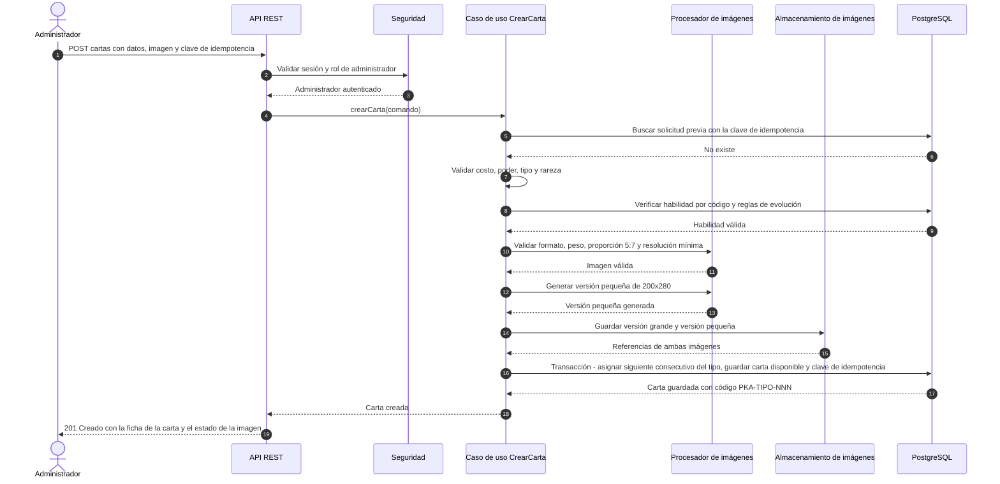
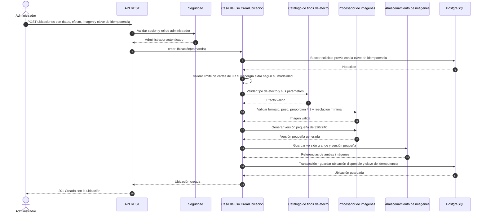
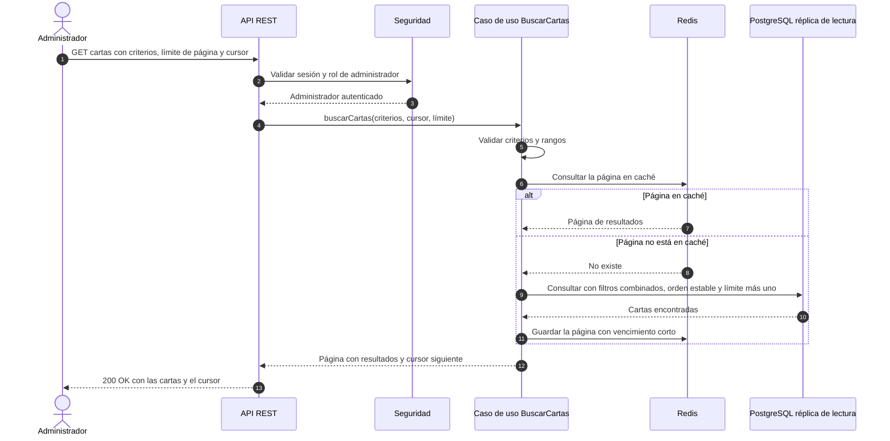

# Especificación de implementación del Sprint 1: PokéArena

Documento para el agente de IA que ayuda a corregir el código del Sprint 1. **Léelo completo antes de tocar código.** Es la fuente de verdad: si algo del código existente contradice este documento, gana este documento.

> **Importante: no tienes acceso a la wiki del equipo (Azure DevOps).** Todo lo que necesitas está en este archivo: los diagramas de secuencia (Anexo A), las decisiones de arquitectura (Anexo B) y los criterios de aceptación completos de las tres historias (Anexo C). Si falta algo, pregunta; no lo supongas.

---

## 0. Cómo debes trabajar (reglas para el agente)

1. **Primero audita, después cambia.** Antes de modificar nada, compara el código existente con este documento y entrega un informe de brechas (sección 12, Fase 0). No empieces a reescribir hasta que el equipo lo apruebe.
2. **Corrige, no reescribas por gusto.** Conserva lo que ya cumple. Reescribe solo lo que se aparta de la arquitectura, de los diagramas de secuencia o de los criterios de aceptación.
3. **Una sola lógica para las tres historias.** Crear carta, Crear ubicación y Buscar carta deben verse como escritas por la misma persona: mismos paquetes, mismos nombres, mismo manejo de errores, misma idempotencia, mismo estilo de pruebas.
4. **No inventes requerimientos.** Si algo no está aquí ni en los criterios, no lo agregues. Si hay una ambigüedad, anótala en la sección "Preguntas abiertas" del informe y pregunta.
5. **Trabaja en pasos pequeños.** Un cambio lógico por commit, con el proyecto compilando y las pruebas pasando en cada commit (`mvn verify`).
6. **El código debe poder defenderse en una oral.** Prefiere código claro y comentado sobre código ingenioso. Cada clase debe tener un encabezado (sección 3.4).
7. **No uses Spring Security** ni ningún framework de autenticación, gestión de llaves o multi-organización (restricción RES-01 del caso). Sí puedes usar una biblioteca que ejecute una decisión nuestra, por ejemplo firmar y verificar un token JWT.
8. Al terminar cada fase, entrega un resumen: qué cambiaste, qué pruebas agregaste, qué quedó pendiente.

---

## 1. Contexto del producto

PokéArena es un juego de cartas Pokémon por turnos simultáneos con una API de torneos para partners. El Sprint 1 implementa **solo tres funcionalidades de administración**, para un usuario con rol de administrador de contenido:

| Historia | Qué hace |
|---|---|
| 2.1.1 Crear carta | Crea una carta con tipo, rareza, habilidad e imagen (versión grande y versión pequeña) |
| 2.2.1 Crear ubicación | Crea una ubicación con efecto, límite de cartas, energía extra e imagen |
| 2.1.2 Buscar carta | Busca cartas con criterios combinables, paginación y orden estable |

El catálogo puede llegar a unas **10,000 cartas**.

Los **criterios de aceptación** están en el Anexo C, los **diagramas de secuencia** en el Anexo A y las **decisiones de arquitectura** (ADR-001 y ADR-002) en el Anexo B. **El código debe seguir los diagramas paso a paso** (sección 6).

---

## 2. Stack (aprobado por el equipo)

| Elemento | Tecnología |
|---|---|
| Lenguaje | Java 21 |
| Framework web | Spring Boot (solo capa web; sin Spring Security) |
| Persistencia | PostgreSQL con migraciones Flyway; acceso con Spring Data JPA o JdbcClient (elige uno y úsalo en todo el proyecto) |
| Caché | Redis |
| Imágenes | ImageIO de Java, más el plugin TwelveMonkeys `imageio-webp` (ImageIO no lee WebP por sí solo) |
| Contrato de API | OpenAPI escrito primero (`src/main/resources/openapi/pokearena.yaml`) |
| Contenedores | Docker Compose; Nginx como balanceador y 2 instancias de la API |
| Pruebas | JUnit 5, AssertJ, Testcontainers (PostgreSQL y Redis), ArchUnit, jqwik |
| Integración continua | GitHub Actions |
| Interfaz | HTML, CSS y JavaScript sin frameworks, servida desde `static/` por la misma API (sección 8) |

---

## 3. Arquitectura que debe respetar el código

### 3.1 Capas y paquetes

Arquitectura en **capas** como monolito modular (ADR-001, Anexo B). Se **conserva el paquete base existente** `cr.ac.tec.pokearena`. Estructura objetivo:

```
cr.ac.tec.pokearena
├── presentation                 (nueva; antes estaba en infrastructure/web)
│   ├── controller               CardController, LocationController, CardSearchController
│   ├── dto                      solicitudes y respuestas HTTP
│   ├── error                    ApiErrorHandler (UN solo manejador global) y ApiError
│   └── security                 filtro de autenticación y control de rol
├── application
│   ├── usecase                  CreateCardUseCase, CreateLocationUseCase, SearchCardsUseCase
│   ├── dto                      comandos y resultados de los casos de uso
│   └── port                     interfaces que los casos de uso necesitan
│                                (CardSearchQuery, ImageProcessor, ImageStorage, IdempotencyStore,
│                                 AuthenticatedUser, ...)
├── domain
│   ├── model                    Card, Location, CardType, CardRarity, Ability, criterios
│   ├── rule                     EvolutionRules, validaciones de dominio
│   ├── effect                   LocationEffectType, LocationEffectRegistry y los plug-ins
│   ├── error                    jerarquía de excepciones de dominio (DomainException)
│   └── repository               CardRepository, LocationRepository (puertos)
└── infrastructure
    ├── persistence              implementaciones JDBC o JPA de los puertos
    ├── storage                  ImageIoProcessor, FileSystemImageStorage
    ├── cache                    caché de búsqueda en Redis
    ├── security                 verificación del token (biblioteca JWT)
    └── config                   configuración de beans
```

Todos los puertos (interfaces) viven en **un solo lugar** por capa: los de persistencia del dominio en `domain.repository` y los demás en `application.port`. No mezcles criterios.

Si más adelante se agregan módulos (Partida, Partners, etc.), cada uno repetirá estas capas bajo su propio paquete; en el Sprint 1 solo existe el catálogo, así que no hace falta un nivel `catalog`.

### 3.2 Reglas de dependencia (se verifican con ArchUnit en CI)

1. `presentation` puede usar `application`. No puede usar `infrastructure` ni acceder a repositorios.
2. `application` puede usar `domain`. No puede usar `presentation` ni `infrastructure`.
3. `domain` **no depende de nada** salvo `java.*`. Prohibido en `domain`: Spring, JPA/Jakarta, Redis, JDBC, JSON, `LocalDateTime.now()`, `Random` y `UUID.randomUUID()` directos.
4. `infrastructure` implementa los **puertos** (interfaces) definidos en `domain`.
5. El reloj y la aleatoriedad entran por puertos (`Clock`, `IdGenerator`), nunca directos.
6. Los módulos futuros solo usarán el catálogo mediante su interfaz pública.

### 3.3 Patrón de extensión (microkernel del motor)

Los efectos de ubicación son **plug-ins**. En `domain`:

```java
public interface LocationEffectType {
    String code();                                  // "TYPE_BONUS", "COST_MODIFIER", "TURN_RESTRICTION"
    void validate(Map<String, Object> parameters);  // lanza DomainValidationException si son inválidos
}
```

Un `LocationEffectRegistry` (clase de dominio sin Spring) recibe la lista de plug-ins y busca por código. Agregar un efecto nuevo = agregar una clase que implemente la interfaz, **sin modificar** el caso de uso. Una prueba debe demostrarlo (sección 10).

### 3.4 Encabezado de cada archivo (acuerdo del contrato de grupo)

Cada clase lleva un comentario inicial con su propósito y responsabilidades, y los bloques relevantes llevan comentarios. Formato:

```java
/**
 * Propósito: caso de uso de la historia 2.1.1 "Crear carta".
 * Responsabilidades: orquestar validaciones, imagen, código único y persistencia.
 * Referencia: Anexo A.1 (diagrama de secuencia de Crear carta).
 */
```

Dentro de los casos de uso, cada paso lleva un comentario que cite el número del diagrama:

```java
// Paso 5 del diagrama: validar costo, poder, tipo y rareza
```

---

## 4. Convenciones comunes (iguales en las tres historias)

### 4.1 Rutas y verbos

| Operación | Método y ruta |
|---|---|
| Crear carta | `POST /api/v1/cartas` (multipart/form-data) |
| Crear ubicación | `POST /api/v1/ubicaciones` (multipart/form-data) |
| Buscar carta | `GET /api/v1/cartas` (query string) |
| Sesión de prueba (solo perfil `dev`) | `POST /api/v1/dev/sesiones` |

Los nombres de las rutas coinciden con los diagramas de secuencia del Anexo A ("POST cartas", "GET cartas"). Los identificadores de Java van en inglés; los mensajes al usuario, en español.

### 4.2 Autenticación y autorización (sin Spring Security)

- Un filtro propio lee `Authorization: Bearer <token>`.
- El token es un JWT firmado con un secreto que viene de una variable de entorno (`APP_JWT_SECRET`). Con claims `sub` (id del usuario) y `role` (`ADMIN` o `PLAYER`) y vencimiento. Se permite usar una biblioteca solo para firmar y verificar.
- Sin token o token inválido: **401**, tipo de error `NOT_AUTHENTICATED`.
- Token válido sin rol `ADMIN`: **403**, tipo de error `FORBIDDEN`. **Debe ser un error distinto del 401** (criterio de las tres historias).
- Las rutas de las tres historias exigen rol `ADMIN`.
- `POST /api/v1/dev/sesiones` emite tokens de prueba para ADMIN o PLAYER. Solo existe con el perfil `dev` (`@Profile("dev")`). **Una prueba debe verificar que con el perfil `prod` ese endpoint no existe** (RNF-SEG-10).

### 4.3 Formato único de errores (RNF-API-03)

Todas las respuestas de error usan este cuerpo (estilo `application/problem+json`), generado en **un único** manejador global (`@RestControllerAdvice`):

```json
{
  "type": "INVALID_FIELD",
  "title": "Campo inválido",
  "status": 400,
  "detail": "El costo debe estar entre 0 y 10.",
  "field": "cost",
  "correlationId": "b3f1c9e0-..."
}
```

Tipos de error de dominio:

| `type` | `status` | Cuándo |
|---|---|---|
| `NOT_AUTHENTICATED` | 401 | Sin credenciales o token inválido |
| `FORBIDDEN` | 403 | Autenticado sin rol de administrador |
| `INVALID_FIELD` | 400 | Valor fuera de rango o catálogo (indica el `field`) |
| `MISSING_FIELD` | 400 | Falta un campo obligatorio, por ejemplo la habilidad |
| `UNKNOWN_ABILITY` | 400 | Código de habilidad inexistente |
| `INVALID_EVOLUTION` | 400 | Evolución a sí misma o ciclo |
| `INVALID_IMAGE_FORMAT` | 400 | Formato no permitido (indica el requisito incumplido) |
| `IMAGE_TOO_LARGE` | 400 | Pesa más de 5 MB |
| `INVALID_IMAGE_RATIO` | 400 | Proporción incorrecta |
| `IMAGE_RESOLUTION_TOO_LOW` | 400 | Resolución menor a la mínima |
| `INVALID_EFFECT` | 400 | Tipo de efecto inexistente o parámetros inválidos |
| `INVALID_SEARCH_CRITERIA` | 400 | Criterio de búsqueda inválido (indica el criterio) |
| `IDEMPOTENCY_KEY_REUSED` | 422 | Misma clave con un contenido distinto |
| `IDEMPOTENCY_KEY_REQUIRED` | 400 | Falta el encabezado `Idempotency-Key` |

Nunca devuelvas un error genérico ni el mensaje de una excepción interna.

### 4.4 Idempotencia (criterio alterno de Crear carta y Crear ubicación)

- Los `POST` exigen el encabezado `Idempotency-Key`.
- Tabla `idempotency_key(key, user_id, endpoint, request_hash, response_status, response_body, created_at)` con unicidad en `(key, user_id, endpoint)`.
- Misma clave y mismo contenido: devuelve **la misma respuesta guardada**, sin crear nada y sin consumir otro consecutivo.
- Misma clave con otro contenido: `IDEMPOTENCY_KEY_REUSED`.
- La clave se guarda **en la misma transacción** que la entidad creada.
- Una prueba de concurrencia lanza dos solicitudes iguales a la vez y comprueba que solo existe una carta.

### 4.5 Correlación y registros

- Cada solicitud recibe un `correlationId` (se toma de `X-Correlation-Id` o se genera) que aparece en los logs en JSON y en el cuerpo de los errores.
- Logs estructurados. No registres imágenes ni secretos.

---

## 5. Modelo de datos (migraciones Flyway)

Tablas mínimas. Toda entidad creada por un administrador lleva `version` (entero, inicia en 1), `active` (booleano, true) y `created_at`, para poder editar y desactivar después sin rediseñar (RNF-ALM-03, RNF-INT-07).

| Tabla | Campos principales |
|---|---|
| `card_type` | `code` (FUE, AGU, PLA, ELE, PSI, LUC), `name` (Fuego, Agua, Planta, Eléctrico, Psíquico, Lucha). Datos semilla |
| `rarity` | `code`, `name` (Común, Poco común, Rara, Legendaria). Datos semilla |
| `ability` | `code` (HAB-000, ...), `name`, `trigger`, `effect_type`, `parameters` (jsonb), `limited_to_type` (nullable), `evolves_to_card_code` (nullable). **Semilla obligatoria: HAB-000 "Sin Habilidad"**, sin efecto |
| `card_type_counter` | `type_code` (PK), `last_number` |
| `card` | `id` (bigserial), `code` (único, inmutable, `PKA-<TIPO>-<NNN>`), `name`, `name_normalized`, `cost`, `power`, `type_code`, `rarity_code`, `ability_code`, `image_large_url`, `image_small_url`, `image_status` (`READY`, `PENDING_RETRY`), `retry_count`, `available`, `version`, `active`, `created_at` |
| `location` | `id`, `name`, `description`, `effect_type` (nullable), `effect_parameters` (jsonb), `card_limit` (0 a 5), `extra_energy_mode` (`NONE`, `FIXED`, `PER_CARD`), `extra_energy_amount`, `image_large_url`, `image_small_url`, `available`, `version`, `active`, `created_at` |
| `idempotency_key` | ver 4.4 |

Índices de `card` para la búsqueda: `code` (único), `type_code`, `rarity_code`, `ability_code`, `(cost)`, `(power)`, y `name_normalized` con índice trigram (`pg_trgm`, GIN) para la búsqueda parcial. El orden de recorrido es por `id`.

`name_normalized` = nombre en minúsculas y sin tildes, calculado en el dominio al crear la carta.

---

## 6. Los tres casos de uso, paso a paso (siguen los diagramas de secuencia)

Cada caso de uso es **una clase** en `application`, con un método público y los pasos **en el mismo orden que el diagrama**. No cambies el orden.

### 6.1 Crear carta (historia 2.1.1)

Clase: `CreateCardUseCase`. Diagrama: Anexo A.1.

| Paso | Qué hace | Error si falla |
|---|---|---|
| 1 | El controlador recibe `POST /api/v1/cartas` con datos, imagen y `Idempotency-Key` | `IDEMPOTENCY_KEY_REQUIRED` |
| 2 | El filtro de seguridad valida sesión y rol | 401 `NOT_AUTHENTICATED` / 403 `FORBIDDEN` |
| 3 | El controlador llama al caso de uso | (no hay) |
| 4 | Busca una solicitud previa con la clave de idempotencia. Si existe con el mismo contenido, devuelve su respuesta guardada y termina | `IDEMPOTENCY_KEY_REUSED` |
| 5 | Valida costo (0 a 10, entero), poder (-20 a 20, entero), tipo y rareza (existen en sus catálogos), nombre no vacío | `INVALID_FIELD` con el campo |
| 6 | Valida la habilidad: obligatoria; el código existe; reglas de evolución (no a sí misma, sin ciclos) | `MISSING_FIELD`, `UNKNOWN_ABILITY`, `INVALID_EVOLUTION` |
| 7 | Valida la imagen: formato real PNG/JPG/WebP (se detecta por contenido, no por la extensión), máximo 5 MB, proporción vertical 5:7 (tolerancia 1%), mínimo 600 × 840 | `INVALID_IMAGE_FORMAT`, `IMAGE_TOO_LARGE`, `INVALID_IMAGE_RATIO`, `IMAGE_RESOLUTION_TOO_LOW` |
| 8 | Genera la versión pequeña de **200 × 280** (síncrono, ADR-002 del Anexo B) | Ver "Si falla la miniatura" |
| 9 | Guarda la versión grande y la pequeña mediante el puerto de almacenamiento | Error interno controlado |
| 10 | **Una sola transacción**: incrementa y obtiene el consecutivo del tipo, guarda la carta como disponible y guarda la clave de idempotencia | Revierte todo |
| 11 | Devuelve **201** con la ficha de la carta | |

**Pasos 1 a 7 ocurren antes de guardar nada**: una solicitud inválida no deja rastro (ni archivos ni filas).

**Código único.** Formato `PKA-<TIPO>-<NNN>` (3 dígitos con ceros a la izquierda; ejemplo `PKA-FUE-001`). El consecutivo es **por tipo**. Se obtiene dentro de la transacción con una sentencia atómica sobre `card_type_counter`:

```sql
UPDATE card_type_counter SET last_number = last_number + 1
WHERE type_code = :type RETURNING last_number;
```

Así dos administradores que crean cartas del mismo tipo a la vez reciben códigos distintos, sin huecos si la transacción revierte. Si pasa de 999, error de dominio claro.

**Ficha de la carta (respuesta).** Código, nombre, costo, poder, tipo, rareza, imagen grande y pequeña, estado de imagen, disponibilidad y la habilidad con su nombre, su código y, **si está limitada a un tipo, a qué tipo afecta**.

**Si falla la miniatura (paso 8).** La carta se guarda con `available = false` e `image_status = PENDING_RETRY`; la respuesta indica ese estado. Una tarea programada (`@Scheduled`) reintenta hasta 3 veces; al lograrlo pone `READY` y `available = true`. El administrador ve el estado en la ficha y en la búsqueda. Una carta no disponible nunca se muestra como disponible.

**Reglas de evolución.** Se implementan en un servicio de dominio `EvolutionRules` con pruebas unitarias propias: (a) una habilidad de evolución cuya carta destino es la misma carta se rechaza; (b) una cadena que forme un ciclo (A evoluciona a B y B a A) se rechaza. Como en el Sprint 1 todavía no se editan cartas, estas reglas se prueban directamente en el servicio. *(Pregunta abierta para el profesor: cómo se dispara la regla en la creación, ya que la carta nueva todavía no tiene código.)*

### 6.2 Crear ubicación (historia 2.2.1)

Clase: `CreateLocationUseCase`. Diagrama: Anexo A.2. Mismos pasos 1 a 4, 9, 10 y 11 que Crear carta; cambian las validaciones:

| Paso | Qué hace | Error si falla |
|---|---|---|
| 5 | Valida nombre y descripción no vacíos; límite de cartas entero de 0 a 5; energía extra: modalidad `NONE`, `FIXED` (monto de 0 a 3) o `PER_CARD` (monto de 0 a 2) | `INVALID_FIELD` con el campo |
| 6 | Pide al `LocationEffectRegistry` validar el tipo de efecto y sus parámetros (efecto opcional: sin efecto es válido) | `INVALID_EFFECT` |
| 7 | Valida la imagen: formato real PNG/JPG/WebP, máximo 5 MB, proporción horizontal 4:3 (tolerancia 1%), mínimo 800 × 600 | errores de imagen de 6.1 |
| 8 | Genera la versión pequeña de **320 × 240** (síncrono, ADR-002 del Anexo B) | igual que en cartas: `available = false` y reintento |
| 10 | Transacción: guarda la ubicación disponible y la clave de idempotencia | |

**Catálogo de efectos (plug-ins):**

| Código | Parámetros | Validación |
|---|---|---|
| `TYPE_BONUS` (Bonificación por tipo) | `type`, `amount` | El tipo existe; el monto es entero de -5 a +5 |
| `COST_MODIFIER` (Modificador de costo) | `amount`, `affectedType` (opcional) | Monto entero de -5 a +5; si hay tipo afectado, existe |
| `TURN_RESTRICTION` (Restricción por turno) | `turns` (lista) | Lista no vacía de enteros de 1 a 6 sin repetidos |

**Regla de partidas en curso:** crear una ubicación solo agrega una fila disponible para partidas **nuevas**; no toca ninguna otra tabla.

### 6.3 Buscar carta (historia 2.1.2)

Clase: `SearchCardsUseCase`. Diagrama: Anexo A.3.

`GET /api/v1/cartas` con estos parámetros (todos opcionales y combinables con AND):

| Parámetro | Significado |
|---|---|
| `code` | Código de la carta (exacto) |
| `name` | Coincidencia parcial, sin distinguir mayúsculas ni tildes |
| `cost`, `costMin`, `costMax` | Valor exacto o rango |
| `power`, `powerMin`, `powerMax` | Valor exacto o rango |
| `type` | Código de tipo |
| `rarity` | Código de rareza |
| `ability` | Código de habilidad (incluye `HAB-000`) |
| `abilityTrigger`, `abilityEffect` | Disparador y efecto de la habilidad |
| `limit` | Tamaño de página (por defecto 20, máximo 100) |
| `cursor` | Cursor opaco de la página siguiente |

| Paso | Qué hace | Error si falla |
|---|---|---|
| 1 a 3 | Controlador y seguridad (rol `ADMIN`) | 401 / 403 |
| 4 | Valida criterios: tipo o rareza inexistentes, costo o poder fuera de rango, rango con mínimo mayor que máximo, `limit` fuera de 1 a 100, cursor inválido | `INVALID_SEARCH_CRITERIA` con el criterio |
| 5 | Consulta Redis con una clave derivada de los criterios normalizados y el cursor | Si Redis falla, **continúa sin caché** (nunca error) |
| 6 | Si no está en caché: consulta la base de lectura con los filtros, `ORDER BY id ASC`, `id > :cursor` y `LIMIT :limit + 1` | |
| 7 | Arma la página: el elemento `limit + 1` indica que hay más y fija `nextCursor` | |
| 8 | Guarda la página en Redis con vencimiento corto (5 a 10 segundos) | |
| 9 | Devuelve **200** | |

Reglas:
- **Sin resultados = 200 con lista vacía**, nunca error.
- **Sin criterios** recorre todo el catálogo con las mismas reglas de página.
- **Orden estable** por `id` y cursor por el último `id` visto: una carta creada durante el recorrido queda al final, así que no hay cartas repetidas ni omitidas.
- Cada resultado incluye: código, nombre, imagen (grande y pequeña), **estado de la imagen**, costo, poder, tipo, rareza, disponibilidad y la habilidad con sus parámetros. El administrador ve **todas** las cartas, también las no disponibles.
- Respuesta: `{ "items": [...], "nextCursor": "..." | null, "limit": 20 }`.
- La base de lectura se configura con una propiedad (`app.datasource.read.url`) que por defecto apunta a la primaria; con réplica real se cambia solo la configuración.
- Que una carta recién creada tarde algunos segundos en aparecer es aceptable (caché y réplica).

---

## 7. OpenAPI primero

1. Escribe `pokearena.yaml` **antes** del código de los controladores, con las tres operaciones, los parámetros, los esquemas de respuesta y el esquema de error de la sección 4.3.
2. Genera las interfaces con `openapi-generator-maven-plugin` (modo `interfaceOnly`) o valida que el código coincida con el contrato con una prueba.
3. En CI, compara el contrato contra el de `main` con `oasdiff` y falla si hay cambios que rompen compatibilidad.

---

## 8. Interfaz web (obligatoria: facilita ver cómo se prueban las historias)

Una sola página servida desde `src/main/resources/static/` (`index.html`, `app.js`, `styles.css`), sin frameworks. Debe hablar con la API real (no datos falsos) y mostrar claramente el resultado de cada prueba.

### 8.1 Barra de sesión (arriba)

Tres botones: **Sin sesión**, **Jugador** (token `PLAYER`) y **Administrador** (token `ADMIN`). Los dos últimos llaman a `POST /api/v1/dev/sesiones`. Muestra la sesión activa. Esto permite probar los errores 401 y 403 con un clic.

### 8.2 Tres pestañas

**Crear carta**: formulario con nombre, costo, poder, tipo, rareza, habilidad (lista con `HAB-000`), archivo de imagen y botón Crear.
**Crear ubicación**: formulario con nombre, descripción, efecto (lista y parámetros que cambian según el tipo), límite de cartas, modalidad y monto de energía extra, archivo de imagen y botón Crear.
**Buscar carta**: formulario con todos los criterios de 6.3, tabla de resultados con miniatura, código, nombre, costo, poder, tipo, rareza, habilidad y estado de imagen, y botón "Cargar más" que usa el cursor.

### 8.3 Panel de respuesta (en cada pestaña)

Después de cada llamada muestra: método y ruta, **código HTTP** (con color: verde 2xx, naranja 4xx, rojo 5xx), el cuerpo JSON completo, el `correlationId` y, si hay imágenes, su vista previa.

### 8.4 Casos de prueba rápidos

Una sección con botones que **rellenan y envían** casos concretos, para que en una demo se vean todos los criterios sin preparar archivos. Las imágenes de prueba se generan en el navegador con `canvas` (tamaño exacto en píxeles) y se envían como archivo.

| Botón | Qué envía | Resultado esperado |
|---|---|---|
| Carta válida | Imagen 600 × 840 PNG | 201 |
| Carta con costo 11 | costo = 11 | 400 `INVALID_FIELD` (cost) |
| Carta sin habilidad | sin campo de habilidad | 400 `MISSING_FIELD` |
| Carta con habilidad inexistente | `HAB-999` | 400 `UNKNOWN_ABILITY` |
| Imagen con proporción incorrecta | 600 × 600 | 400 `INVALID_IMAGE_RATIO` |
| Imagen muy pequeña | 300 × 420 | 400 `IMAGE_RESOLUTION_TOO_LOW` |
| Imagen mayor a 5 MB | archivo generado de más de 5 MB | 400 `IMAGE_TOO_LARGE` |
| Formato no permitido | archivo de texto con extensión .png | 400 `INVALID_IMAGE_FORMAT` |
| Reintento con la misma clave | repite la última solicitud con su `Idempotency-Key` | Misma respuesta, sin carta nueva |
| Sin sesión / como jugador | cualquier operación | 401 / 403 |
| Ubicación válida | Imagen 800 × 600 | 201 |
| Ubicación con límite 6 | límite = 6 | 400 `INVALID_FIELD` |
| Ubicación con efecto inexistente | `MAGIC_FIELD` | 400 `INVALID_EFFECT` |
| Búsqueda sin resultados | nombre que no existe | 200 con lista vacía |
| Búsqueda con rango invertido | min 8, max 2 | 400 `INVALID_SEARCH_CRITERIA` |

La interfaz usa solo `fetch` y DOM estándar, con un diseño limpio y legible. No se evalúa la estética sino la claridad de cómo se prueban las historias.

---

## 9. Despliegue local (RNF-INF-01, RNF-REN-03)

`docker compose up` debe levantar todo con **un solo comando**:

- `postgres` (con healthcheck y volumen),
- `redis`,
- `api` con **2 réplicas** (`deploy.replicas: 2` o dos servicios `api1` y `api2`), sin estado,
- `nginx` como balanceador en el puerto 8080, repartiendo entre las instancias,
- volumen compartido para las imágenes (`/data/images`), porque las dos instancias deben ver los mismos archivos.

La API lee su configuración de variables de entorno (conexión a PostgreSQL y Redis, `APP_JWT_SECRET`, perfil activo). Ningún secreto en el repositorio. La interfaz y la API se sirven por `http://localhost:8080`.

---

## 10. Pruebas obligatorias

Una prueba por cada criterio de aceptación, con nombre en español que cite el criterio (`@DisplayName`). Estructura igual en las tres historias.

| Nivel | Qué cubre |
|---|---|
| Unitarias (dominio y aplicación, sin Spring) | Validaciones de campos; formato del código; `EvolutionRules`; cada plug-in de efecto; registro de efectos (agregar un efecto de prueba **sin modificar** el caso de uso) |
| Integración (Testcontainers con PostgreSQL y Redis) | Los tres casos de uso de punta a punta; cada error de las tablas de 6.1 a 6.3 con su código HTTP y `type`; 401 contra 403; solicitud sin rastro tras un error de validación |
| Idempotencia | Reintento con la misma clave: una sola carta y un solo consecutivo; misma clave con otro contenido |
| Concurrencia (RNF-PRU-03) | 20 hilos creando cartas del mismo tipo: todos los códigos distintos y consecutivos; dos solicitudes idénticas a la vez: una sola carta |
| Miniatura | Éxito y tamaño exacto de la versión pequeña; fallo simulado (puerto de imágenes que lanza excepción): carta `available = false`, `PENDING_RETRY`, y tras el reintento pasa a `READY` |
| Búsqueda | Cada filtro y sus combinaciones; nombre sin tildes ni mayúsculas; rango; lista vacía; recorrido completo con paginación sin repetidos ni omitidos aunque se creen cartas durante el recorrido; Redis caído no rompe la búsqueda |
| Rendimiento | Cargar 10,000 cartas de prueba (script SQL con `generate_series` en `scripts/`) y comprobar que una búsqueda paginada responde en menos de 300 ms y que el plan usa índices (`EXPLAIN`); documentar el resultado |
| Arquitectura (ArchUnit, RNF-ARQ-04) | Las reglas de 3.2; que `domain` no use Spring ni JPA ni el reloj ni la aleatoriedad directos |
| Seguridad | El endpoint de sesión de prueba no existe con el perfil `prod` |

El pipeline de GitHub Actions ejecuta: compilación, pruebas unitarias, de integración, de arquitectura y `oasdiff`. Un fallo bloquea el merge.

---

## 11. Datos semilla y datos de prueba

- Migración Flyway con: los 6 tipos, las 4 rarezas y la habilidad `HAB-000 "Sin Habilidad"`.
- `scripts/seed-10000-cartas.sql`: inserta 10,000 cartas válidas de prueba (con `generate_series`), solo para el perfil de pruebas de rendimiento.
- Las imágenes de prueba para las pruebas automáticas se generan por código (BufferedImage con tamaños exactos); no se guardan archivos binarios en el repositorio.

---

## 12. Plan de trabajo por fases

### Hallazgos preliminares (a confirmar en la Fase 0)

Se obtuvieron revisando **solo el árbol de carpetas**, no el contenido. Verifica cada punto en el código antes de actuar.

**Qué hay y conviene conservar**
- Separación en `domain`, `application` e `infrastructure`, con puertos de repositorio en el dominio e implementaciones en `infrastructure.persistence`.
- Un caso de uso por historia (`CreateCardUseCase`, `CreateLocationUseCase`, `SearchCardsUseCase`).
- Migraciones con Flyway (`V039__card_search.sql`).
- Pruebas de arquitectura (`CardSearchArchitectureTests`), de validación (`CardSearchValidationTests`) y contra PostgreSQL (`CardSearchPostgresTests`), con un mecanismo de base de datos desechable y su prueba de seguridad. Se pueden conservar mientras funcionen; migrar a Testcontainers es opcional.
- La documentación y el contrato de la búsqueda (`docs/us39-*`).

**Brechas probables**

| # | Hallazgo | Qué hacer |
|---|---|---|
| 1 | Hay mucho trabajo específico de la búsqueda (US39: documentos, script, pruebas, contrato, manejador de errores) y casi nada equivalente para Crear carta y Crear ubicación (no hay pruebas ni documentación). Es el origen de "tres lógicas distintas" | Usar la estructura de la búsqueda como patrón y llevar Crear carta y Crear ubicación al mismo nivel |
| 2 | Los controladores están en `infrastructure/web`; no hay capa de presentación separada | Moverlos a `presentation.controller` (ver 3.1) |
| 3 | `CardSearchErrorHandler` maneja solo los errores de la búsqueda. Probablemente las otras dos historias no usan el mismo formato de error | Reemplazarlo por un único `ApiErrorHandler` global con el formato de 4.3 |
| 4 | `CardSearchException` y `SearchIdentity` son específicos de la búsqueda | Generalizar: `DomainException` con tipos de error y una identidad autenticada (`AuthenticatedUser`) común a las tres historias |
| 5 | No se ve filtro de autenticación ni roles, y no existe el endpoint de sesión de prueba | Implementar 4.2 |
| 6 | No se ve idempotencia ni almacén de claves | Implementar 4.4 |
| 7 | `ImageService` es una clase concreta en `infrastructure.storage`; si los casos de uso la usan directamente, **violan la regla de dependencias** | Definir los puertos `ImageProcessor` e `ImageStorage` en `application.port` y mover el código a sus implementaciones |
| 8 | El esquema se define por tres vías: `schema.sql`, Flyway (`V039`) y `SearchSchemaMigration.java` | Unificar en **Flyway**: una migración inicial con todo el esquema (tablas, semilla de tipos, rarezas y `HAB-000`) y quitar `schema.sql` y la clase Java |
| 9 | No hay Docker Compose, Dockerfile, Nginx ni Redis | Implementar la sección 9 y la caché de búsqueda |
| 10 | El contrato OpenAPI cubre solo la búsqueda y está en `docs/` | Un único contrato con las tres operaciones en `src/main/resources/openapi/`, escrito antes del código de cada operación |
| 11 | No hay interfaz web | Implementar la sección 8 |
| 12 | `target/` aparece en el árbol | Confirmar que `.gitignore` lo excluye y que no está en el repositorio |
| 13 | Los puertos están repartidos (`domain.repository` y `application.port`) | Dejar un criterio único (ver 3.1) |

### Fase 0: auditoría (sin cambiar código)

Entrega un informe con:

1. Una tabla **requisito → estado** (cumple, parcial, falta) para: capas y paquetes, reglas de dependencia, autenticación 401/403, formato de errores, idempotencia, cada paso de los tres diagramas, cada criterio de aceptación, interfaz, Docker Compose, pruebas.
2. Dónde el código **diverge entre historias** (nombres, estructura, validaciones, manejo de errores) y cuál versión conviene conservar como patrón.
3. Una lista de qué se **reescribe** y qué se **conserva**.
4. Las **preguntas abiertas**.

Espera la aprobación del equipo antes de seguir.

### Fase 1: base compartida

Formato único de errores, filtro de autenticación y roles, endpoint `dev/sesiones`, idempotencia, correlación, validación y procesado de imágenes (con la miniatura), puertos de reloj y aleatoriedad, pruebas de arquitectura. Ninguna historia continúa hasta que esta base esté lista, porque las tres dependen de ella.

### Fase 2: unificar las tres historias (una por una, en este orden)

1. **Crear carta** (la más completa; sirve de patrón).
2. **Crear ubicación** (misma estructura y los mismos componentes compartidos).
3. **Buscar carta**.

Para cada una: ajustar el caso de uso para que siga el diagrama paso a paso, corregir las validaciones, escribir las pruebas del criterio y dejar `mvn verify` en verde antes de pasar a la siguiente.

### Fase 3: interfaz web (sección 8)

### Fase 4: despliegue y cierre

Docker Compose con 2 instancias y balanceador, datos de 10,000 cartas y medición, contrato OpenAPI revisado, CI en verde, README con los pasos para levantar el proyecto en menos de 15 minutos y para ejecutar las pruebas.

---

## 13. Lista de verificación final (antes de la review)

- [ ] `docker compose up` levanta todo; la interfaz abre en `http://localhost:8080`.
- [ ] Las tres historias siguen los pasos de sus diagramas de secuencia (revisión paso por paso con los comentarios del código).
- [ ] Las tres historias comparten estructura, formato de errores, idempotencia y estilo.
- [ ] Todos los criterios de éxito, error y alternos tienen su prueba, y todas pasan.
- [ ] 401 y 403 son errores distintos.
- [ ] Una solicitud inválida no deja archivos ni filas.
- [ ] El código de carta nunca se repite bajo concurrencia.
- [ ] Una falla de miniatura deja la carta no disponible y se reintenta.
- [ ] La búsqueda responde acotada con 10,000 cartas y no repite ni omite resultados.
- [ ] Los botones de casos de prueba rápidos de la interfaz muestran cada criterio.
- [ ] Las pruebas de arquitectura pasan en CI.
- [ ] Cada integrante puede explicar cualquier archivo del código.

---

## Anexo A: Diagramas de secuencia del escenario de éxito

Los tres diagramas están en sintaxis Mermaid. Los mensajes de cada paso corresponden a las tablas de la sección 6. **Los casos de uso deben ejecutar estos pasos en este orden.**

### A.1 Crear carta



### A.2 Crear ubicación



### A.3 Buscar carta



---

## Anexo B: Decisiones de arquitectura

### ADR-001: Arquitectura de referencia (aceptado)

- **Decisión:** arquitectura **en capas**, organizada como **monolito modular** (un solo despliegue, módulos con fronteras explícitas). Alternativas descartadas: orientada a eventos (demasiado costosa de construir y de mantener consistente para un equipo de 4 en 8 semanas) y microkernel como arquitectura global.
- **Refinamiento 1:** el motor del juego usa el patrón **microkernel por dentro**: un núcleo con las reglas fijas y las habilidades y efectos como **plug-ins** que se agregan sin modificar el núcleo.
- **Refinamiento 2:** la entrega de resultados a partners usa un **mecanismo de eventos acotado** (se registra junto con la liquidación y un proceso aparte lo envía con reintentos). No aplica al Sprint 1.
- **Drivers principales:** "exactamente una vez" (integridad), motor determinista y desacoplado, extensibilidad de habilidades y efectos, fronteras de módulos verificables con pruebas de arquitectura, API sin estado con 2 o más instancias, seguridad en el servidor, y la restricción de equipo y tiempo.
- **Consecuencia práctica:** las operaciones críticas se resuelven con transacciones en una sola base PostgreSQL; Redis nunca es la única fuente de verdad.

### ADR-002: Generación de las versiones pequeñas de imágenes (aceptado)

- **Decisión:** generación **síncrona**, dentro de la misma solicitud que crea la carta o la ubicación, con ImageIO.
- **Flujo normal:** validar imagen, generar la versión pequeña, guardar ambas versiones y registrar la carta o ubicación como disponible.
- **Si la generación falla:** la entidad se guarda con `available = false` e `image_status = PENDING_RETRY`; una tarea programada reintenta hasta 3 veces; al lograrlo pasa a `READY` y disponible. El administrador ve el estado de la imagen.
- **Alternativas descartadas:** asíncrona con cola (más compleja de construir y de probar) y bajo demanda (la entidad quedaría disponible sin su versión pequeña).
- **Riesgo conocido:** pueden quedar archivos huérfanos si la solicitud falla después de guardar los archivos; se limpian con una tarea programada.

---

## Anexo C: Criterios de aceptación completos de las tres historias

Fuente oficial del profesor. **Cada criterio debe tener su prueba automatizada.**

### C.1 Historia 2.1.1: Crear carta

**Descripción:** Yo como administrador quiero crear una carta eligiendo su tipo, su rareza y su habilidad de los catálogos definidos para entonces ampliar el contenido del juego.

**Éxito**

- Con nombre, imagen, costo, poder, tipo, rareza y habilidad, la carta queda disponible en el catálogo.
- El administrador sube una sola imagen de la carta en formato PNG, JPG o WebP, de máximo 5 MB, con proporción vertical 5:7 y resolución mínima de 600 × 840 píxeles. Esa imagen es la versión grande, que se usa en el catálogo y en la colección.
- El sistema genera automáticamente una versión pequeña de 200 × 280 píxeles, que se usa en el tablero durante la partida. La carta solo queda disponible para los jugadores cuando ambas versiones existen.
- El sistema asigna a cada carta un código único e inmutable con el formato PKA-<TIPO>-<NNN>, donde <TIPO> es la abreviatura del tipo (FUE, AGU, PLA, ELE, PSI o LUC) y <NNN> un consecutivo de 3 dígitos por tipo; por ejemplo, PKA-FUE-001.
- Valores permitidos: costo de 0 a 10; poder de -20 a 20 (una carta puede restar poder a su ubicación); tipo Fuego, Agua, Planta, Eléctrico, Psíquico o Lucha; rareza Común, Poco común, Rara o Legendaria.
- La habilidad es obligatoria y se selecciona por su código entre las habilidades existentes. El sistema incluye desde el inicio la habilidad Sin Habilidad (HAB-000), que no tiene efecto, de modo que es posible crear cartas aunque todavía no exista ninguna otra habilidad.
- La ficha de la carta muestra su tipo, su habilidad y, si la habilidad está limitada a un tipo de carta, a qué tipo afecta.

**Errores**

- Una solicitud sin credenciales es rechazada indicando que el usuario no está autenticado.
- Un usuario autenticado sin rol de administrador es rechazado indicando que no tiene permiso, con un error distinto al de usuario no autenticado.
- Un costo, poder, tipo o rareza fuera de los valores permitidos es rechazado indicando el campo inválido.
- Una imagen con formato no permitido, de más de 5 MB, con una proporción distinta a 5:7 o con una resolución menor a 600 × 840 es rechazada indicando el requisito incumplido, y la carta no se guarda.
- Si la generación de la versión pequeña falla, la carta no queda disponible para los jugadores con una imagen faltante; el sistema reintenta la generación y el administrador puede ver el estado de la imagen.
- Una carta sin habilidad seleccionada es rechazada indicando que debe elegir una, aunque sea Sin Habilidad.
- Un código de habilidad inexistente es rechazado.
- Asignar una habilidad de evolución cuya carta destino es la misma carta es rechazado.

**Alternos**

- Reenviar la misma solicitud de creación por un reintento de red no crea una carta duplicada ni consume un código adicional.
- Dos administradores que crean cartas del mismo tipo al mismo tiempo reciben códigos distintos.
- Asignar habilidades de evolución que formen un ciclo entre cartas (A evoluciona a B y B evoluciona a A) es rechazado.
- Si la generación de la versión pequeña se hace de forma síncrona o asíncrona es una decisión del equipo, documentada en un ADR.

### C.2 Historia 2.2.1: Crear ubicación

**Descripción:** Yo como administrador quiero crear una ubicación eligiendo su efecto del catálogo de tipos disponibles para entonces variar las condiciones de cada partida.

**Éxito**

- Con nombre, descripción, imagen y un efecto válido (o sin efecto), la ubicación queda disponible para asignarse a partidas nuevas.
- Además del efecto, cada ubicación se configura con: (1) límite de cartas por jugador, un número entero de 0 a 5, donde 0 significa que no se pueden jugar cartas en ella; y (2) energía extra por turno, con modalidad fija (cada jugador recibe un monto de 0 a 3 al inicio de cada turno) o por cartas (cada jugador recibe un monto de 0 a 2 por cada carta propia que tenga en la ubicación al inicio del turno).
- Catálogo de tipos de efecto y sus parámetros: Bonificación por tipo (tipo y cantidad de poder de -5 a +5); Modificador de costo (cantidad de -5 a +5 y tipo afectado opcional), que cambia el costo de las cartas que se juegan en esa ubicación; Restricción por turno (turnos en los que no se pueden jugar cartas en la ubicación).
- Los parámetros del efecto se validan según su tipo; por ejemplo, la bonificación por tipo exige un tipo existente y un monto.
- El administrador sube una sola imagen de la ubicación en formato PNG, JPG o WebP, de máximo 5 MB, con proporción horizontal 4:3 y resolución mínima de 800 × 600 píxeles. El sistema genera automáticamente una versión pequeña de 320 × 240 píxeles para el tablero; la ubicación solo puede asignarse a partidas cuando ambas versiones existen.

**Errores**

- Una solicitud sin credenciales o de un usuario sin rol de administrador es rechazada, con errores distinguibles para cada caso.
- Un tipo de efecto inexistente o con parámetros inválidos es rechazado y la ubicación no se guarda.
- Un límite de cartas fuera del rango de 0 a 5, una modalidad de energía extra inexistente o un monto de energía extra fuera de su rango es rechazado indicando el campo inválido.
- Una imagen con formato no permitido, de más de 5 MB, con una proporción distinta a 4:3 o con una resolución menor a 800 × 600 es rechazada indicando el requisito incumplido, y la ubicación no se guarda.

**Alternos**

- Reenviar la misma solicitud de creación por un reintento de red no crea una ubicación duplicada.
- Una ubicación creada mientras hay partidas en curso no altera esas partidas.

### C.3 Historia 2.1.2: Buscar carta

**Descripción:** Yo como administrador quiero buscar cartas en el catálogo completo del juego combinando varios criterios para entonces revisar y balancear el contenido existente.

**Éxito**

- Se puede buscar por código, nombre (coincidencia parcial, sin distinguir mayúsculas ni tildes), costo, poder, tipo, rareza y habilidad (por código, incluida Sin Habilidad, o por disparador y efecto).
- Los criterios pueden combinarse y los resultados cumplen todos los criterios activos a la vez.
- Costo y poder aceptan un valor exacto o un rango.
- Cada resultado muestra código, nombre, imagen, estado de la imagen, costo, poder, tipo, rareza y habilidad con sus parámetros.
- El tiempo de respuesta y el tamaño de cada respuesta se mantienen acotados aunque el catálogo tenga miles de cartas y muchas cumplan los criterios, y el administrador puede llegar a cualquiera de los resultados.

**Errores**

- Una solicitud sin credenciales o de un usuario sin rol de administrador es rechazada, con errores distinguibles para cada caso.
- Un criterio con un valor inválido (tipo o rareza inexistente, costo o poder fuera de los valores permitidos, o un rango con mínimo mayor que máximo) es rechazado indicando el criterio.

**Alternos**

- Una combinación de criterios sin resultados devuelve una lista vacía, no un error.
- Una búsqueda sin criterios recorre todo el catálogo bajo las mismas reglas de tiempo y tamaño de respuesta.
- Al recorrer los resultados, el orden es estable: el administrador no ve cartas repetidas ni omitidas aunque se creen cartas nuevas mientras recorre.
- Una carta recién creada puede tardar algunos segundos en aparecer en los resultados.

