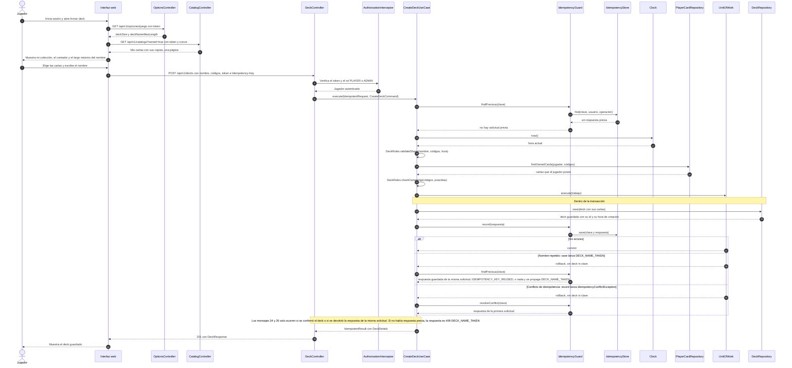
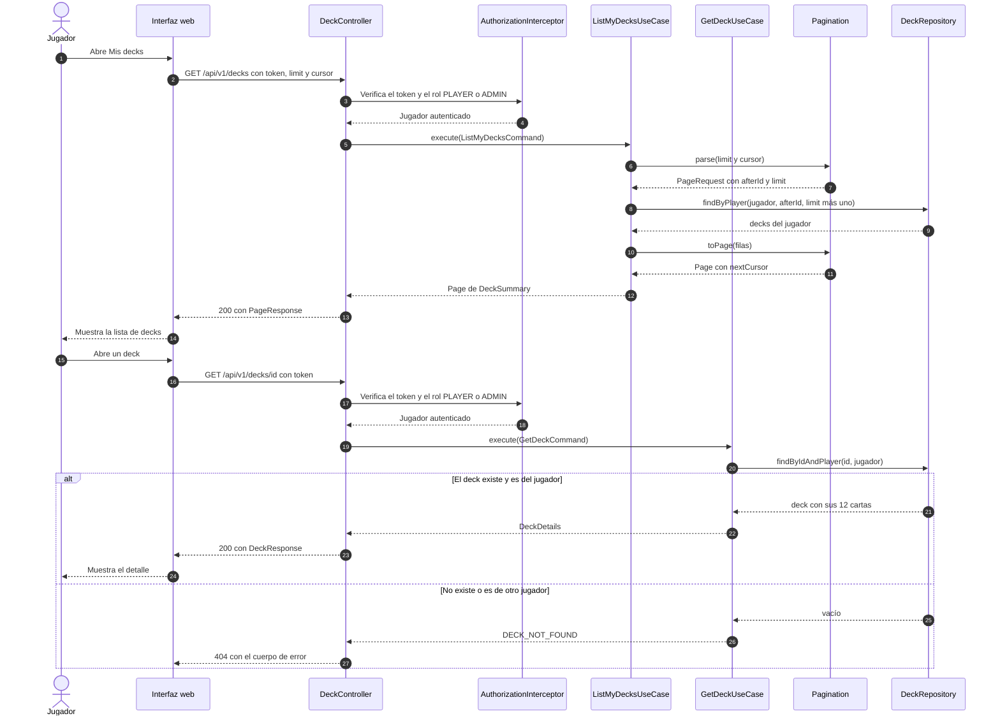
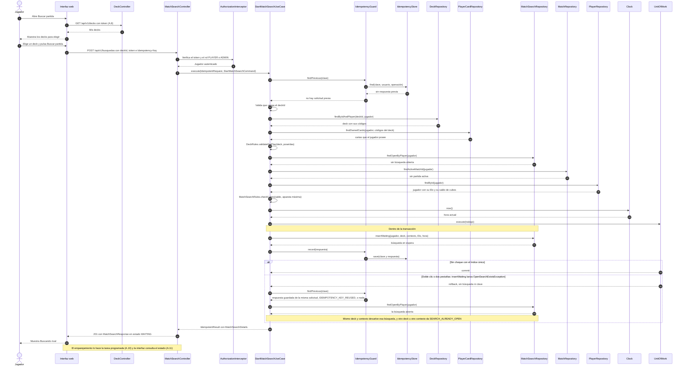
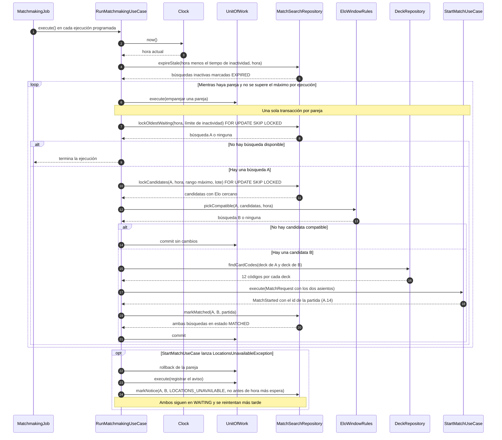
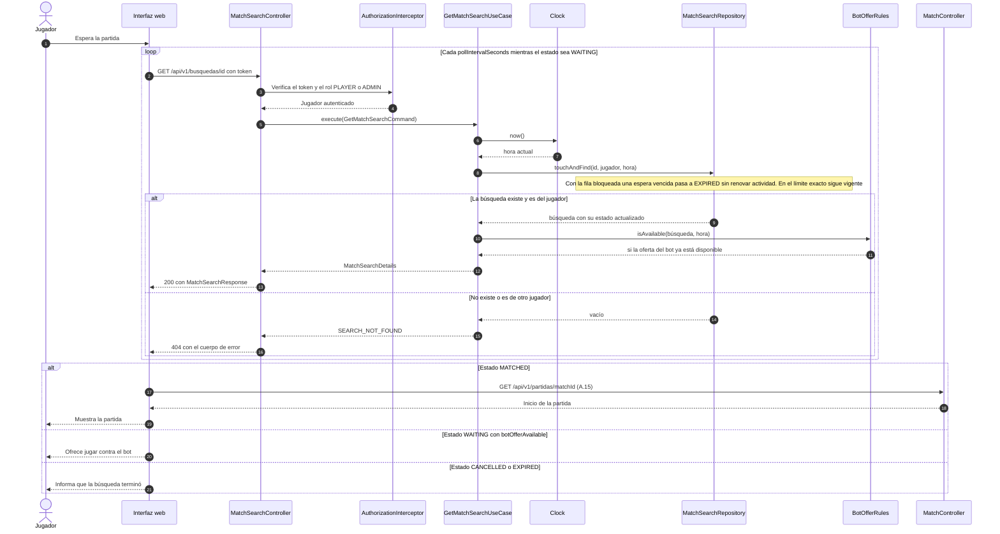
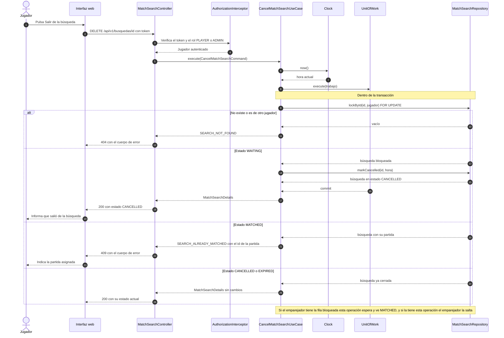
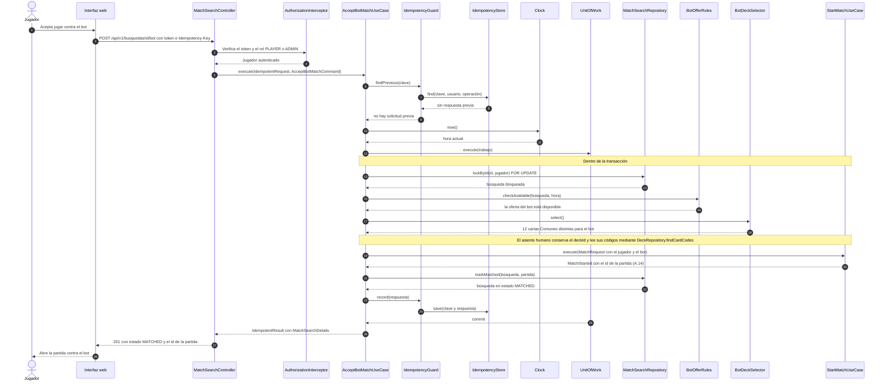
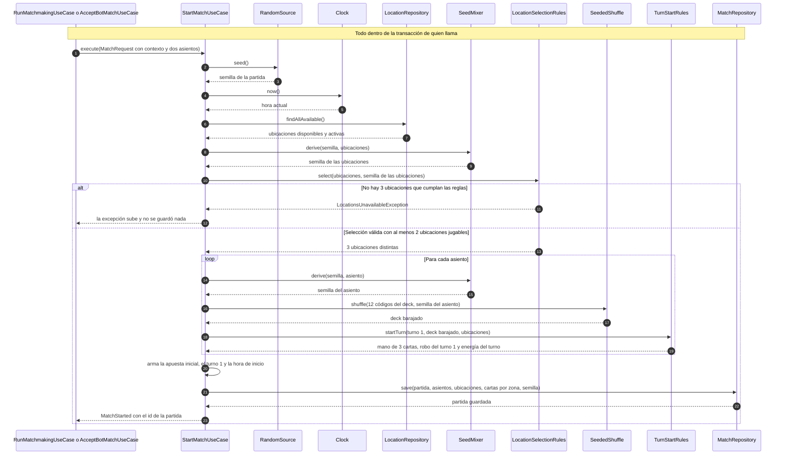
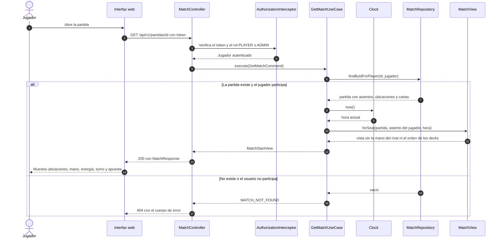

# Especificación de implementación: PokéArena Sprint 3 (Crear deck, Buscar partida, Consultar y salir de la búsqueda, Iniciar la partida)

Documento para los agentes de IA que ayudan a construir las funcionalidades del Sprint 3. **Léelo completo antes de tocar código.** Lo usan los cuatro integrantes del equipo, cada uno con su propio agente y su propia historia. Es la fuente de verdad del Sprint 3: si el código existente contradice este documento, gana este documento, **salvo** en lo que el Sprint 2 ya dejó implementado y probado (convenciones, formato de errores, autorización, idempotencia y paginación), que se **reutiliza** tal como está.

> **No tienes acceso a la wiki del equipo (Azure DevOps).** Todo lo necesario está aquí: diagramas de secuencia (Anexo A), decisiones de diseño (Anexo B) y criterios de aceptación completos de las cuatro historias (Anexo C). Si falta algo, pregunta; no lo supongas.

> **El profesor revisa que el código haga exactamente lo que muestran los diagramas del Anexo A.** Cada mensaje de cada diagrama debe corresponder a una llamada real del código, y cada llamada importante del código debe aparecer en el diagrama. Ver 0.4.

---

## 0. Cómo debes trabajar

1. **Una fase a la vez** (sección 16). Al terminar cada fase entrega un resumen (qué cambiaste, qué pruebas agregaste, qué quedó pendiente, resultado de `.\mvnw.cmd clean verify`) y **espera la aprobación** de quien te dirige antes de seguir.
2. **No inventes requerimientos.** Si hay una ambigüedad, anótala y pregunta. Las decisiones que el equipo debe confirmar están en el Anexo B.2, cada una con su valor por defecto.
3. **Trabaja solo en tu historia.** Cada integrante tiene una (sección 1.2). No modifiques código de otra historia salvo en los **archivos compartidos** de 1.3, y en ellos agrega, no reorganices.
4. **Los diagramas son la especificación del código.**
   1. Antes de implementar tu historia, lee sus diagramas (Anexo A).
   2. En cada caso de uso, comenta el número de mensaje que cita, por ejemplo `// Mensaje 12 del diagrama A.9: validar que el deck pertenece al jugador`.
   3. Si el código necesita un paso que el diagrama no tiene, o el diagrama tiene un paso que el código no hace, **detente y avisa**: el diagrama se actualiza (con aprobación) en el mismo commit que el cambio de código.
   4. Los participantes de los diagramas son las **clases e interfaces reales**. Si renombras una clase, actualiza el diagrama.
   5. Los números de mensaje son los de la numeración automática (`autonumber`) de Mermaid: **las notas y los bloques `alt`, `opt`, `loop` y `end` no cuentan**. Cuenta los mensajes del diagrama ya dibujado; no escribas a mano la tabla de errores de memoria (en el Sprint 3 una tabla escrita a mano quedó desfasada). En una rama `alt`, la numeración sigue el orden del texto, rama por rama.
5. **Mismo estilo que el Sprint 2.** Misma estructura de paquetes, misma plantilla de caso de uso (autorizar, idempotencia, validar, ejecutar en `UnitOfWork`, responder), mismos encabezados con propósito, responsabilidades y referencia al diagrama.
6. **Pasos pequeños y commits.** Un cambio lógico por commit, con `.\mvnw.cmd clean verify` en verde **antes** de cada commit. Haz commits **solo cuando quien te dirige lo pida**, siempre en tu rama de historia, nunca en `main`, y **nunca** `push`, `merge` ni `rebase` sin que te lo pidan.
7. **Sin atribución a IA en los commits ni en los PR.** No agregues `Co-Authored-By`, ni "Generated with ...", ni líneas de sesión, ni enlaces. Mensajes cortos, en español, con el formato `feat:`, `refactor:`, `test:` o `docs:` y sin comillas tipográficas.
8. **No uses Spring Security** ni frameworks que tomen decisiones de diseño de autenticación (restricción RES-01).
9. **Cero números mágicos.** Toda cantidad (12 cartas, 3 ubicaciones, 8 cubos, 60 segundos, rangos de Elo, tamaños de mano, energías) vive en una constante de dominio con nombre o en `application.properties`. La interfaz **no repite** esos valores: los obtiene de la API (sección 11).
10. **El código debe poder defenderse en una oral individual.** Prefiere claridad sobre ingenio, comenta las decisiones y explica cada una al entregar.
11. **Docker Desktop debe estar encendido** para ejecutar las pruebas de integración (Testcontainers).

---

## 1. Contexto

PokéArena es un juego de cartas Pokémon por turnos simultáneos, con ranking Elo, una moneda llamada cubos y una API de torneos para partners. El catálogo puede llegar a unas **10.000 cartas**, y esto se considera en cada decisión de esta especificación. El Sprint 3 agrega los cimientos del juego: armar un deck, buscar rival y preparar la partida. **Jugar los turnos** (confirmar, resolver, terminar la partida, recompensas) **no** está en este sprint.

### 1.1 Historias del Sprint 3

| Historia | Usuario | Qué se construye |
|---|---|---|
| 3.1.3 Crear Deck | Jugador | Armar y consultar decks de 12 cartas de mi colección |
| 4.1.1 Buscar Partida | Jugador | Entrar a la búsqueda con un deck y emparejar por Elo |
| 4.1.2 Consultar la búsqueda y salir de la búsqueda de partida | Jugador | Ver el estado de la búsqueda, salir de ella y aceptar jugar contra el bot |
| 5.1.1 Iniciar la partida | Sistema | Preparar la partida: ubicaciones, barajado, mano inicial, energía y apuesta |

Además hay una historia artificial **"Refactory SP2"** (correcciones del Sprint 2), que ya está implementada y no se toca aquí.

**Dependencias entre historias:** Crear Deck es base de Buscar Partida. Buscar Partida y la oferta del bot **invocan** a Iniciar la partida. Por eso las migraciones y los contratos se acuerdan primero (sección 16, fase 0).

### 1.2 Reparto y ramas

Cada historia se implementa en **su propia rama**, creada desde `main` actualizado, con el nombre `feature/US-<ID>-<nombre>` donde `<ID>` es el número del work item de Azure DevOps.

| Historia | Rama de ejemplo | Casos de uso | Migración Flyway |
|---|---|---|---|
| 3.1.3 Crear Deck | `feature/US-44-crear-deck` | `CreateDeckUseCase`, `ListMyDecksUseCase`, `GetDeckUseCase` | `V3__decks.sql` |
| 5.1.1 Iniciar la partida | `feature/US-<ID>-iniciar-partida` | `StartMatchUseCase`, `GetMatchUseCase` | `V4__partidas.sql` |
| 4.1.1 Buscar Partida | `feature/US-<ID>-buscar-partida` | `StartMatchSearchUseCase`, `RunMatchmakingUseCase` | `V5__busquedas_de_partida.sql` |
| 4.1.2 Consultar y salir de la búsqueda | `feature/US-<ID>-consultar-busqueda` | `GetMatchSearchUseCase`, `CancelMatchSearchUseCase`, `AcceptBotMatchUseCase` | (usa `V5`) |

Las dos historias de búsqueda comparten la tabla `match_search` y deben coordinarse; se recomienda que las implementen dos personas distintas **sobre la misma base**, o una sola persona. El orden de las migraciones importa: `V5` referencia a `V4`, y `V4` referencia a `V3`.

### 1.3 Archivos compartidos (puntos de choque entre ramas)

Estos archivos los tocan varias historias. **Agrega al final, no reordenes ni reformatees**, y haz cambios pequeños para evitar conflictos:

- `application.properties` (claves nuevas de las secciones 5.7 y 7).
- `pokearena.yaml` (rutas y esquemas nuevos; etiquetas).
- `ErrorType` y `ApiErrorCatalog` (tipos nuevos de 5.3).
- `README.md` y el Anexo A de este documento.
- Configuración de beans en `infrastructure.config`.

Para reducir conflictos, la **fase 0** (sección 16) hace primero un PR pequeño con todo lo compartido.

---

## 2. Qué debe verificarse al final

La lista completa está en la sección 17. En resumen:

- Todos los criterios de aceptación del Anexo C tienen una prueba cuyo `@DisplayName` cita su identificador.
- El código sigue los diagramas del Anexo A.
- Las operaciones críticas son **exactamente una vez** bajo concurrencia (un jugador nunca está en dos partidas ni en dos búsquedas, una búsqueda se empareja una sola vez, una partida se crea completa o no se crea).
- Con 10.000 cartas, ninguna operación nueva carga las cartas en memoria ni recorre el catálogo completo.

---

## 3. Stack

El mismo del Sprint 2, sin dependencias nuevas obligatorias: Java 21, Spring Boot (solo capa web), JDBC con SQL escrito a mano (sin ORM), Flyway, PostgreSQL 17, Redis 7.4, JUnit 5, Testcontainers, ArchUnit. **No agregues dependencias** sin consultar.

---

## 4. Arquitectura

La arquitectura, las capas y la frontera transaccional son **las mismas del Sprint 2** (`UnitOfWork`, puertos y adaptadores, `IdempotencyGuard`, `Pagination`). Resumen de lo que importa aquí:

### 4.1 Capas y paquetes (base `cr.ac.tec.pokearena`)

| Capa | Paquetes | Contenido nuevo del Sprint 3 |
|---|---|---|
| Interfaz | `static/` | Pantallas de armar deck, buscar partida, estado de la búsqueda e inicio de partida |
| API | `api.controller`, `api.dto`, `api.error` | `DeckController`, `MatchSearchController`, `MatchController`, sus DTO |
| Aplicación | `application.usecase`, `application.port`, `application.dto` | Los casos de uso de 1.2, `BotDeckSelector`, `MatchSeat`, comandos y resultados |
| Dominio | `domain.model`, `domain.rule`, `domain.repository`, `domain.error` | `Deck`, `MatchSearch`, `Match`, `DeckRules`, `EloWindowRules`, `BotOfferRules`, `LocationSelectionRules`, `SeededShuffle`, `TurnStartRules`, puertos de repositorio |
| Infraestructura | `infrastructure.persistence`, `infrastructure.config` | Adaptadores `Jdbc*Repository`, `MatchmakingJob`, configuración de beans |
| Datos | PostgreSQL | Tablas de 6 |

### 4.2 Reglas de dependencia (ArchUnit, ya en CI)

1. `api` usa `application`; no usa `infrastructure` ni repositorios.
2. `application` usa `domain`; no usa `api` ni `infrastructure`.
3. `domain` **no depende de nada** salvo `java.*`. Prohibido en `domain` y `application`: Spring, Jakarta, JDBC, Redis, JSON, y las llamadas a `LocalDateTime.now()`, `Instant.now()`, `java.util.Random` y `UUID.randomUUID()`.
4. El reloj y el azar entran por los puertos `Clock` y `RandomSource` (ya existen).
5. Los puertos de persistencia viven **solo** en `domain.repository`.

**Importante para el azar:** el dominio **no puede** usar `java.util.Random`. Para barajar con una semilla, el dominio incluye una clase propia `SeededShuffle` (sección 7.3) basada en un generador determinista simple (SplitMix64). La semilla de cada partida la entrega `RandomSource.seed()`.

### 4.3 Frontera transaccional

- Una transacción por caso de uso, con `UnitOfWork.execute`.
- `StartMatchUseCase` **no abre su propia transacción**: se ejecuta **dentro de la transacción de quien lo llama** (`RunMatchmakingUseCase` o `AcceptBotMatchUseCase`). Así, emparejar y crear la partida son **una sola unidad**: o se crea la partida para ambos, o ambos siguen en la búsqueda.
- Nada de efectos externos (archivos, Redis) dentro de las transacciones nuevas. No hay archivos en este sprint.
- Las lecturas (consultar decks, ver partida) no usan transacción explícita.

### 4.4 Principios y patrones (aplicar solo donde simplifiquen)

| Principio o patrón | Dónde | Por qué |
|---|---|---|
| SRP | Una clase por regla: `DeckRules`, `EloWindowRules`, `BotOfferRules`, `LocationSelectionRules`, `TurnStartRules` | Reglas puras, fáciles de probar sin Spring |
| DIP, puertos y adaptadores | `DeckRepository`, `MatchSearchRepository`, `MatchRepository` | Los casos de uso no conocen JDBC |
| Repository y Unit of Work | Todos los accesos a datos | Fronteras claras |
| Plantilla de caso de uso | Todos | Misma estructura que Sprint 2 |
| Strategy y Registry | Los efectos de ubicación existentes, para decidir si una ubicación es jugable (7.3) | Sin `if` por tipo de efecto |
| Builder | Criterios o comandos con varios parámetros opcionales | Legibilidad |

### 4.5 Encabezados y comentarios

Cada clase lleva un comentario inicial con propósito, responsabilidades y referencia al diagrama. Los casos de uso citan el número de mensaje del diagrama paso por paso (0.4).

---

## 5. Convenciones comunes (reutilizadas del Sprint 2)

### 5.1 Rutas nuevas

Todas requieren credenciales propias y aceptan `PLAYER` o `ADMIN` (un administrador también es jugador, igual que en el catálogo). Todas declaran `@RequiresRole({PLAYER, ADMIN})` en cada método, y `OpenApiContractIT` y `RouteSecurityCoverageIT` deben seguir pasando.

| Operación | Método y ruta | Historia | Idempotency-Key |
|---|---|---|---|
| Crear deck | `POST /api/v1/decks` | 3.1.3 | Obligatoria |
| Listar mis decks | `GET /api/v1/decks` | 3.1.3 | No |
| Consultar un deck | `GET /api/v1/decks/{id}` | 3.1.3 | No |
| Buscar partida | `POST /api/v1/busquedas` | 4.1.1 | Obligatoria |
| Consultar la búsqueda | `GET /api/v1/busquedas/{id}` | 4.1.2 | No |
| Salir de la búsqueda | `DELETE /api/v1/busquedas/{id}` | 4.1.2 | No (es idempotente por naturaleza) |
| Aceptar jugar contra el bot | `POST /api/v1/busquedas/{id}/bot` | 4.1.2 | Obligatoria |
| Ver el inicio de la partida | `GET /api/v1/partidas/{id}` | 5.1.1 | No |
| Opciones del juego | `GET /api/v1/opciones/juego` | todas | No |

`GET /api/v1/opciones/juego` sigue el patrón de `/opciones/catalogo` del Sprint 2 y entrega lo que la interfaz necesita para **no escribir números a mano** (sección 11).

### 5.2 Autenticación y autorización

Sin cambios: JWT propio, `401 NOT_AUTHENTICATED` contra `403 FORBIDDEN`, cerrado por defecto. **Un jugador solo ve sus propios decks, búsquedas y partidas**: ante un id ajeno o inexistente se responde igual (`404`), sin revelar si existe.

### 5.3 Formato único de errores

El mismo cuerpo `ApiError` (`type`, `title`, `status`, `detail`, `field`, `allowedValues`, `correlationId`). Se **reutilizan** `MISSING_FIELD`, `INVALID_FIELD`, `IDEMPOTENCY_KEY_REQUIRED`, `IDEMPOTENCY_KEY_REUSED`, `INVALID_PAGINATION`, `NOT_AUTHENTICATED` y `FORBIDDEN`. **Tipos nuevos** (se agregan a `ErrorType`, `ApiErrorCatalog` y al OpenAPI en la fase 0):

| `type` | `status` | Cuándo | Historia |
|---|---|---|---|
| `INVALID_DECK_SIZE` | 400 | El deck no tiene exactamente 12 cartas; el `detail` indica la cantidad actual | 3.1.3 |
| `DUPLICATE_DECK_CARDS` | 400 | Hay cartas repetidas; el `detail` lista los códigos repetidos | 3.1.3 |
| `CARD_NOT_OWNED` | 400 | Incluye una carta que el jugador no posee; el `detail` lista los códigos | 3.1.3 |
| `DECK_NAME_TAKEN` | 409 | Ya existe un deck del jugador con ese nombre | 3.1.3 |
| `DECK_NOT_FOUND` | 404 | El deck no existe **o no pertenece al jugador** (mismo mensaje para ambos) | 3.1.3, 4.1.1 |
| `INVALID_DECK` | 400 | El deck no cumple las reglas de un deck válido al buscar partida; el `detail` indica el motivo | 4.1.1 |
| `ACTIVE_MATCH_EXISTS` | 409 | El jugador ya tiene una partida activa; el `detail` incluye su id | 4.1.1 |
| `SEARCH_ALREADY_OPEN` | 409 | Ya hay una búsqueda abierta (otro deck u otro contexto); el `detail` incluye su id y deck | 4.1.1 |
| `INSUFFICIENT_CUBES` | 422 | Saldo menor a la apuesta máxima; el `detail` indica el saldo y que debe comprar cubos | 4.1.1 |
| `SEARCH_NOT_FOUND` | 404 | La búsqueda no existe o no es del jugador | 4.1.2 |
| `SEARCH_ALREADY_MATCHED` | 409 | Salir o aceptar el bot de una búsqueda que ya encontró partida; el `detail` incluye el id de la partida | 4.1.2 |
| `SEARCH_NOT_OPEN` | 409 | Aceptar el bot en una búsqueda cancelada o expirada | 4.1.2 |
| `BOT_OFFER_NOT_AVAILABLE` | 409 | Aceptar el bot antes de que pase el tiempo de espera | 4.1.2 |
| `MATCH_PREPARATION_FAILED` | 409 | No se pudo preparar la partida (por ejemplo, no hay ubicaciones válidas); el jugador sigue en la búsqueda | 4.1.2, 5.1.1 |
| `MATCH_NOT_FOUND` | 404 | La partida no existe o el usuario no participa en ella | 5.1.1 |

Los identificadores de Java van en inglés; los mensajes al usuario, en español. Las excepciones de validación son `DomainException` tipadas, nunca `IllegalArgumentException`.

### 5.4 Idempotencia

Los tres `POST` de este sprint usan `IdempotencyGuard` exactamente como `CreateCardUseCase`: `findPrevious` al inicio, `record` **dentro de la misma transacción**, `resolveConflict` ante `IdempotencyConflictException`. El endpoint de la clave es `"<MÉTODO> <patrón>"` (por ejemplo `POST /api/v1/decks`). El `RequestHash` de cada solicitud:

- Crear deck: `name` y los códigos **ordenados** (el orden en que se envían no cambia la huella).
- Buscar partida: `deckId` y `context`.
- Aceptar el bot: el id de la búsqueda.

### 5.5 Paginación

Se reutiliza `Pagination` y `app.pagination.*` sin cambios (cursor por `id`, `limit + 1`). Se aplica a `GET /api/v1/decks`. Por eso **`deck.id` es `bigserial`** (como `card.id`), y no un UUID.

### 5.6 Correlación y logs

El `correlationId` del Sprint 2 se mantiene. Registra en INFO: búsqueda creada, pareja formada (ids de búsqueda y de partida), partida creada, búsqueda expirada. No registres tokens.

### 5.7 Configuración nueva (`application.properties`)

Toda con nombre y valor por defecto. Se agrega **toda junta en la fase 0**.

```properties
# Reglas de la partida (5.1.1)
app.match.locations-per-match=3
app.match.min-playable-locations=2
app.match.initial-hand-size=3
app.match.max-hand-size=7
app.match.initial-energy=2
app.match.energy-per-turn=1
app.match.max-turns=6
app.match.turn-duration=PT30S
app.match.initial-bet=4
app.match.max-bet=8

# Emparejamiento (4.1.1 y 4.1.2)
app.matchmaking.enabled=true
app.matchmaking.tick-interval=PT2S
app.matchmaking.initial-elo-range=100
app.matchmaking.elo-range-step=50
app.matchmaking.elo-range-step-interval=PT10S
app.matchmaking.max-elo-range=400
app.matchmaking.inactivity-timeout=PT30S
app.matchmaking.bot-offer-after=PT60S
app.matchmaking.client-poll-interval=PT5S
app.matchmaking.candidate-batch-size=20
app.matchmaking.max-pairs-per-tick=50
app.matchmaking.failure-retry-delay=PT30S
```

El tamaño del deck (12) y la longitud máxima del nombre (40) son **constantes de dominio** en `DeckRules` (`DECK_SIZE`, `NAME_MAX_LENGTH`), porque son reglas del juego, y llegan a la interfaz por `GET /api/v1/opciones/juego`.

Una clase de configuración (`MatchSettings`, `MatchmakingSettings`) lee estas propiedades y las entrega a los casos de uso y reglas; **el dominio recibe los valores por constructor**, no lee propiedades.

### 5.8 El Elo y los cubos ya existen

`player.elo` (inicia en 0) y `player.cube_balance` ya existen en el esquema. No se agregan columnas a `player`. El Elo **no cambia** en este sprint (lo actualizan las recompensas, que son de otra historia). La apuesta de 4 cubos **se registra** en la partida pero **no se descuenta** del saldo: la liquidación es de otra historia.

---

## 6. Modelo de datos (Flyway)

Tres migraciones nuevas, **una por historia**, con estos nombres y en este orden. Reglas generales: tablas en singular; claves foráneas; restricciones `CHECK`; fechas `timestamptz` que **entran por parámetro** (nunca `now()` en SQL).

### 6.1 `V3__decks.sql` (historia 3.1.3)

```sql
CREATE TABLE deck (
    id               bigserial   PRIMARY KEY,
    player_id        uuid        NOT NULL REFERENCES player (id),
    name             text        NOT NULL,
    name_normalized  text        NOT NULL,
    version          integer     NOT NULL DEFAULT 1,
    active           boolean     NOT NULL DEFAULT TRUE,
    created_at       timestamptz NOT NULL,
    CONSTRAINT uq_deck_player_name UNIQUE (player_id, name_normalized)
);

CREATE TABLE deck_card (
    deck_id   bigint NOT NULL REFERENCES deck (id),
    card_code text   NOT NULL REFERENCES card (code),
    PRIMARY KEY (deck_id, card_code)
);

CREATE INDEX idx_deck_player ON deck (player_id, id);
```

- `name_normalized` (minúsculas, sin tildes) lo calcula el dominio con `NameNormalizer`, igual que en las cartas.
- La cantidad exacta de 12 cartas la impone la **aplicación** (`DeckRules`); una prueba de integración comprueba que ningún camino guarda un deck con otra cantidad.
- **Implementado en V3:** además de lo anterior, dos restricciones de coherencia con `card` y `location`: `ck_deck_name_not_blank` y `ck_deck_version_positive`. El 12 y el 40 **no** están en la base de datos: viven solo en `DeckRules`.
- Un deck no se edita ni se elimina en este sprint (no hay historias para ello). Por eso, mientras una búsqueda o una partida lo usa, **no puede cambiar**: la clave foránea y la falta de endpoints de edición lo garantizan.

### 6.2 `V4__partidas.sql` (historia 5.1.1)

La tabla se llama `game_match` (y no `match`) para no chocar con palabras de SQL.

```sql
CREATE TABLE game_match (
    id                    uuid        PRIMARY KEY,
    context               text        NOT NULL CHECK (context IN ('RANKED', 'TOURNAMENT')),
    vs_bot                boolean     NOT NULL,
    status                text        NOT NULL CHECK (status IN ('ACTIVE', 'FINISHED')),
    seed                  bigint      NOT NULL,
    bet                   smallint    NOT NULL CHECK (bet >= 0),
    turn                  smallint    NOT NULL CHECK (turn >= 1),
    turn_started_at       timestamptz NOT NULL,
    turn_duration_seconds smallint    NOT NULL CHECK (turn_duration_seconds > 0),
    created_at            timestamptz NOT NULL
);

CREATE TABLE game_match_player (
    match_id   uuid     NOT NULL REFERENCES game_match (id),
    seat       smallint NOT NULL CHECK (seat IN (1, 2)),
    player_id  uuid     NULL REFERENCES player (id),
    is_bot     boolean  NOT NULL,
    deck_id    bigint   NULL REFERENCES deck (id),
    energy     smallint NOT NULL CHECK (energy >= 0),
    active     boolean  NOT NULL,
    PRIMARY KEY (match_id, seat),
    CONSTRAINT ck_match_player_bot CHECK ((is_bot AND player_id IS NULL) OR (NOT is_bot AND player_id IS NOT NULL))
);

-- Un jugador nunca está en dos partidas activas (garantía en la base de datos).
CREATE UNIQUE INDEX uq_match_player_active
    ON game_match_player (player_id) WHERE active AND player_id IS NOT NULL;

CREATE TABLE game_match_location (
    match_id    uuid     NOT NULL REFERENCES game_match (id),
    slot        smallint NOT NULL CHECK (slot BETWEEN 1 AND 3),
    location_id bigint   NOT NULL REFERENCES location (id),
    PRIMARY KEY (match_id, slot),
    CONSTRAINT uq_match_location UNIQUE (match_id, location_id)
);

CREATE TABLE game_match_card (
    match_id  uuid     NOT NULL,
    seat      smallint NOT NULL,
    position  smallint NOT NULL CHECK (position >= 0),
    card_code text     NOT NULL REFERENCES card (code),
    zone      text     NOT NULL CHECK (zone IN ('DECK', 'HAND', 'GRAVEYARD')),
    PRIMARY KEY (match_id, seat, position),
    CONSTRAINT uq_match_card UNIQUE (match_id, seat, card_code),
    FOREIGN KEY (match_id, seat) REFERENCES game_match_player (match_id, seat)
);
```

- `position` es el **orden del deck barajado** (0 es la primera carta). Quedan registrados el orden y la semilla, para que la repetición reproduzca la partida exactamente.
- `zone` indica dónde está cada carta: `HAND` (mano), `DECK` (por robar) o `GRAVEYARD` (cementerio, vacío al iniciar).
- El bot ocupa un asiento con `is_bot = true` y `player_id` nulo; su deck también se guarda en `game_match_card`.
- `CHECK (slot BETWEEN 1 AND 3)` y `locations-per-match`: si cambia la propiedad, se cambia la migración siguiente; el número 3 aparece **una sola vez** como regla del dominio y una vez en el esquema, documentado.

### 6.3 `V5__busquedas_de_partida.sql` (historias 4.1.1 y 4.1.2)

```sql
CREATE TABLE match_search (
    id              uuid        PRIMARY KEY,
    player_id       uuid        NOT NULL REFERENCES player (id),
    deck_id         bigint      NOT NULL REFERENCES deck (id),
    context         text        NOT NULL CHECK (context IN ('RANKED', 'TOURNAMENT')),
    status          text        NOT NULL CHECK (status IN ('WAITING', 'MATCHED', 'CANCELLED', 'EXPIRED')),
    elo             integer     NOT NULL,
    match_id        uuid        NULL REFERENCES game_match (id),
    notice          text        NULL,
    not_before      timestamptz NULL,
    created_at      timestamptz NOT NULL,
    last_polled_at  timestamptz NOT NULL,
    closed_at       timestamptz NULL,
    CONSTRAINT ck_match_search_match CHECK ((status = 'MATCHED') = (match_id IS NOT NULL))
);

-- Un jugador solo puede tener una búsqueda abierta, sin importar el contexto.
CREATE UNIQUE INDEX uq_match_search_open ON match_search (player_id) WHERE status = 'WAITING';

CREATE INDEX idx_match_search_waiting ON match_search (created_at, id) WHERE status = 'WAITING';
```

- `elo` es el Elo del jugador **al empezar** la búsqueda.
- `notice` guarda el motivo si la partida no se pudo preparar (`LOCATIONS_UNAVAILABLE`); la interfaz lo muestra. `not_before` evita reintentar al instante (5.7 `failure-retry-delay`).
- `last_polled_at` se actualiza cada vez que el jugador consulta su búsqueda y sirve para detectar la inactividad.

### 6.4 Resumen de garantías en la base de datos

| Garantía | Mecanismo |
|---|---|
| Un jugador, una búsqueda abierta | Índice único parcial `uq_match_search_open` |
| Un jugador, una partida activa | Índice único parcial `uq_match_player_active` |
| Nombre de deck único por jugador | `uq_deck_player_name` |
| Búsqueda `MATCHED` si y solo si tiene partida | `ck_match_search_match` |
| Una partida nunca repite ubicación ni carta por asiento | `uq_match_location`, `uq_match_card` |

---

## 7. Casos de uso

Todos siguen la **plantilla**: autorizar → (idempotencia, si es `POST`) → validar → ejecutar en `UnitOfWork` → responder. **Todas las validaciones ocurren antes de guardar nada.**

### 7.1 Crear Deck (3.1.3): `CreateDeckUseCase`, `ListMyDecksUseCase`, `GetDeckUseCase`. Anexo A.7 y A.8

**Solicitud.** `POST /api/v1/decks` con JSON `{ "name": "texto", "cards": ["PKA-FUE-001", ...] }`.

| Paso | Qué hace | Error |
|---|---|---|
| 1 | Autoriza (`PLAYER` o `ADMIN`) | `401` / `403` |
| 2 | `IdempotencyGuard.findPrevious`: misma clave y huella, devuelve la respuesta guardada; huella distinta, error | `IDEMPOTENCY_KEY_REQUIRED`, `IDEMPOTENCY_KEY_REUSED` |
| 3 | `Clock.now()` y luego `DeckRules.validateShape(jugador, nombre, códigos, hora)`, **en este orden**: nombre presente y de `NAME_MIN_LENGTH` a `NAME_MAX_LENGTH` caracteres (contados en caracteres reales); lista `cards` presente; cantidad exacta `DECK_SIZE`; ningún código nulo o vacío (`INVALID_FIELD` en `cards`); sin repetidas. Devuelve un `NewDeck` validado (nombre sin espacios sobrantes, códigos ordenados) | `MISSING_FIELD`, `INVALID_FIELD`, `INVALID_DECK_SIZE`, `DUPLICATE_DECK_CARDS` |
| 4 | `PlayerCardRepository.findOwnedCards(jugador, códigos)`: **una sola consulta** que devuelve las cartas poseídas (con sus datos) | |
| 5 | `DeckRules.checkOwnership(códigos, poseídas)`: todas deben estar poseídas | `CARD_NOT_OWNED` (lista las que faltan) |
| 6 | `UnitOfWork`: `DeckRepository.save` (deck y sus 12 cartas) e `IdempotencyGuard.record` | `DECK_NAME_TAKEN` si la restricción única falla; `IdempotencyConflictException` si perdió la carrera |
| 7 | Responde `201` con `DeckResponse` | |

- **Con 10.000 cartas**, la comprobación de posesión es **una** consulta por la clave `(player_id, card_code)`, nunca una por carta ni un recorrido del catálogo.
- El deck puede tener cartas que el jugador posee en una sola copia: se piden 12 cartas **distintas**, no copias.
- **Nombre repetido (implementado así):** el paso 3 no consulta por nombre. `DeckRepository.save` usa `INSERT ... ON CONFLICT ON CONSTRAINT uq_deck_player_name DO NOTHING RETURNING id, created_at`; si no vuelve fila, lanza `DeckException.nameTaken`. No se captura una excepción del driver (el driver de PostgreSQL es solo de ejecución, y no se lee el texto de los errores). Bajo concurrencia, la segunda transacción espera a la primera: si esta confirma, la segunda recibe `DECK_NAME_TAKEN`; si revierte, la segunda inserta.
- **Idempotencia después de un choque de nombre (obligatorio):** el error **nunca** se guarda como respuesta idempotente (el `UnitOfWork` revierte deck, cartas y clave). Pero dos envíos **idénticos y simultáneos** (reintento de red) también chocan por el nombre. Por eso, ante `DECK_NAME_TAKEN` y **fuera de la transacción revertida**, el caso de uso llama a `IdempotencyGuard.findPrevious`: misma clave y misma huella devuelve la respuesta guardada de la primera solicitud (el mismo 201); misma clave con otra huella, `IDEMPOTENCY_KEY_REUSED`; si no hay nada guardado, se propaga `DECK_NAME_TAKEN`. `IdempotencyConflictException` se sigue resolviendo con `resolveConflict`. Un reintento posterior tras un 409 se vuelve a ejecutar y puede dar 201 si el nombre ya quedó libre.
- **Hora de creación:** `save` devuelve la hora **tal como la guardó la base** (`RETURNING ... created_at`). PostgreSQL guarda microsegundos y el reloj de Java da nanosegundos; si la respuesta usara la hora de Java, el `201` y el `GET` posterior mostrarían horas distintas.
- **Reintento por red:** la misma `Idempotency-Key` devuelve el mismo deck sin duplicarlo.

**Listar y consultar.**

- `GET /api/v1/decks?limit&cursor` → `ListMyDecksUseCase`: `Pagination.parse`, `DeckRepository.findByPlayer(jugador, afterId, limit + 1)`, `Pagination.toPage`. Devuelve `PageResponse<DeckSummaryResponse>` (`id`, `name`, `size`, `createdAt`).
- `GET /api/v1/decks/{id}` → `GetDeckUseCase`: `DeckRepository.findByIdAndPlayer(id, jugador)`; si no existe o es de otro jugador, `DECK_NOT_FOUND` (`404`). Devuelve `DeckResponse` con las cartas (código, nombre, tipo, rareza, costo, poder, miniatura), obtenidas en **una** consulta.

### 7.2 Buscar Partida y Consultar/Salir (4.1.1 y 4.1.2). Anexo A.9 a A.13

#### 7.2.1 Buscar partida: `StartMatchSearchUseCase` (A.9)

**Solicitud.** `POST /api/v1/busquedas` con `{ "deckId": 7, "context": "RANKED" }`. Hoy solo se acepta `RANKED` (otro valor: `INVALID_FIELD` con `allowedValues ["RANKED"]`); el campo existe para que los torneos lo usen después sin cambiar el esquema.

Orden de las comprobaciones (importa para los criterios):

| Paso | Qué hace | Error |
|---|---|---|
| 1 | Autoriza | `401` / `403` |
| 2 | `IdempotencyGuard.findPrevious` | `IDEMPOTENCY_KEY_*` |
| 3 | `deckId` presente | `MISSING_FIELD` (`field = deckId`, "Debes seleccionar un deck") |
| 4 | `DeckRepository.findByIdAndPlayer`: existe y es del jugador | `DECK_NOT_FOUND` |
| 5 | `PlayerCardRepository.findOwnedCards` y `DeckRules.validateForPlay(códigos, poseídas)`, que **ya existe** y devuelve un `Optional<String>` con el motivo (vacío si el deck es jugable): exactamente `DECK_SIZE` cartas distintas, todas poseídas. **Esta historia crea el tipo `INVALID_DECK` y lo lanza** con ese motivo | `INVALID_DECK` (con el motivo) |
| 6 | `MatchSearchRepository.findOpenByPlayer`: si hay una abierta **del mismo deck y contexto**, se devuelve esa (la solicitud es idempotente); si es de otro deck u otro contexto | `SEARCH_ALREADY_OPEN` (con su id) |
| 7 | `MatchRepository.findActiveMatchId`: partida activa | `ACTIVE_MATCH_EXISTS` |
| 8 | `PlayerRepository.findById`: `cube_balance >= app.match.max-bet` | `INSUFFICIENT_CUBES` |
| 9 | `UnitOfWork`: `MatchSearchRepository.insertWaiting` (Elo y hora de ahora) e `IdempotencyGuard.record` | |
| 10 | Responde `201` (o `200` si devolvió la búsqueda existente) con `MatchSearchResponse` | |

- **Doble clic, dos pestañas, reintento:** deja **una sola** búsqueda abierta. Si la restricción `uq_match_search_open` hace fallar el insert de la segunda solicitud, el caso de uso hace rollback y, **fuera de la transacción revertida**, aplica el mismo patrón que Crear deck (7.1): primero `IdempotencyGuard.findPrevious` (misma clave y huella: devuelve la respuesta guardada, el mismo 201; otra huella: `IDEMPOTENCY_KEY_REUSED`); si no hay respuesta previa, `findOpenByPlayer` y devuelve esa búsqueda (mismo deck y contexto) o `SEARCH_ALREADY_OPEN` (otro deck u otro contexto). El error nunca se guarda como respuesta idempotente.
- **El deck no cambia durante la búsqueda ni la partida:** es consecuencia de que no existen endpoints para editarlo y de que la búsqueda lo referencia. Para usar otro, el jugador sale de la búsqueda y busca de nuevo.
- La búsqueda guarda `elo = player.elo` y `last_polled_at = ahora` (`Clock`).
- **El emparejamiento no lo hace este caso de uso**, sino la tarea programada (7.2.2).

#### 7.2.2 Emparejamiento: `RunMatchmakingUseCase` y `MatchmakingJob` (A.10)

`MatchmakingJob` (en `infrastructure`, `@Scheduled(fixedDelayString = "${app.matchmaking.tick-interval}")`, activo solo si `app.matchmaking.enabled`) llama a `RunMatchmakingUseCase.execute()` y captura cualquier `RuntimeException` para registrarla. **Se ejecuta en todas las instancias de la API al mismo tiempo**; la corrección no depende de que corra en una sola.

En cada ejecución:

1. **Expirar las inactivas.** `MatchSearchRepository.expireStale(límite, ahora)` pone `EXPIRED` a las `WAITING` cuyo `last_polled_at` sea anterior a `ahora - inactivity-timeout`. El cierre se registra con la hora del barrido y se conserva la última actividad. El método devuelve el número de filas expiradas. Una expirada **nunca** se empareja.
2. **Repetir hasta `max-pairs-per-tick` veces**, y **cada pareja en su propia transacción** (`UnitOfWork.execute`):
   1. `lockOldestWaiting(ahora, límiteDeInactividad)`: la búsqueda `WAITING` más antigua, no inactiva y con `not_before` vencido, con `FOR UPDATE SKIP LOCKED`. Si no hay, termina.
   2. `lockCandidates(A, ahora, límiteDeInactividad, max-elo-range, candidate-batch-size)`: hasta N candidatas `WAITING` (mismo contexto, otro jugador, no inactivas) con diferencia de Elo menor o igual al rango **máximo**, ordenadas por cercanía de Elo y antigüedad, con `FOR UPDATE SKIP LOCKED`.
   3. `EloWindowRules.pickCompatible(A, candidatas, ahora)` (dominio, regla pura): devuelve la primera candidata cuya diferencia de Elo es menor o igual al rango efectivo. Si no hay, **la transacción termina sin cambios** (A sigue esperando).
   4. Si hay pareja: carga los códigos de ambos decks (`DeckRepository.findCardCodes`), llama a **`StartMatchUseCase`** (7.3) dentro de la misma transacción, y marca **ambas** búsquedas como `MATCHED` con el id de la partida (`markMatched`).
3. **Si `StartMatchUseCase` lanza `LocationsUnavailableException`:** la transacción se revierte (no queda nada) y, en **otra** transacción, se registra en ambas búsquedas `notice = LOCATIONS_UNAVAILABLE` y `not_before = ahora + failure-retry-delay`. Ambos siguen en `WAITING` y vuelven a intentarse más tarde. Los jugadores ven el mensaje al consultar su búsqueda.
4. **Cualquier otra excepción** durante una pareja revierte esa transacción completa: ninguna búsqueda queda `MATCHED` ni existe partida a medias.

**Rango efectivo de Elo.** Para una búsqueda con tiempo de espera `t = ahora - created_at`:

```
rango(t) = min(max-elo-range, initial-elo-range + elo-range-step * piso(t / elo-range-step-interval))
```

Dos búsquedas son compatibles si `|eloA - eloB| <= max(rango(A), rango(B))` (la que lleva más tiempo esperando manda). Esta fórmula vive **solo** en `EloWindowRules` (una vez, en Java); el SQL solo filtra con el rango máximo. Con los valores por defecto el rango sube de 100 a 400 en 60 segundos.

**Por qué es correcto con varias instancias.**

- `FOR UPDATE SKIP LOCKED` hace que dos instancias nunca elijan la misma búsqueda: la que llega segunda **salta** las filas bloqueadas, no espera, y por eso no hay bloqueos mutuos.
- La transición `WAITING` → `MATCHED` ocurre dentro de la transacción que bloqueó ambas filas.
- Aunque todo lo anterior fallara, el índice `uq_match_player_active` impide que un jugador quede en dos partidas.

#### 7.2.3 Consultar la búsqueda: `GetMatchSearchUseCase` (A.11)

`GET /api/v1/busquedas/{id}`.

1. Autoriza.
2. `MatchSearchRepository.touchAndFind(id, jugador, ahora)`: si está `WAITING` y `last_polled_at < ahora - inactivity-timeout`, pasa a `EXPIRED` con `closed_at = ahora` y conserva la última actividad. En el límite exacto sigue vigente. Una consulta vigente renueva la actividad sin retroceder su instante. La decisión y la lectura ocurren bajo el mismo bloqueo de fila. Si no existe o no es del jugador: `SEARCH_NOT_FOUND`.
3. `BotOfferRules.isAvailable(búsqueda, ahora)`: `WAITING` y `ahora >= created_at + bot-offer-after`.
4. Responde `200` con `MatchSearchResponse`.

`MatchSearchResponse`:

```json
{
  "id": "uuid",
  "status": "WAITING | MATCHED | CANCELLED | EXPIRED",
  "deckId": 7,
  "context": "RANKED",
  "createdAt": "...",
  "matchId": "uuid | null",
  "botOfferAvailable": false,
  "notice": null,
  "pollIntervalSeconds": 5
}
```

- `matchId` solo viene cuando `status = MATCHED`.
- `pollIntervalSeconds` sale de `app.matchmaking.client-poll-interval`; la interfaz lo usa y **no** escribe el 5 a mano. Quien deja de consultar durante `inactivity-timeout` sale de la búsqueda (paso 1 de 7.2.2).
- `notice` trae `LOCATIONS_UNAVAILABLE` si la última pareja no pudo prepararse.
- Una búsqueda `CANCELLED` o `EXPIRED` se devuelve tal cual; nunca se empareja.

#### 7.2.4 Salir de la búsqueda: `CancelMatchSearchUseCase` (A.12)

`DELETE /api/v1/busquedas/{id}`. Dentro de un `UnitOfWork`:

1. `MatchSearchRepository.lockById(id, jugador)`: `SELECT ... FOR UPDATE` **bloqueante** (a diferencia del emparejador). Si no existe o es ajena: `SEARCH_NOT_FOUND`.
2. Según el estado:
   - `WAITING`: `markCancelled(ahora)` y responde `200` con estado `CANCELLED`.
   - `MATCHED`: **rechaza** con `SEARCH_ALREADY_MATCHED` (`409`) indicando el id de la partida.
   - `CANCELLED` o `EXPIRED`: responde `200` con su estado actual (salir dos veces no es un error).

**Salir y emparejar a la vez dan un resultado consistente.** El emparejador usa `SKIP LOCKED` y esta operación bloquea la fila:

- Si el emparejador toma la fila primero, la salida espera, ve `MATCHED` y se rechaza indicando la partida.
- Si la salida toma la fila primero, el emparejador la salta (queda `CANCELLED` sin partida).

#### 7.2.5 Aceptar jugar contra el bot: `AcceptBotMatchUseCase` (A.13)

`POST /api/v1/busquedas/{id}/bot`, con `Idempotency-Key`.

1. Autoriza e `IdempotencyGuard.findPrevious`.
2. `UnitOfWork`:
   1. `lockById(id, jugador)` (bloqueante). No existe o ajena: `SEARCH_NOT_FOUND`.
   2. `MATCHED`: `SEARCH_ALREADY_MATCHED` con el id de la partida. `CANCELLED` o `EXPIRED`: `SEARCH_NOT_OPEN`.
   3. `WAITING` pero antes del tiempo de espera: `BOT_OFFER_NOT_AVAILABLE`.
   4. `BotDeckSelector.select()` arma el deck del bot (12 cartas Comunes distintas, disponibles y activas, elegidas con `RandomSource` mediante `CollectibleCardRepository.pickRandomCollectible`).
   5. `StartMatchUseCase` con el jugador (su deck de la búsqueda) y el asiento del bot, **en la misma transacción**.
   6. `markMatched(búsqueda, partida)` e `IdempotencyGuard.record`.
3. Si `StartMatchUseCase` lanza `LocationsUnavailableException`: rollback y `MATCH_PREPARATION_FAILED` (`409`); la búsqueda sigue `WAITING`.
4. Responde `201` con `MatchSearchResponse` (estado `MATCHED`).

**No aceptar la oferta no requiere ninguna llamada:** la búsqueda continúa y `botOfferAvailable` sigue en `true` mientras esté `WAITING`.

La partida contra el bot **se prepara con las mismas reglas** (7.3) y se marca `vs_bot = true`. Jugar contra el bot (sus decisiones) es de otra historia.

### 7.3 Iniciar la partida (5.1.1): `StartMatchUseCase`, `GetMatchUseCase`. Anexo A.14 y A.15

`StartMatchUseCase.execute(MatchRequest)` **requiere una transacción activa** (lo invocan los casos de uso de 7.2.2 y 7.2.5). `MatchRequest` contiene el contexto, los dos `MatchSeat` y, para cada uno: `playerId` (nulo si es bot), `deckId` (nulo si es bot) y `deckCodes` (12 códigos).

| Paso | Qué hace |
|---|---|
| 1 | `RandomSource.seed()` → `matchSeed`; `Clock.now()` |
| 2 | `LocationRepository.findAllAvailable()`: ubicaciones `available AND active` (el catálogo de ubicaciones es pequeño; no se pagina) |
| 3 | `LocationSelectionRules.select(ubicaciones, semilla)`: elige `locations-per-match` ubicaciones **distintas**, garantizando al menos `min-playable-locations` jugables. Si no es posible: `LocationsUnavailableException` (sin guardar nada) |
| 4 | Para cada asiento: `SeededShuffle.shuffle(deckCodes, semilla derivada del asiento)` |
| 5 | `TurnStartRules.startTurn(1, …)` para cada asiento: reparte la mano inicial, roba la siguiente carta y calcula la energía del turno 1 |
| 6 | `MatchRepository.save`: la partida, los dos asientos, las 3 ubicaciones y las cartas de cada asiento por zona, con la semilla, la apuesta, el turno 1 y la hora de inicio |
| 7 | Devuelve `MatchStarted` con el id de la partida |

**Ubicación "jugable".** Una ubicación permite jugar cartas si `card_limit > 0` **y** su efecto no restringe **todos** los turnos. Para no usar `if` por tipo de efecto, se agrega a `LocationEffectType` un método con implementación por defecto (`boolean blocksAllTurns(Map<String,Object> parameters)`, que devuelve `false`) y `TurnRestrictionEffect` lo implementa (verdadero si restringe todos los turnos del 1 al `max-turns`). Antes de implementarlo, **lee `TurnRestrictionEffect` y confirma** cómo guarda sus parámetros; si hay duda, pregunta (Anexo B.2).

**Selección de ubicaciones, determinista.** Con la lista ordenada por `id`:

1. Baraja la lista con `SeededShuffle` y la semilla derivada `locations`.
2. Toma las primeras 3.
3. Mientras haya menos de 2 jugables entre ellas, reemplaza una no jugable por la siguiente jugable de las restantes.
4. Si no se puede (hay menos de 3 ubicaciones, o menos de 2 jugables en total): `LocationsUnavailableException`.

**Semillas.** `matchSeed` es la única fuente de azar. Las semillas de cada elemento se **derivan** de ella con una función pura del dominio (`SeedMixer.derive(semilla, propósito)`, basada en SplitMix64): una para las ubicaciones y una por asiento. Ningún dato del cliente participa. La semilla y el orden resultante quedan **guardados** (6.2), de modo que la repetición reproduce la partida exactamente.

**Inicio de turno (`TurnStartRules`, dominio, pura).** Para un asiento, en el turno `n`:

1. **Mano inicial:** las primeras `initial-hand-size` cartas del deck barajado pasan a la zona `HAND`.
2. **Robo:** si la mano tiene menos de `max-hand-size` cartas, roba la siguiente carta del deck (pasa a `HAND`); si ya tiene `max-hand-size`, no roba. **Al iniciar el turno 1 también se roba**, así que la mano queda en 4 cartas.
3. **Energía base:** `initial-energy + (n - 1) * energy-per-turn` (2, 3, 4, 5, 6 y 7 en los turnos 1 a 6). **No se acumula** de un turno al siguiente: cada turno parte de la base.
4. **Energía extra de ubicaciones:** para cada una de las 3 ubicaciones se suma: el monto `FIXED`, o el monto `PER_CARD` multiplicado por la cantidad de cartas **propias** en esa ubicación contadas al inicio del turno. En el turno 1 no hay cartas en el tablero, por lo que `PER_CARD` suma 0; la regla recibe el conteo como parámetro para poder probarla con valores mayores en pruebas unitarias.

**Estado inicial.** Turno 1; `turn_started_at = ahora`; `turn_duration_seconds = app.match.turn-duration` (30 s); apuesta `app.match.initial-bet` (4 cubos) para las partidas clasificatorias; cementerio vacío; `status = ACTIVE`; `active = true` en ambos asientos.

**Todo o nada.** La preparación ocurre dentro de la transacción del llamador: si cualquier paso falla, **no queda ninguna fila** en `game_match*` y las búsquedas siguen `WAITING` (7.2.2). El orden del código evita guardar nada antes de tener la selección de ubicaciones.

**Mismas reglas para el bot y los torneos.** `StartMatchUseCase` no distingue bot de jugador salvo por el asiento sin `playerId`.

**Ver el inicio de la partida (`GetMatchUseCase`, `GET /api/v1/partidas/{id}`).** Es una vista **mínima y de solo lectura**, necesaria para comprobar los criterios de 5.1.1 desde la interfaz (la historia "Consultar el estado de la partida" completa es de otro sprint). Responde solo a los dos jugadores de la partida; cualquier otro usuario o un id inexistente: `MATCH_NOT_FOUND` (`404`).

```json
{
  "id": "uuid",
  "status": "ACTIVE",
  "context": "RANKED",
  "vsBot": false,
  "turn": 1,
  "turnDurationSeconds": 30,
  "turnEndsAt": "...",
  "serverTime": "...",
  "bet": 4,
  "locations": [
    { "slot": 1, "id": 10, "name": "...", "description": "...", "cardLimit": 3,
      "extraEnergyMode": "FIXED", "extraEnergyAmount": 1, "imageLargeUrl": "..." }
  ],
  "you":   { "seat": 1, "energy": 3, "hand": [ { "code": "...", "name": "...", "cost": 2, "power": 3, "imageSmallUrl": "..." } ],
             "deckRemaining": 8, "graveyard": [] },
  "rival": { "isBot": false, "handCount": 4, "deckRemaining": 8, "graveyard": [] }
}
```

**Lo que la respuesta NUNCA incluye (se prueba):** la mano del rival, el orden del deck de ninguno de los dos jugadores (solo la cantidad restante), la semilla ni el identificador de las cartas aún no robadas. La vista es una **función pura** (`MatchView.forSeat`) que recibe la partida y el asiento del solicitante.

### 7.4 Opciones del juego (sección 11)

`GET /api/v1/opciones/juego` (`{PLAYER, ADMIN}`) devuelve, leído de las constantes y propiedades (nunca escrito en la interfaz):

```json
{ "deckSize": 12, "deckNameMaxLength": 40, "minCubesToSearch": 8, "searchPollSeconds": 5 }
```

**Ya implementado** (historia 3.1.3) en el `OptionsController` existente, con `GetGameOptionsUseCase` y los dos primeros campos. La historia de búsquedas agrega los otros dos en esa misma respuesta, en su propio commit (sección 1.3, agrega sin reordenar); no crea otro controlador.

---

## 8. Concurrencia y consistencia (resumen)

| Situación | Garantía | Mecanismo |
|---|---|---|
| Doble clic o reintento al buscar partida | Una sola búsqueda abierta | `uq_match_search_open` + `IdempotencyGuard` |
| Dos instancias emparejando | Cada búsqueda se empareja una sola vez; sin bloqueos mutuos | `FOR UPDATE SKIP LOCKED`, una transacción por pareja |
| Un jugador en dos partidas | Imposible | `uq_match_player_active` |
| Falla entre emparejar y crear la partida | O la partida se crea para ambos, o ambos vuelven a la búsqueda | Una sola transacción; el aviso se guarda en otra |
| Salir y emparejar a la vez | Búsqueda cancelada sin partida, o partida creada y salida rechazada | Bloqueo de fila bloqueante en salir, `SKIP LOCKED` en el emparejador |
| Dos decks con el mismo nombre a la vez | Uno `201` y otro `DECK_NAME_TAKEN` | `uq_deck_player_name` |
| Reintento de red al crear deck | Un solo deck | `IdempotencyGuard` |
| Jugador inactivo | Sale de la búsqueda y nunca se empareja | `last_polled_at` y `expireStale`, y se excluye aunque aún no se haya marcado |
| Preparación falla a mitad | Sin partida con datos parciales | Transacción del llamador, rollback completo |

---

## 9. Almacenamiento, transacciones y caché (decisiones)

- **PostgreSQL es la única fuente de verdad** del emparejamiento. **No se usa Redis** para la cola de búsqueda: la integridad de "exactamente una partida por pareja" y "un jugador, una partida" se apoya en transacciones, restricciones y bloqueos, que Redis no ofrece con las mismas garantías. Ver Anexo B.1.
- **No se cachea** ningún dato de este sprint: son datos del jugador y de estado vivo.
- El **catálogo de cartas** no se toca: ninguna operación nueva recorre las 10.000 cartas. La posesión de un deck es una consulta por índice; la selección de ubicaciones trabaja sobre el catálogo de ubicaciones (pequeño); el deck del bot usa `pickRandomCollectible` (top-N en SQL).
- Los `GET` no usan transacción explícita. `GET /api/v1/busquedas/{id}` hace una escritura mínima (`last_polled_at`) de una sola sentencia atómica.

---

## 10. OpenAPI primero

Cada historia escribe **su parte** del contrato `pokearena.yaml` **antes** del código, en un PR pequeño o en el primer commit de su rama: rutas, parámetros, esquemas (`DeckResponse`, `DeckSummaryResponse`, `CreateDeckRequest`, `MatchSearchResponse`, `StartMatchSearchRequest`, `MatchResponse`, `GameOptionsResponse`), roles, y los errores nuevos de 5.3. Etiquetas nuevas: `Decks`, `Búsquedas`, `Partidas` (declárenlas en `tags`). `OpenApiContractIT` compara el contrato contra la aplicación en los dos sentidos y falla hasta que ambos coinciden. En CI, `oasdiff` compara con `main`.

---

## 11. Interfaz web (presentación)

La interfaz cubre las cuatro historias. Reglas heredadas: sin `innerHTML` (se verifica por prueba), token solo en memoria, llamadas solo al mismo origen, y **ningún valor de regla escrito a mano**: todo sale de `GET /api/v1/opciones/juego` y de las respuestas (por ejemplo, `pollIntervalSeconds`).

| Pantalla | Qué hace | Llamadas |
|---|---|---|
| Armar deck | Lista mi colección (paginada, "Cargar más"), permite elegir cartas y muestra cuántas van; campo de nombre; muestra el error del servidor | `GET /api/v1/catalogo?owned=true`, `POST /api/v1/decks`, `GET /api/v1/opciones/juego` |
| Mis decks | Lista y detalle de mis decks | `GET /api/v1/decks`, `GET /api/v1/decks/{id}` |
| Buscar partida | Elegir un deck y buscar; muestra errores (cubos, partida activa, búsqueda abierta) | `GET /api/v1/decks`, `POST /api/v1/busquedas` |
| Estado de la búsqueda | Consulta cada `pollIntervalSeconds`; botón "Salir"; oferta del bot cuando `botOfferAvailable`; muestra `notice`; al encontrar partida, abre la vista de inicio | `GET /api/v1/busquedas/{id}`, `DELETE /api/v1/busquedas/{id}`, `POST /api/v1/busquedas/{id}/bot` |
| Inicio de partida | Muestra ubicaciones, mi mano, mi energía, el turno con su tiempo restante, la apuesta y el conteo de la mano del rival | `GET /api/v1/partidas/{id}` |

**Casos rápidos** (botones de prueba, como en el Sprint 2), uno por cada error de 5.3 que se pueda provocar desde la interfaz: deck de 11 y de 13 cartas, deck con repetidas, deck con carta ajena, buscar sin deck, buscar con deck ajeno, buscar dos veces, salir de una búsqueda con partida, aceptar el bot antes de tiempo.

Mientras el equipo decide si la interfaz se migra a otro framework, estas pantallas se construyen **sobre la interfaz actual** (`static/`); la migración conserva las mismas reglas y llamadas.

---

## 12. Despliegue local

Sin cambios: `docker compose up` levanta PostgreSQL, Redis, dos instancias de la API y Nginx. **Las dos instancias ejecutan `MatchmakingJob`**: es intencional (8). Los scripts de prueba que arman una colección o un deck de ejemplo viven en `scripts/` y no son migraciones.

---

## 13. Pruebas obligatorias

Una prueba por **cada criterio de aceptación** del Anexo C, con `@DisplayName` en español que **cita su identificador** (por ejemplo `C.8-E3: ...`), agrupadas en `@Nested` **Éxito**, **Errores** y **Alternos**, como en el Sprint 2.

| Nivel | Qué cubre |
|---|---|
| Unitarias (dominio y aplicación, sin Spring) | `DeckRules` (cantidad, repetidas, posesión, orden de comprobaciones); `EloWindowRules` (rango inicial, ampliación, tope, compatibilidad, reloj controlado); `BotOfferRules`; `LocationSelectionRules` (solo 2 ubicaciones, 1 jugable, varias combinaciones, semilla fija); `SeededShuffle` (misma semilla, mismo orden; permutación válida); `SeedMixer`; `TurnStartRules` (energía 2 a 7, robo, tope de 7, energía extra `FIXED` y `PER_CARD` con conteos mayores a 0); `MatchView` (no incluye la mano del rival ni el orden del deck) |
| Casos de uso con puertos falsos | Orden de las comprobaciones de 7.2.1; salir con cada estado; aceptar el bot en cada estado; preparación que falla a mitad (repositorio que lanza en la tercera inserción): sin filas y búsquedas `WAITING` |
| Integración (Testcontainers) | Las cuatro historias de punta a punta; cada error con su `status` y `type`; 401 contra 403; ids ajenos dan 404 |
| Idempotencia | Crear deck con la misma clave: un solo deck; misma clave con otro contenido: error; buscar partida y aceptar el bot, igual |
| Concurrencia | Dos creaciones de deck con el mismo nombre; **10 solicitudes simultáneas de buscar partida del mismo jugador: una búsqueda abierta**; **50 búsquedas `WAITING` emparejadas por 4 hilos que ejecutan `RunMatchmakingUseCase` a la vez: cada jugador en a lo sumo una partida, 25 partidas, ninguna búsqueda `MATCHED` sin partida ni `WAITING` con partida**; **salir contra emparejar, repetido 100 veces: siempre uno de los dos resultados consistentes** |
| Reloj controlado | Ampliación del rango con el tiempo; oferta del bot a los 60 s; expiración por inactividad; `not_before`. Todo con un `Clock` falso, **sin dormir** |
| Determinismo | Con `RandomSource` de semilla fija, las mismas ubicaciones, el mismo orden de los decks y la misma mano inicial; el orden y la semilla quedan guardados |
| Seguridad | El deck, la búsqueda y la partida de otro jugador dan 404; ninguna vía de la API revela la mano del rival, el orden del deck ni la semilla; ningún campo del cliente influye en el azar |
| Rendimiento | Con `scripts/seed-10000-cartas.sql`: crear un deck con las 12 cartas de una colección real, y preparar una partida, responden en **menos de 300 ms** y el plan de la comprobación de posesión usa el índice de `player_card`. Documentar el resultado |
| Arquitectura | Las reglas de 4.2 con ArchUnit siguen pasando (sin `Random`, `now()` ni `randomUUID` en dominio y aplicación) |
| Contrato | `OpenApiContractIT` y `RouteSecurityCoverageIT` con las rutas nuevas |

---

## 14. Datos semilla y de prueba

- No se agregan datos semilla a las migraciones.
- Las pruebas necesitan: una colección de 15 cartas Comunes (la entrega inicial ya lo hace), al menos 3 ubicaciones con distintas configuraciones (jugables y no jugables) y dos o más jugadores con distintos Elo y cubos. Cada prueba los crea con **ayudantes de prueba** (constructores de datos), no con SQL repetido.
- El jugador de prueba de `dev/sesiones` recibe la colección inicial (15 Comunes distintas), por lo que puede armar un deck de inmediato en el entorno de desarrollo.
- Para demostrar el emparejamiento a mano se necesitan dos sesiones de jugador distintas (por ejemplo, dos navegadores). Se documenta en el `README`.

---

## 15. Qué hacer con el código existente

Se **reutiliza** todo lo del Sprint 2: `IdempotencyGuard`, `Pagination`, `UnitOfWork`, `ApiErrorHandler`, `AuthorizationInterceptor`, `RandomSource`, `Clock`, `CollectibleCardRepository.pickRandomCollectible`, `PlayerCatalogRepository`, `NameNormalizer`, `ImageRules`. No se refactoriza código ajeno a las historias. **Antes de crear una clase nueva, busca si ya existe una equivalente.** Si hay algo duplicado, repórtalo; no lo arregles dentro de la historia.

---

## 16. Plan de trabajo por fases

### Fase 0: base compartida (un solo PR pequeño, primero)

Lo hace **una persona** y se mezcla antes de que las demás empiecen a implementar:

1. Las tres migraciones `V3`, `V4` y `V5` (6).
2. Las propiedades de 5.7 y las clases `MatchSettings` y `MatchmakingSettings`.
3. Los tipos de error nuevos de 5.3 en `ErrorType`, `ApiErrorCatalog` y el esquema de error del OpenAPI.
4. Las constantes `DeckRules.DECK_SIZE` y `NAME_MAX_LENGTH`.
5. Verificar con `.\mvnw.cmd clean verify` que las migraciones se aplican y que Flyway las valida.

### Fases por historia (cada integrante, en su rama)

| Fase | Contenido |
|---|---|
| 1 | Contrato OpenAPI de la historia, esquemas y rutas (10); el diagrama del Anexo A se revisa con el equipo |
| 2 | Dominio: modelo y reglas puras, con sus pruebas unitarias |
| 3 | Puertos y adaptadores `Jdbc*`, con pruebas de integración de repositorio |
| 4 | Caso de uso y controlador, siguiendo el diagrama mensaje a mensaje (0.4) |
| 5 | Pruebas por criterio del Anexo C, concurrencia y rendimiento (13) |
| 6 | Interfaz de la historia y casos rápidos (11) |
| 7 | Actualizar el Anexo A y el `README` si algo cambió; pedir revisión del PR |

**Orden entre historias:** Crear Deck y la base de `V4` (tablas y puerto `MatchRepository.findActiveMatchId`) van primero porque las búsquedas dependen de ellas. Iniciar la partida y Buscar Partida se pueden desarrollar a la vez si acuerdan primero la firma de `StartMatchUseCase.execute(MatchRequest)` y de `MatchSeat` (7.3). Aceptar el bot necesita ambas.

Al terminar cada fase, entrega el resumen y espera la aprobación.

---

## 17. Lista de verificación final

- [ ] `docker compose up` levanta todo; con dos sesiones de jugador distintas se puede armar un deck, buscar, emparejar y ver el inicio de la partida desde la interfaz.
- [ ] Los diagramas A.7 a A.15 coinciden con el código mensaje a mensaje; los comentarios citan los números.
- [ ] Todos los criterios de C.7 a C.10 tienen su prueba, con su identificador en el `@DisplayName`, y pasan.
- [ ] 401 y 403 son errores distintos; todos los errores usan el formato único; los ids ajenos dan 404.
- [ ] Un jugador nunca está en dos búsquedas abiertas ni en dos partidas activas, probado bajo concurrencia.
- [ ] Una pareja crea exactamente una partida; si falla, ninguna queda a medias.
- [ ] Salir y emparejar a la vez deja un resultado consistente.
- [ ] La partida guarda la semilla y el orden de los decks; con semilla fija se reproduce exactamente.
- [ ] La API nunca revela la mano del rival, el orden de ningún deck ni la semilla.
- [ ] No hay números mágicos: todo en constantes de dominio o en `application.properties`; la interfaz no repite valores.
- [ ] Con 10.000 cartas, crear un deck y preparar una partida responden en menos de 300 ms.
- [ ] El contrato OpenAPI coincide con la aplicación; `oasdiff` pasa en CI.
- [ ] Las pruebas de arquitectura pasan y `.\mvnw.cmd clean verify` pasa en una máquina limpia.
- [ ] Ningún commit ni PR contiene atribución a IA.
- [ ] Cada integrante puede explicar cualquier archivo del código y cualquier diagrama.

---

## Anexo A: Diagramas de secuencia

Un diagrama por operación, con las **clases e interfaces reales** como participantes y la **interfaz web como primer participante** (corrección del profesor). Cada interfaz de repositorio, almacenamiento o reloj es un **puerto** que implementa un adaptador de infraestructura; los diagramas no dibujan "PostgreSQL" porque el caso de uso solo conoce el puerto. Están escritos con `;` al final de cada instrucción para pegarlos en la wiki de Azure DevOps (un diagrama por página, envuelto en `::: mermaid`).

Los números que aparecen en los comentarios del código (`// Mensaje N del diagrama A.x`) son los de la numeración automática (`autonumber`).

### A.7 Crear deck (historia 3.1.3, implementado)



**Mensaje del diagrama → clase y método** (los comentarios `// Mensaje N` del código usan esta numeración):

| Mensajes | Clase y método |
|---|---|
| 2 y 3 | `OptionsController.game` y `GetGameOptionsUseCase.execute` |
| 4 y 5 | `CatalogController.explore` (filtro `owned=true`) |
| 8 | `DeckController.create` |
| 9 y 10 | `AuthorizationInterceptor` (`@RequiresRole({PLAYER, ADMIN})`) |
| 11 | `DeckController.create` llama a `CreateDeckUseCase.execute` |
| 12 a 15 | `IdempotencyGuard.findPrevious` y `IdempotencyStore.find` |
| 16 y 17 | `Clock.now` |
| 18 | `DeckRules.validateShape` |
| 19 y 20 | `PlayerCardRepository.findOwnedCards` (`JdbcPlayerCardRepository`) |
| 21 | `DeckRules.checkOwnership` |
| 22 | `UnitOfWork.execute` |
| 23 y 24 | `DeckRepository.save` (`JdbcDeckRepository`, `RETURNING id, created_at`) |
| 25 y 26 | `IdempotencyGuard.record` y `IdempotencyStore.save` |
| 27 | Commit del `UnitOfWork` |
| 28 a 30 | `catch (DeckException)` con `DECK_NAME_TAKEN`, seguido de `IdempotencyGuard.findPrevious` |
| 31 a 33 | `catch (IdempotencyConflictException)`, seguido de `IdempotencyGuard.resolveConflict` |
| 34 y 35 | `IdempotentResult.executed` y `DeckController.create` (201) |

**Caminos de error (numeración real):**

| Mensaje | Falla | Resultado |
|---|---|---|
| 9 y 10 | Sin token, o con uno inválido o vencido | `401 NOT_AUTHENTICATED` |
| Entre 10 y 11 | Sin `Idempotency-Key` (lo valida `IdempotencyKeyHeader`) | `400 IDEMPOTENCY_KEY_REQUIRED` |
| 12 a 15 | Misma clave con otra huella | `422 IDEMPOTENCY_KEY_REUSED` |
| 18 | Nombre vacío o muy largo; sin lista de cartas; un código nulo o vacío | `400 MISSING_FIELD` / `INVALID_FIELD` |
| 18 | Menos o más de 12 cartas | `400 INVALID_DECK_SIZE` con la cantidad actual |
| 18 | Cartas repetidas | `400 DUPLICATE_DECK_CARDS` con los códigos |
| 21 | Carta no poseída | `400 CARD_NOT_OWNED` con los códigos |
| 23 y 28 a 30 | Nombre ya usado por el jugador, y no es un reintento de la misma solicitud | `409 DECK_NAME_TAKEN` |

### A.8 Consultar mis decks (historia 3.1.3, implementado)



| Mensajes | Clase y método |
|---|---|
| 2, 5, 12 y 13 | `DeckController.list` y `ListMyDecksUseCase.execute` |
| 3, 4, 17 y 18 | `AuthorizationInterceptor` |
| 6, 7, 10 y 11 | `Pagination.parse` y `Pagination.toPage` |
| 8 y 9 | `DeckRepository.findByPlayer` |
| 16 y 19 | `DeckController.get` llama a `GetDeckUseCase.execute` |
| 20, 21 y 25 | `DeckRepository.findByIdAndPlayer` |
| 22 y 23 | `DeckDetails.of` y el 200 |
| 26 y 27 | `DeckException.notFound` y el 404 por `ApiErrorHandler` |

### A.9 Buscar partida (historia 4.1.1)



**Caminos de error (no dibujados; cada uno tiene su prueba):**

| Mensaje | Falla | Resultado |
|---|---|---|
| Entre 8 y 9 | Sin `Idempotency-Key` | `IDEMPOTENCY_KEY_REQUIRED` |
| 10 a 13 | Misma clave con otra huella | `IDEMPOTENCY_KEY_REUSED` |
| 14 | Falta el deck | `MISSING_FIELD` (`deckId`) |
| 15 y 16 | Deck inexistente o de otro jugador | `DECK_NOT_FOUND` |
| 19 | Deck que no cumple las reglas (`validateForPlay` devuelve un motivo) | `INVALID_DECK` con el motivo |
| 20 y 21 | Búsqueda abierta de otro deck u otro contexto | `SEARCH_ALREADY_OPEN` con su id |
| 22 y 23 | Partida activa | `ACTIVE_MATCH_EXISTS` con su id |
| 26 | Saldo menor a la apuesta máxima | `INSUFFICIENT_CUBES` con el saldo |

*Numeración de Mermaid (`autonumber`), sin contar notas ni bloques. El `alt` final suma los mensajes 34 a 39 (el 34 es el commit; del 35 al 39, el choque con el índice único); del 40 al 42 es la respuesta.*

### A.10 Emparejamiento (tarea programada, historias 4.1.1 y 4.1.2)



**Notas:**

- El emparejador corre en **todas** las instancias; `SKIP LOCKED` evita que dos tomen la misma búsqueda y no espera, por lo que no hay bloqueos mutuos.
- Cualquier otra excepción dentro de una pareja revierte esa transacción completa: ninguna búsqueda queda `MATCHED` ni hay partida a medias.
- `expireStale` es la transición `WAITING` a `EXPIRED` por inactividad (4.1.2). Las búsquedas inactivas se excluyen también de `lockOldestWaiting` y `lockCandidates`, de modo que **nunca se emparejan** aunque aún no se hayan marcado.

### A.11 Consultar la búsqueda (historia 4.1.2)



### A.12 Salir de la búsqueda (historia 4.1.2)



### A.13 Aceptar jugar contra el bot (historia 4.1.2)



**Caminos de error (no dibujados; cada uno tiene su prueba):**

| Mensaje | Falla | Resultado |
|---|---|---|
| 13 y 14 | Búsqueda inexistente o ajena | `SEARCH_NOT_FOUND` |
| 13 y 14 | Estado `MATCHED` (lo comprueba el caso de uso con la fila ya bloqueada) | `SEARCH_ALREADY_MATCHED` con el id de la partida |
| 13 y 14 | Estado `CANCELLED` o `EXPIRED` (igual) | `SEARCH_NOT_OPEN` |
| 13 y 14 | WAITING con última actividad anterior al corte de inactividad | SEARCH_NOT_OPEN (C.9-R1) |
| 17 | Menos de 12 cartas Comunes elegibles | MATCH_PREPARATION_FAILED y rollback |
| 15 | Aún no pasa el tiempo de espera | `BOT_OFFER_NOT_AVAILABLE` |
| 19 | No hay ubicaciones válidas (`StartMatchUseCase` lanza `LocationsUnavailableException`; no hay mensaje 20) | Rollback y `MATCH_PREPARATION_FAILED`; la búsqueda sigue `WAITING` |

### A.14 Iniciar la partida (historia 5.1.1)



**Notas:**

- Todo lo aleatorio sale de **una sola semilla** entregada por `RandomSource`; ningún dato del cliente participa. La semilla y el orden de cada deck se **guardan** en `MatchRepository.save` (mensaje 21 de la numeración de Mermaid, que cuenta las ramas del `alt` en orden), y con ellos la repetición reproduce la partida.
- El asiento del bot se prepara igual: su deck lo trae `BotDeckSelector` y no tiene `playerId`.
- El único mensaje que escribe en la base es `save`, y ocurre después de tener la selección de ubicaciones. Si cualquier paso falla, el rollback del llamador deja la base sin ninguna fila `game_match*`.

### A.15 Ver el inicio de la partida (historia 5.1.1)



---

## Anexo B: Decisiones de diseño

### B.1 Decisiones tomadas en este sprint

| # | Decisión | Alternativas consideradas | Por qué |
|---|---|---|---|
| D-S3-01 | El emparejamiento vive en **PostgreSQL** (tabla `match_search`, `SKIP LOCKED`) | Redis (conjunto ordenado) o cola en memoria por instancia | La garantía de "una partida por pareja" y "un jugador, una partida" exige transacciones, restricciones y bloqueos de fila; Redis podría perder el estado y no participa en la transacción de crear la partida. La carga esperada (miles de búsquedas, no millones) es baja para una tabla con índice parcial |
| D-S3-02 | **Una transacción por pareja** que incluye crear la partida | Marcar `MATCHED` primero y crear la partida después | Si algo falla, ambas búsquedas siguen `WAITING` sin estados intermedios que recuperar |
| D-S3-03 | **Índices únicos parciales** para "una búsqueda abierta" y "una partida activa" | Solo validar en la aplicación | Garantía en la base de datos incluso con varias instancias o errores del código |
| D-S3-04 | El emparejador usa `SKIP LOCKED` y salir usa bloqueo bloqueante | Bloqueo bloqueante en ambos | Sin bloqueos mutuos entre instancias, y el resultado de la carrera salir contra emparejar es consistente |
| D-S3-05 | **Una semilla por partida** y un `SeededShuffle` propio en el dominio | `Collections.shuffle` con `Random` | El dominio no puede usar `Random`; con una semilla guardada la repetición reproduce la partida |
| D-S3-06 | **Inactividad medida por consultas** (`last_polled_at`) | Latidos separados o websockets | Cumple "deja de consultar su búsqueda"; sin infraestructura nueva |
| D-S3-07 | **Los rangos de Elo se amplían con el tiempo** con una fórmula única en `EloWindowRules` | Calcular en SQL | Una sola fuente de la regla, probable con reloj falso |
| D-S3-08 | `GET /api/v1/partidas/id` mínima y de solo lectura | Probar solo contra la base de datos | Permite verificar desde la interfaz los criterios de 5.1.1; el estado completo de la partida es otra historia |
| D-S3-09 | `deck.id` es `bigserial`, las búsquedas y partidas usan UUID | UUID para todo | Reutiliza la paginación por cursor `id > cursor` ya existente |
| D-S3-10 | La apuesta se **registra** pero no se **descuenta** | Descontar al iniciar | La liquidación de cubos es de otra historia; solo se exige el saldo mínimo para buscar |
| D-S3-11 | Los datos para la interfaz salen de `GET /api/v1/opciones/juego` | Constantes en el JavaScript | La corrección del profesor sobre números fijos aplica también a la interfaz |

### B.2 Decisiones que el equipo debe confirmar (con su valor por defecto)

Si no se indica lo contrario, el agente usa el valor por defecto y lo anota en su resumen.

| # | Pregunta | Valor por defecto |
|---|---|---|
| Q1 | **Bot:** ¿cómo arma su deck y tiene Elo? | Deck de 12 Comunes al azar (`pickRandomCollectible`), sin Elo, sin `player_id` |
| Q2 | ¿Las partidas contra el bot tienen apuesta? | La misma preparación, apuesta `initial-bet`; la liquidación se decide en la historia de recompensas |
| Q3 | ¿Cuántos decks puede tener un jugador? | Sin límite (los criterios no lo definen) |
| Q4 | ¿Se puede **eliminar** o **editar** un deck? | No en este sprint; no hay historia |
| Q5 | Longitud máxima del nombre del deck | 40 caracteres (`DeckRules.NAME_MAX_LENGTH`) |
| Q6 | **Valores del emparejamiento** (rango inicial, paso, intervalo, tope, inactividad) | 100, 50 cada 10 s, tope 400, 30 s (5.7) |
| Q7 | ¿Cómo guarda `TurnRestrictionEffect` sus parámetros? | El agente lo lee en el código y lo confirma antes de implementar `blocksAllTurns` |
| Q8 | ¿Qué hace `PER_CARD` en el turno 1 si no hay tablero? | Suma 0; la regla recibe el conteo como parámetro |
| Q9 | ¿Se mantiene `GET /api/v1/partidas/id` aunque no esté en las historias? | Sí, mínima (D-S3-08) |
| Q10 | Contexto de torneo | Solo se acepta `RANKED`; el campo y el esquema ya admiten `TOURNAMENT` |

### B.3 ADR vigentes

ADR-001 (arquitectura en capas como monolito modular), ADR-002 (miniaturas síncronas), ADR-003 (almacenamiento y transacciones), ADR-004 (caché del catálogo). Este sprint **no cambia** ninguna de esas decisiones y las **aplica**: las transacciones y la compensación de ADR-003 sostienen el emparejamiento y la preparación de la partida, y la caché de ADR-004 no se usa aquí.

---

## Anexo C: Criterios de aceptación completos

Cada criterio tiene un identificador. **Cada prueba cita su identificador en el `@DisplayName`** (por ejemplo, `C.8-R4: un jugador con menos de 8 cubos no puede buscar partida`). Los identificadores usan: **E** (éxito), **R** (error) y **A** (alterno).

### C.7 Historia 3.1.3: Crear Deck

**Descripción:** Yo como jugador quiero crear un deck de 12 cartas de mi colección para entonces usarlo en mis partidas.

| ID | Criterio | Pruebas esperadas |
|---|---|---|
| C.7-E1 | Con exactamente 12 cartas distintas de su colección y un nombre, el deck queda guardado. | `CreateDeckUseCaseTest`, `DeckControllerIT` |
| C.7-E2 | El jugador puede tener varios decks y consultarlos. | `DeckControllerIT` (lista y detalle) |
| C.7-R1 | Un deck con menos o más de 12 cartas es rechazado indicando la cantidad actual. | `DeckRulesTest`, `DeckControllerIT` |
| C.7-R2 | Un deck con cartas repetidas es rechazado indicando cuáles. | `DeckRulesTest`, `DeckControllerIT` |
| C.7-R3 | Un deck que incluye una carta que el jugador no posee es rechazado indicando cuál. | `DeckRulesTest`, `DeckControllerIT` |
| C.7-R4 | Un jugador no puede consultar ni usar los decks de otro jugador, aunque conozca su identificador. | `DeckControllerIT` (404), `MatchSearchControllerIT` |
| C.7-A1 | Reenviar la misma solicitud por un reintento de red no crea un deck duplicado. | `DeckIdempotencyIT` |
| C.7-A2 | Un nombre de deck repetido entre los decks del mismo jugador es rechazado indicando el conflicto. | `DeckControllerIT`, `DeckConcurrencyIT` |

### C.8 Historia 4.1.1: Buscar Partida

**Descripción:** Yo como jugador quiero buscar una partida clasificatoria indicando el deck que voy a usar para entonces enfrentar a un rival de nivel similar.

| ID | Criterio | Pruebas esperadas |
|---|---|---|
| C.8-E1 | Al buscar partida, el jugador indica uno de sus decks; el deck es válido si le pertenece y tiene exactamente 12 cartas distintas de su colección. | `StartMatchSearchUseCaseTest`, `MatchSearchControllerIT` |
| C.8-E2 | Con un deck válido, el jugador queda en búsqueda y el sistema le busca un rival. | `MatchSearchControllerIT` |
| C.8-E3 | El sistema empareja jugadores con Elo cercano; la diferencia aceptada se amplía conforme aumenta el tiempo de espera, hasta un máximo documentado. | `EloWindowRulesTest`, `RunMatchmakingIT` (reloj controlado) |
| C.8-E4 | Al emparejar, se crea exactamente una partida con ambos jugadores y el deck que cada uno indicó. | `RunMatchmakingIT` |
| C.8-E5 | Para buscar una partida clasificatoria, el jugador debe tener al menos 8 cubos, que es la apuesta máxima posible de una partida. | `MatchSearchRulesTest`, `MatchSearchControllerIT` |
| C.8-R1 | Buscar partida sin indicar un deck es rechazado indicando que debe seleccionar uno. | `MatchSearchControllerIT` |
| C.8-R2 | Un deck inexistente, que pertenece a otro jugador o que no cumple las reglas de un deck válido es rechazado indicando el motivo. | `MatchSearchControllerIT` |
| C.8-R3 | Un jugador con una partida activa no puede buscar otra partida. | `MatchSearchControllerIT` |
| C.8-R4 | Un jugador con menos de 8 cubos no puede buscar partida clasificatoria; el sistema le indica su saldo y que debe comprar cubos para continuar. | `MatchSearchControllerIT` |
| C.8-R5 | Un jugador solo puede tener una búsqueda abierta, sin importar el contexto: buscar partida clasificatoria con una búsqueda de torneo abierta, o al revés, es rechazado indicando la búsqueda vigente. | `MatchSearchControllerIT` (con una búsqueda `TOURNAMENT` insertada por la prueba) |
| C.8-A1 | Buscar partida dos veces en el mismo contexto (doble clic, dos pestañas o un reintento) deja una sola búsqueda abierta. | `MatchSearchConcurrencyIT` (10 solicitudes simultáneas) |
| C.8-A2 | El deck indicado no puede cambiarse mientras la búsqueda está abierta ni durante la partida; para usar otro, el jugador sale de la búsqueda y busca de nuevo. | `MatchSearchControllerIT` (otro deck da `SEARCH_ALREADY_OPEN`) |
| C.8-A3 | Aunque el emparejamiento se ejecute en varias instancias al mismo tiempo, un jugador nunca queda en dos partidas. | `RunMatchmakingConcurrencyIT` (4 hilos, 50 búsquedas) |
| C.8-A4 | Si ocurre una falla después de emparejar y antes de crear la partida, ningún jugador queda bloqueado: o la partida se crea para ambos, o ambos vuelven a la búsqueda. | `RunMatchmakingUseCaseTest` (repositorio que falla), `RunMatchmakingIT` |

### C.9 Historia 4.1.2: Consultar la búsqueda y salir de la búsqueda de partida

**Descripción:** Yo como jugador quiero saber si ya se encontró mi partida y poder salir de la búsqueda para entonces no esperar sin información.

| ID | Criterio | Pruebas esperadas |
|---|---|---|
| C.9-E1 | El jugador consulta el estado de su búsqueda: en espera, partida encontrada (con su identificador), cancelada o expirada. | `MatchSearchControllerIT` |
| C.9-E2 | El jugador puede salir de la búsqueda y esta queda cancelada. | `CancelMatchSearchUseCaseTest`, `MatchSearchControllerIT` |
| C.9-E3 | Tras 60 segundos sin rival, se le ofrece jugar contra el bot; si acepta, inicia una partida contra el bot con el deck que indicó; si no acepta, la búsqueda continúa y la oferta sigue disponible mientras la búsqueda esté abierta. | `BotOfferRulesTest`, `AcceptBotMatchIT` (reloj controlado) |
| C.9-R1 | Un jugador que deja de consultar su búsqueda durante el tiempo definido por el equipo queda fuera de la búsqueda y nunca es emparejado. | `RunMatchmakingIT` (expiración e inactivas no emparejadas) |
| C.9-R2 | Salir de una búsqueda que ya encontró partida es rechazado e indica la partida asignada. | `MatchSearchControllerIT` |
| C.9-A1 | Si la salida de la búsqueda y el emparejamiento ocurren al mismo tiempo, el resultado es consistente: o la búsqueda queda cancelada sin partida, o existe la partida y la salida es rechazada. | `CancelVsMatchmakingConcurrencyIT` (100 repeticiones) |
| C.9-A2 | Una búsqueda cancelada o expirada nunca se empareja. | `RunMatchmakingIT` |

### C.10 Historia 5.1.1: Iniciar la partida

**Descripción:** Yo como sistema quiero preparar cada partida nueva para entonces que ambos jugadores comiencen en condiciones justas.

| ID | Criterio | Pruebas esperadas |
|---|---|---|
| C.10-E1 | Al crearse la partida, el sistema selecciona al azar 3 ubicaciones distintas del catálogo, visibles para ambos jugadores desde el inicio, garantizando que al menos 2 de ellas permitan jugar cartas (límite mayor que 0 y sin restricción en todos los turnos). | `LocationSelectionRulesTest`, `StartMatchIT`, `MatchControllerIT` |
| C.10-E2 | Para cada jugador, el sistema baraja al azar el deck con el que entró a la partida y le entrega una mano inicial de 3 cartas. | `SeededShuffleTest`, `TurnStartRulesTest`, `StartMatchIT` |
| C.10-E3 | Al inicio de cada turno, incluido el turno 1, cada jugador roba la siguiente carta de su deck; si ya tiene 7 cartas en la mano, no roba. | `TurnStartRulesTest` |
| C.10-E4 | Al inicio de cada turno, cada jugador recibe una cantidad de energía que arranca en 2 y suma 1 en cada turno: 2, 3, 4, 5, 6 y 7 en los turnos 1 a 6. La energía que no se usa en un turno no se acumula para el siguiente. | `TurnStartRulesTest` |
| C.10-E5 | A la energía base del turno se suma la energía extra que otorguen las ubicaciones según su configuración: el monto fijo, o el monto por cada carta propia en la ubicación, contado al inicio del turno. | `TurnStartRulesTest` (`FIXED` y `PER_CARD` con conteos mayores a 0) |
| C.10-E6 | La partida inicia en el turno 1, con la energía de ese turno para cada jugador y el tiempo del turno en marcha. Cada turno dura 30 segundos. | `StartMatchIT`, `MatchControllerIT` (`turnEndsAt`) |
| C.10-E7 | Las partidas clasificatorias inician con una apuesta de 4 cubos. | `StartMatchIT` |
| C.10-E8 | Cada jugador tiene un cementerio, inicialmente vacío, donde quedan sus cartas destruidas o descartadas durante la partida. | `StartMatchIT`, `MatchControllerIT` |
| C.10-R1 | Si no es posible elegir 3 ubicaciones que cumplan las reglas, la partida no se crea y ambos jugadores vuelven a la búsqueda con un mensaje que explica la causa. | `StartMatchUseCaseTest`, `RunMatchmakingIT` (`notice`), `AcceptBotMatchIT` |
| C.10-R2 | Ningún dato enviado por el cliente influye en las ubicaciones elegidas, el orden de los decks ni la mano inicial. | `StartMatchUseCaseTest` (solo la semilla de `RandomSource`), `ArchitectureRulesTest` |
| C.10-R3 | Si la preparación falla a mitad del proceso, no queda una partida creada con datos parciales. | `StartMatchUseCaseTest` (falla en la tercera inserción), `StartMatchIT` |
| C.10-A1 | Las ubicaciones elegidas y el orden barajado de cada deck quedan registrados, de modo que la repetición reproduce la partida exactamente. | `StartMatchIT` (semilla fija y lectura de `game_match*`) |
| C.10-A2 | Ningún jugador puede ver el orden de su propio deck ni el del rival. | `MatchViewTest`, `MatchControllerIT` |
| C.10-A3 | Las partidas contra el bot y las de torneo se preparan con las mismas reglas. | `StartMatchIT` (asiento del bot), `AcceptBotMatchIT` |

---

## Anexo D: Puertos, métodos y clases nuevas

Antes de crear algo, comprueba si ya existe una clase equivalente (15). Los nombres de los métodos son los que citan los diagramas.

### D.1 Puertos de repositorio (`domain.repository`) y adaptadores (`infrastructure.persistence`)

| Puerto | Métodos | Adaptador |
|---|---|---|
| `DeckRepository` | `save(NewDeck)` (lanza `DeckException.nameTaken` con `INSERT ... ON CONFLICT ON CONSTRAINT uq_deck_player_name DO NOTHING RETURNING id, created_at`) **[implementado]**, `findByIdAndPlayer(id, jugador)`, `findByPlayer(jugador, afterId, límite)`, `findCardCodes(deckId)` | `JdbcDeckRepository` |
| `PlayerCardRepository` (existente) | agrega `findOwnedCards(jugador, códigos)`: una consulta que devuelve las cartas poseídas con sus datos (reutiliza `OwnedCard` si encaja) | `JdbcPlayerCardRepository` |
| `MatchSearchRepository` | `insertWaiting`, `findOpenByPlayer`, `touchAndFind`, `lockById`, `lockOldestWaiting`, `lockCandidates`, `markMatched`, `markCancelled`, `markNotice`, `expireStale` | `JdbcMatchSearchRepository` |
| `MatchRepository` | `save(NewMatch)`, `findActiveMatchId(jugador)`, `findByIdForPlayer(id, jugador)` | `JdbcMatchRepository` |
| `LocationRepository` (existente) | agrega `findAllAvailable()` | `JdbcLocationRepository` |
| `PlayerRepository` (existente) | se usa `findById` para el Elo y el saldo de cubos; si no existe, agrégalo | `JdbcPlayerRepository` |

Las consultas de `lockOldestWaiting`, `lockCandidates` y `lockById` usan `FOR UPDATE`; las dos primeras con `SKIP LOCKED`. Exigen una transacción activa (como `lockInitialCollectionState`).

### D.2 Dominio (`domain.rule` y `domain.model`), sin Spring ni JDBC

| Clase | Responsabilidad |
|---|---|
| `DeckRules` **[implementado]** | `DECK_SIZE`, `NAME_MIN_LENGTH`, `NAME_MAX_LENGTH`; `validateShape(jugador, nombre, códigos, hora)`, `checkOwnership`, `validateForPlay` (devuelve `Optional<String>`; Buscar Partida lo convierte en `INVALID_DECK`) |
| `EloWindowRules` | `rangeFor(búsqueda, ahora)` y `pickCompatible(A, candidatas, ahora)` |
| `BotOfferRules` | `isAvailable` y `checkAvailable` |
| `MatchSearchRules` | `checkCubes(saldo, apuestaMáxima)` |
| `LocationSelectionRules` | `select(ubicaciones, semilla)` (7.3) |
| `SeededShuffle` | Barajado determinista con SplitMix64; recibe la semilla, no usa `java.util.Random` |
| `SeedMixer` | `derive(semilla, propósito)`, función pura |
| `TurnStartRules` | `startTurn(turno, deckBarajado, ubicaciones, conteoPropioPorUbicación)` (7.3) |
| `MatchView` | `forSeat(partida, asiento, ahora)`, vista sin información oculta |
| Modelo | `Deck`, `NewDeck`, `StoredDeck`, `MatchSearch`, `MatchSearchStatus`, `MatchContext`, `Match`, `MatchSeat`, `MatchZone` |
| Errores (`domain.error`) | Las excepciones tipadas de 5.3, más `LocationsUnavailableException` y `OpenSearchExistsException` (señales internas). Los errores de deck son `DeckException` con una fábrica por error **[implementado]** |

### D.3 Aplicación (`application`)

| Clase | Responsabilidad |
|---|---|
| `CreateDeckUseCase`, `ListMyDecksUseCase`, `GetDeckUseCase` | Historia 3.1.3 (7.1) |
| `StartMatchSearchUseCase`, `RunMatchmakingUseCase` | Historia 4.1.1 (7.2.1 y 7.2.2) |
| `GetMatchSearchUseCase`, `CancelMatchSearchUseCase`, `AcceptBotMatchUseCase` | Historia 4.1.2 (7.2.3 a 7.2.5) |
| `StartMatchUseCase`, `GetMatchUseCase` | Historia 5.1.1 (7.3) |
| `GetGameOptionsUseCase` **[implementado]** | Opciones del juego (7.4); las demás historias agregan sus campos |
| `BotDeckSelector` | Arma el deck del bot con `CollectibleCardRepository` y `RandomSource` |
| Comandos y resultados | `CreateDeckCommand`, `StartMatchSearchCommand`, `AcceptBotMatchCommand`, `MatchRequest`, `MatchStarted`, `DeckDetails`, `MatchSearchDetails`, `MatchStartView` |

### D.4 API (`api`) e infraestructura

| Clase | Responsabilidad |
|---|---|
| `DeckController` **[implementado]**, `MatchSearchController`, `MatchController`. Las opciones del juego viven en el `OptionsController` existente | Rutas de 5.1, cada método con `@RequiresRole({PLAYER, ADMIN})` |
| DTO | `CreateDeckRequest`, `StartMatchSearchRequest`, `DeckResponse`, `DeckSummaryResponse`, `MatchSearchResponse`, `MatchResponse`, `GameOptionsResponse` |
| `MatchmakingJob` | `@Scheduled`, activo si `app.matchmaking.enabled`; llama a `RunMatchmakingUseCase.execute()` y registra cualquier `RuntimeException` |
| Configuración de beans | `DeckConfiguration`, `MatchmakingConfiguration`, `MatchConfiguration` (arman los casos de uso con `new`, como el resto) |


---

## Anexo E: Lo aprendido al implementar la historia 3.1.3 (obligatorio para las demás)

La historia 3.1.3 (Crear Deck) ya está implementada y es el **modelo a seguir**. Léela (`CreateDeckUseCase`, `JdbcDeckRepository`, `DeckControllerIT`, `DeckIdempotencyIT`, `DeckConcurrencyIT`, `DeckPerformanceIT`) antes de escribir la tuya.

1. **Idempotencia y errores de restricción única.** Cuando una operación con `Idempotency-Key` falla dentro de la transacción por una restricción única (nombre de deck, búsqueda abierta, y los casos análogos), hay que consultar `IdempotencyGuard.findPrevious` **después del rollback y fuera de la transacción**. Dos envíos idénticos y simultáneos (reintento de red) chocan entre sí, y deben recibir el mismo 201, no un 409. El error nunca se guarda como respuesta idempotente. Aplica a `StartMatchSearchUseCase` y `AcceptBotMatchUseCase`.
2. **Detectar la restricción en SQL, no en la excepción.** El driver de PostgreSQL es solo de ejecución (sin `getConstraint()`), y no se leen mensajes de error. Usa `INSERT ... ON CONFLICT ON CONSTRAINT <nombre> DO NOTHING RETURNING ...` y, si no vuelve fila, lanza el error de dominio. Para índices únicos parciales (que no se pueden nombrar en `ON CONFLICT ON CONSTRAINT`), usa `ON CONFLICT (columnas) WHERE <predicado> DO NOTHING`.
3. **Horas devueltas al cliente.** PostgreSQL guarda microsegundos y el reloj de Java da nanosegundos. Todo instante que la respuesta devuelva debe salir de `RETURNING` o releerse de la base, no del `Clock`. Si no, el 201 y el `GET` posterior difieren.
4. **Huecos en las secuencias.** Un `INSERT ... ON CONFLICT DO NOTHING` que no inserta consume un número de la secuencia (por ejemplo, ids 1, 2 y 4). Es normal y no afecta la paginación por `id > cursor`.
5. **Pruebas.** Existen ayudantes que debes reutilizar: `DeckHttp` (solicitudes HTTP y solicitudes simultáneas con `CountDownLatch`, sin pausas fijas), `TestPlayers.delete` (**agrégale el borrado de tus tablas nuevas antes del de jugadores**, o las claves foráneas impedirán borrar jugadores de prueba), `TestCards.card` (devuelve el código). Las pruebas de rendimiento siguen el patrón de `DeckPerformanceIT`: 3 calentamientos, 20 medidas por HTTP real, p95 y `EXPLAIN (ANALYZE)` sobre el SQL exacto con datos suficientes (se agregan ~400 jugadores, porque con una tabla de 15 filas PostgreSQL lee todo por ser más barato), y limpieza en `@AfterAll` con `finally`.
6. **No se puede probar 403 en las rutas nuevas:** solo existen los roles `PLAYER` y `ADMIN`, y ambos tienen permiso. Se prueba 401 sin token o con token inválido, y 201/200 con ambos roles. La distinción 401/403 la cubren `AuthorizationIT` y `RouteSecurityCoverageIT`.
7. **Contrato OpenAPI.** Para que `OpenApiContractIT` no quede en rojo entre fases, las rutas nuevas se agregan al YAML **al empezar la fase del controlador**, justo antes de escribirlo; esquemas, errores y etiquetas pueden ir antes.
8. **Interfaz.** Las recargas internas de listas son silenciosas y no reemplazan la respuesta del panel (`send` con `silent`). Los textos del servidor se pintan con `textContent`. `StaticInterfaceSafetyTest` y `PlayerInterfaceBehaviorTest` revisan cada archivo `.js` nuevo: agrega los tuyos. Las pantallas se sirven desde la imagen de la API: tras cambiar la interfaz, **`docker compose up --build -d`** y Ctrl+F5.
9. **Cambios en tablas de errores.** No las escribas de memoria: cuenta los mensajes del diagrama renderizado (0.4, punto 5).
10. **Lo que Crear Deck dejó listo para ti:** `DeckRepository.findByIdAndPlayer` y `findCardCodes`, `PlayerCardRepository.findOwnedCards`, `DeckRules.validateForPlay` (devuelve el motivo; tú creas y lanzas `INVALID_DECK`), los errores `DECK_NOT_FOUND` y `DECK_NAME_TAKEN`, y `GET /api/v1/opciones/juego` con `deckSize` y `deckNameMaxLength` (agrega tus campos allí).