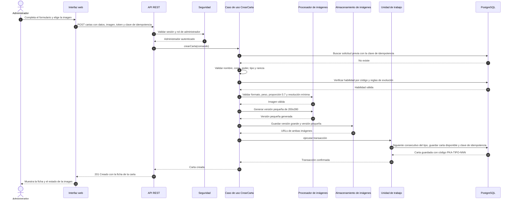
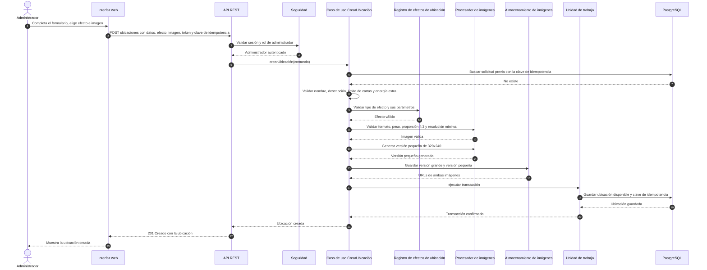
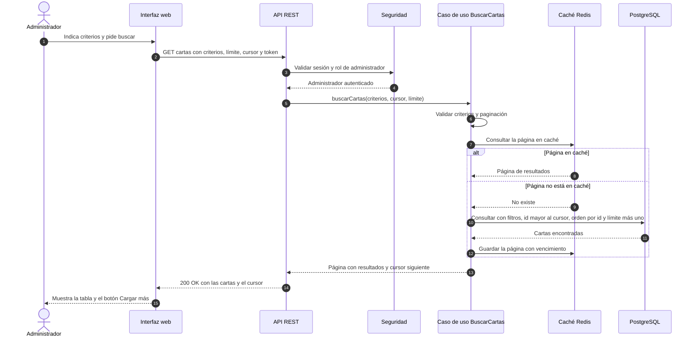
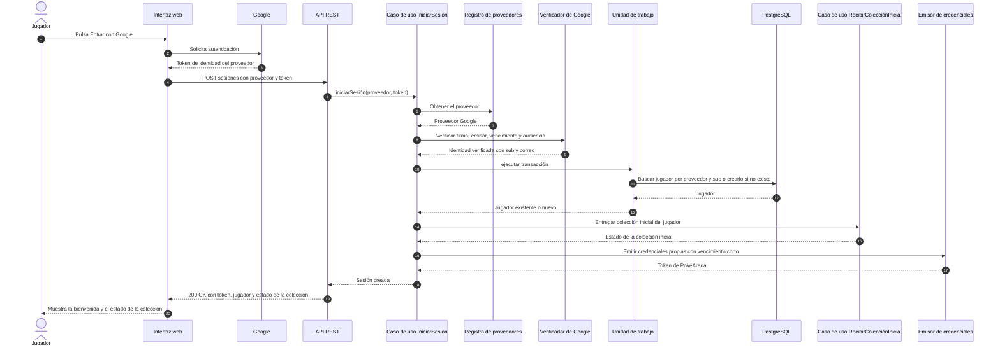
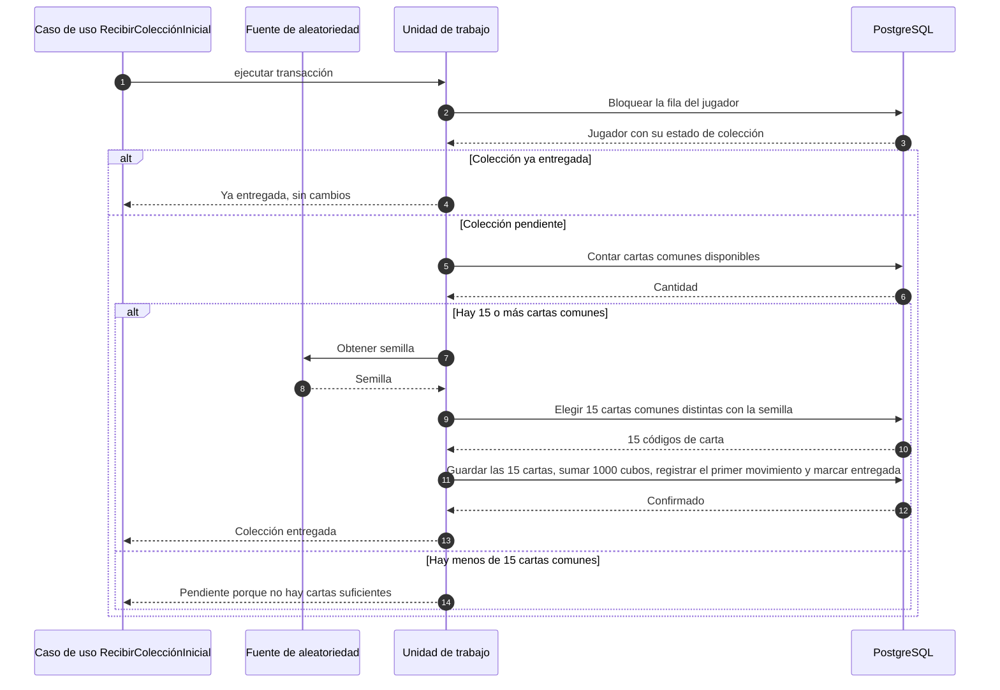
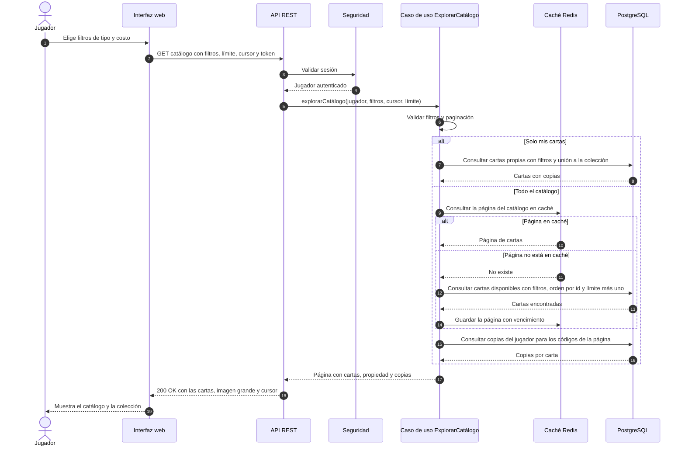

# Especificación de implementación v2: PokéArena (Sprint 1 refactorizado y Sprint 2)

Documento para el agente de IA que ayuda a construir y corregir el código. **Léelo completo antes de tocar código.** Es la fuente de verdad: si el código existente contradice este documento, gana este documento. Esta versión **reemplaza** a la anterior y también reemplaza las respuestas a las preguntas de la Fase 0 que la contradigan (en especial sobre la paginación de la búsqueda).

> **No tienes acceso a la wiki del equipo (Azure DevOps).** Todo lo necesario está aquí: diagramas de secuencia (Anexo A), decisiones de arquitectura (Anexo B) y criterios de aceptación completos de las seis historias (Anexo C). Si falta algo, pregunta; no lo supongas.

---

## 0. Cómo debes trabajar

1. **Una fase a la vez.** Al terminar cada fase entrega un resumen (qué cambiaste, qué pruebas agregaste, qué quedó pendiente) y espera la aprobación del equipo antes de seguir.
2. **No inventes requerimientos.** Si hay una ambigüedad, anótala y pregunta.
3. **Una sola lógica para todas las historias.** Las seis historias deben verse escritas por la misma persona: misma estructura de paquetes, mismo manejo de errores, misma autorización, misma idempotencia, mismo estilo de pruebas.
4. **Pasos pequeños.** Un cambio lógico por commit, con `.\mvnw.cmd clean verify` en verde en cada commit. **No hagas commit ni push** sin que el equipo lo pida. Nunca trabajes directo en `main`.
5. **El código debe poder defenderse en una oral individual.** Prefiere claridad sobre ingenio, comenta las decisiones y explica cada una al entregar.
6. **No uses Spring Security** ni frameworks que tomen decisiones de diseño de autenticación, llaves de API o multi-organización (restricción RES-01). Sí puedes usar una biblioteca que ejecute una decisión del equipo, por ejemplo verificar la firma de un JWT.
7. **Aplica los principios y patrones solo donde simplifiquen** (sección 4.4). Cada patrón que uses debe poder justificarse en una frase.
8. **Cero números mágicos.** Los valores como tamaños de página, límites, vencimientos, cantidades de reintentos y tamaños de miniatura van en constantes de dominio o en configuración (`application.properties`), con nombre.

---

## 1. Contexto

PokéArena es un juego de cartas Pokémon por turnos simultáneos, con ranking Elo, una moneda llamada cubos y una API de torneos para partners. El catálogo puede llegar a unas **10,000 cartas**.

**Alcance de esta entrega (seis historias):**

| Origen | Historia | Usuario |
|---|---|---|
| Sprint 1 (se rehace) | 2.1.1 Crear carta | Administrador |
| Sprint 1 (se rehace) | 2.2.1 Crear ubicación | Administrador |
| Sprint 1 (se rehace) | 2.1.2 Buscar carta | Administrador |
| Sprint 2 (nueva) | 1.1.1 Inicio de sesión con proveedor | Jugador |
| Sprint 2 (nueva) | 3.1.1 Recibir colección inicial | Jugador |
| Sprint 2 (nueva) | 3.1.2 Explorar el catálogo y mi colección | Jugador |

Además hay una historia artificial **"Refactory SP1"** que agrupa las tareas de corrección del Sprint 1.

---

## 2. Correcciones pedidas por el profesor (obligatorias)

Cada una debe verificarse en la lista final (sección 17).

| # | Corrección del profesor | Qué significa para el código |
|---|---|---|
| 1 | Debe haber **presentación** para las funcionalidades, o sea interfaz | Una interfaz web usable para las seis historias (sección 11) |
| 2 | Corregir los campos de **Crear ubicación** | Implementar todos los campos del criterio: nombre, descripción, imagen, efecto, límite de cartas y energía extra, con su validación |
| 3 | La capa de presentación hablaba de APIs y debe ser **interfaz** | La capa de presentación es la **interfaz de usuario**. La API REST es otra capa, aparte (sección 4.1) |
| 4 | En el diagrama de Crear carta falta la presentación **antes del POST** | La interfaz web es el primer participante de todos los diagramas (Anexo A) |
| 5 | En **Crear carta** solo se valida una parte de los campos | Validar nombre, costo, poder, tipo, rareza, habilidad e imagen, cada uno con su error tipado |
| 6 | **No se implementa el procesador de imágenes** | Componente explícito: puerto `ImageProcessor` (validar imagen y generar miniatura) y puerto `ImageStorage`, con sus implementaciones y pruebas |
| 7 | **Buscar carta funciona distinto a Crear carta** | Misma plantilla de caso de uso, errores, autorización y estilo de pruebas en todas las historias |
| 8 | Sacar `int pageSize = 50`; la **paginación está extraña** | Una sola estrategia de paginación para todo el sistema, configurable, sin valores fijos en el código (sección 5.5) |
| 9 | La tabla de drivers debe decir qué priorizar **para que funcione el diseño** | Fuera del alcance del código; solo se refleja en las decisiones de la sección 4 |

---

## 3. Stack

| Elemento | Tecnología |
|---|---|
| Lenguaje | **Java 21** |
| Framework web | Spring Boot (solo capa web; sin Spring Security) |
| Persistencia | PostgreSQL con **Flyway**; acceso con `JdbcTemplate` (quitar el starter de JPA, que no se usa) |
| Caché y estado compartido | Redis |
| Imágenes | Thumbnailator con tamaño forzado (exacto) y el plugin **TwelveMonkeys `imageio-webp`** para leer WebP |
| Identidad | Verificación del token del proveedor con una biblioteca JWT (por ejemplo `nimbus-jose-jwt`) más JWKS; credenciales propias firmadas con la misma biblioteca |
| Contrato de API | OpenAPI escrito a mano **antes** del código, validado con una prueba de contrato |
| Contenedores | Docker Compose, Nginx y 2 instancias de la API |
| Pruebas | JUnit 5, AssertJ, **Testcontainers** (PostgreSQL y Redis), ArchUnit, jqwik, y un servidor simulado del proveedor de identidad |
| CI | GitHub Actions |
| Interfaz | HTML, CSS y JavaScript sin frameworks, servida desde `static/` |

---

## 4. Arquitectura

### 4.1 Capas

Arquitectura en **capas** como monolito modular (ADR-001, Anexo B). Cinco capas, de afuera hacia adentro:

| Capa | Qué es | Dónde vive |
|---|---|---|
| **Presentación (interfaz web)** | Lo que ve y usa la persona: pantallas, formularios, resultados | `src/main/resources/static/` |
| **API** | Contrato HTTP: controladores, DTOs, seguridad, formato de errores | Paquete `api` |
| **Aplicación** | Casos de uso: orquestan, controlan la transacción y la idempotencia | Paquete `application` |
| **Dominio** | Modelo, reglas, plug-ins y **puertos** (interfaces) | Paquete `domain` |
| **Infraestructura** | Implementa los puertos: base de datos, Redis, imágenes, proveedor de identidad | Paquete `infrastructure` |

Se **conserva el paquete base** `cr.ac.tec.pokearena`:

```
cr.ac.tec.pokearena
├── api
│   ├── controller        CardController, LocationController, SessionController, CatalogController
│   ├── dto               solicitudes y respuestas HTTP
│   ├── error             ApiErrorHandler (UN solo manejador global) y ApiError
│   └── security          filtro de autenticación y control de rol
├── application
│   ├── usecase           un caso de uso por historia
│   ├── dto               comandos y resultados
│   └── port              puertos que necesitan los casos de uso
│                         (UnitOfWork, IdempotencyStore, ImageProcessor, ImageStorage,
│                          IdentityProvider, TokenIssuer, CatalogCache, RandomSource, Clock, ...)
├── domain
│   ├── model             Card, Location, Ability, Player, ...
│   ├── rule              EvolutionRules, validaciones de dominio
│   ├── effect            LocationEffectType, LocationEffectRegistry y los plug-ins
│   ├── error             DomainException y sus tipos
│   └── repository        puertos de persistencia (CardRepository, PlayerRepository, ...)
└── infrastructure
    ├── persistence       implementaciones JDBC y UnitOfWork transaccional
    ├── storage           procesador y almacenamiento de imágenes
    ├── cache             caché de catálogo en Redis
    ├── identity          verificador de tokens de Google y emisor de credenciales propias
    └── config            configuración de beans y propiedades
```

Todos los puertos de **persistencia** viven en `domain.repository`; los demás puertos, en `application.port`. No mezcles criterios.

### 4.2 Reglas de dependencia (se verifican con ArchUnit en CI)

1. `api` puede usar `application`. No puede usar `infrastructure` ni repositorios.
2. `application` puede usar `domain`. No puede usar `api` ni `infrastructure`.
3. `domain` **no depende de nada** salvo `java.*`. Prohibido en `domain`: Spring, Jakarta, JDBC, Redis, JSON, y las llamadas directas a `LocalDateTime.now()`, `Random` y `UUID.randomUUID()`.
4. `infrastructure` implementa los puertos definidos en `domain` y `application`.
5. El reloj y la aleatoriedad entran por puertos (`Clock`, `RandomSource`).
6. **Pruebas de arquitectura reales con ArchUnit** (las actuales revisan los `import` como texto): deben cubrir las reglas 1 a 5 y la ausencia de `now()`, `Random` y `UUID.randomUUID()` en `domain` y `application`.

### 4.3 Frontera transaccional

Los casos de uso **no usan anotaciones de Spring**. La transacción se controla con un puerto de la aplicación:

```java
public interface UnitOfWork {
    <T> T execute(Supplier<T> work);   // abre la transacción; revierte si hay excepción
}
```

La implementación (`infrastructure.persistence`) usa `TransactionTemplate`. Reglas: una transacción por caso de uso; nada de efectos externos (archivos, Redis) dentro de ella, salvo lo indicado en cada historia.

**Excepción documentada: reintentos de miniaturas (7.1).** `ThumbnailRetryUseCase` abre **una transacción por entidad** y, dentro de ella, con la fila bloqueada (`FOR UPDATE SKIP LOCKED`), **lee la versión grande y escribe la miniatura** en disco. Justificación: el bloqueo de la fila es justamente lo que impide que dos instancias de la API procesen la misma entidad a la vez; si los archivos se tocaran fuera de la transacción, el bloqueo ya se habría soltado y dos instancias podrían generar la misma miniatura. No hace falta compensar: si la transacción falla después de escribir `small.png`, la entidad sigue sin miniatura (su URL nunca se publicó) y el próximo intento reemplaza el archivo.

### 4.4 Principios y patrones (aplicar solo donde simplifiquen)

| Principio o patrón | Dónde aplicarlo | Por qué |
|---|---|---|
| **Responsabilidad única (SRP)** | Una clase por responsabilidad: validar, procesar imagen, persistir, orquestar | Fácil de probar y de explicar |
| **Inversión de dependencias (DIP)** y puertos y adaptadores | Los casos de uso dependen de interfaces; la infraestructura las implementa | Dominio y aplicación sin Spring |
| **Strategy y Registry** | `LocationEffectType` y su `LocationEffectRegistry`; `IdentityProvider` e `IdentityProviderRegistry` | Agregar un efecto o un proveedor sin modificar el caso de uso (abierto/cerrado) |
| **Repository** | `CardRepository`, `LocationRepository`, `PlayerRepository` | Aislar el acceso a datos |
| **Unit of Work** | `UnitOfWork` (4.3) | Fronteras transaccionales explícitas |
| **Cadena de validaciones** | Validadores pequeños y ordenados para imagen y campos | Reglas independientes y fáciles de probar |
| **Builder** | Criterios de búsqueda y de catálogo | Parámetros opcionales sin constructores enormes |
| **Plantilla de caso de uso** | Todos siguen el mismo esqueleto: autorizar, idempotencia, validar, ejecutar en `UnitOfWork`, responder | Resuelve "Buscar funciona distinto a Crear" |

Evita sobreingeniería: si un patrón no resuelve un problema concreto del código, no lo agregues.

### 4.5 Encabezados y comentarios (acuerdo de calidad del equipo)

Cada clase lleva un comentario inicial con su propósito y responsabilidades. Los casos de uso citan, **paso por paso**, el diagrama del Anexo A:

```java
/**
 * Propósito: caso de uso de la historia 2.1.1 "Crear carta".
 * Responsabilidades: orquestar validaciones, imagen, código único y persistencia.
 * Referencia: Anexo A.1.
 */
...
// Paso 5 del diagrama: validar costo, poder, tipo y rareza
```

---

## 5. Convenciones comunes

### 5.1 Rutas

| Operación | Método y ruta | Rol |
|---|---|---|
| Inicio de sesión | `POST /api/v1/sesiones` | Público |
| Crear carta | `POST /api/v1/cartas` (multipart/form-data) | Administrador |
| Buscar carta | `GET /api/v1/cartas` | Administrador |
| Crear ubicación | `POST /api/v1/ubicaciones` (multipart/form-data) | Administrador |
| Explorar catálogo y mi colección | `GET /api/v1/catalogo` | Jugador autenticado |
| Credenciales de prueba (solo perfil `dev`) | `POST /api/v1/dev/sesiones` | Público en `dev` |

Los identificadores de Java van en inglés; los mensajes al usuario, en español.

### 5.2 Autenticación y autorización (sin Spring Security)

- El flujo de entrada es el **inicio de sesión con proveedor** (sección 8.1). Tras él, **todas** las solicitudes se autorizan con credenciales propias de PokéArena (un JWT firmado por la aplicación), **nunca** con el token del proveedor.
- Un interceptor propio de Spring MVC (`AuthorizationInterceptor`, no un filtro de servlet, para que sus errores salgan por el manejador global en el formato único) lee `Authorization: Bearer <token>`. El token lleva `sub` (id del jugador), `role` (`PLAYER` o `ADMIN`) y vencimiento corto (propiedad `app.security.access-token-ttl`, por defecto 15 minutos). El secreto de firma viene de `APP_JWT_SECRET` (mínimo 32 bytes; sin él la aplicación no arranca).
- Sin token o token inválido o vencido: **401** `NOT_AUTHENTICATED`. Token válido sin el rol requerido: **403** `FORBIDDEN`. **Son errores distintos.**
- **Cada operación declara quién puede usarla**, en el método o en la clase del controlador (lo del método manda):
  - `@RequiresRole(...)` acepta **uno o varios roles**, en una lista explícita y **sin jerarquía** (ADMIN no incluye a PLAYER por sí solo). Las operaciones de administración (Crear carta, Crear ubicación, Buscar carta) usan `@RequiresRole(ADMIN)`. El catálogo del jugador (3.1.2) usa `@RequiresRole({PLAYER, ADMIN})`, porque un administrador también es jugador.
  - `@PublicRoute` marca una operación pública, como el inicio de sesión o `dev/sesiones`.
  - **Cerrado por defecto:** una operación de la aplicación sin ninguna de las dos se rechaza con **403** `FORBIDDEN` sin ejecutarse, y queda un aviso en el log. Una prueba recorre todas las operaciones registradas y falla si alguna no declara una de las dos (excepto el controlador de `/error`).
- **El rol de administrador se asigna por configuración**: la propiedad `app.admin.identities` es una lista de identidades `proveedor:sub` que reciben el rol `ADMIN`. Todo el resto recibe `PLAYER`. **El rol se recalcula en cada ingreso** y se actualiza en la base si cambió: la configuración es la fuente de verdad, así quien sale de la lista pierde el rol y quien entra lo recibe sin borrar su cuenta.
- **Limitación conocida:** el token se acepta durante toda su vigencia (15 minutos) sin consultar el estado del jugador. Por ejemplo, un cambio de rol se refleja en el siguiente ingreso, no en los tokens ya emitidos. Es aceptable en este sprint porque el vencimiento es corto y la desactivación de cuentas no está en el alcance; se documenta también en el ADR de almacenamiento.
- `POST /api/v1/dev/sesiones` emite credenciales de prueba para ADMIN o PLAYER, **solo con el perfil `dev`** (`@Profile("dev")`). Una prueba debe comprobar que con el perfil `prod` no existe (RNF-SEG-10).
- Las credenciales de prueba **pertenecen a jugadores reales**: `dev/sesiones` crea (o reutiliza) un jugador con proveedor `dev`, por la misma vía que el inicio de sesión (fila en `player` y en `player_identity`, sección 6). Así el `sub` del token siempre es un `player(id)` existente y los datos de prueba (colección, cubos, copias, claves de idempotencia) cumplen las mismas reglas y claves foráneas que los reales.

### 5.3 Formato único de errores (RNF-API-03)

Todas las respuestas de error usan este cuerpo, generado por **un único** `@RestControllerAdvice`:

```json
{
  "type": "INVALID_FIELD",
  "title": "Campo inválido",
  "status": 400,
  "detail": "El costo debe estar entre 0 y 10.",
  "field": "cost",
  "allowedValues": ["0..10"],
  "correlationId": "b3f1c9e0-..."
}
```

`field` y `allowedValues` aparecen cuando aplican. Tipos de error:

| `type` | `status` | Cuándo |
|---|---|---|
| `NOT_AUTHENTICATED` | 401 | Sin credenciales, inválidas o vencidas |
| `FORBIDDEN` | 403 | Autenticado sin el rol requerido |
| `INVALID_IDENTITY_TOKEN` | 401 | Token del proveedor no emitido por él, vencido, firma inválida o emitido para otra aplicación |
| `IDENTITY_PROVIDER_UNAVAILABLE` | 503 | El proveedor no responde; no se crea ninguna cuenta |
| `UNSUPPORTED_PROVIDER` | 400 | Proveedor no registrado |
| `INVALID_FIELD` | 400 | Valor fuera de rango o catálogo (con `field` y `allowedValues`) |
| `MISSING_FIELD` | 400 | Falta un campo obligatorio |
| `UNKNOWN_ABILITY` | 400 | Código de habilidad inexistente |
| `INVALID_EVOLUTION` | 400 | Evolución a sí misma o ciclo |
| `INVALID_IMAGE_FORMAT` | 400 | Formato no permitido |
| `IMAGE_TOO_LARGE` | 400 | Pesa más de 5 MB |
| `INVALID_IMAGE_RATIO` | 400 | Proporción incorrecta |
| `IMAGE_RESOLUTION_TOO_LOW` | 400 | Resolución menor a la mínima |
| `INVALID_EFFECT` | 400 | Tipo de efecto inexistente o parámetros inválidos |
| `INVALID_SEARCH_CRITERIA` | 400 | Criterio de búsqueda inválido |
| `INVALID_PAGINATION` | 400 | `limit` o `cursor` inválidos |
| `IDEMPOTENCY_KEY_REQUIRED` | 400 | Falta `Idempotency-Key` |
| `IDEMPOTENCY_KEY_REUSED` | 422 | Misma clave con contenido distinto |

**Tipos de protocolo.** Los tipos anteriores son de **dominio** (`domain.error.ErrorType`, los lanza una `DomainException`). Además, la **capa API** (`api.error`) define estos cinco tipos para errores que nacen en el protocolo HTTP y no en el dominio; no existen en `domain` y ningún caso de uso los lanza:

| `type` | `status` | Cuándo |
|---|---|---|
| `BAD_REQUEST` | 400 | La solicitud no se puede interpretar (por ejemplo, un cuerpo JSON mal formado) |
| `NOT_FOUND` | 404 | La ruta no existe |
| `METHOD_NOT_ALLOWED` | 405 | La ruta existe pero no admite ese método (la respuesta incluye el encabezado `Allow`) |
| `UNSUPPORTED_MEDIA_TYPE` | 415 | El cuerpo viene en un tipo de contenido que la ruta no acepta |
| `INTERNAL_ERROR` | 500 | Error inesperado: el detalle es un texto fijo y el mensaje interno solo queda en el log, con el `correlationId` |

Regla para las demás excepciones estándar de Spring sin tipo propio: **cualquier otro 4xx se informa como `BAD_REQUEST` (400) y cualquier 5xx como `INTERNAL_ERROR` (500)**, siempre con el mismo formato.

Nunca devuelvas un error genérico ni el mensaje de una excepción interna (el único error genérico permitido es `INTERNAL_ERROR`, y nunca revela su causa). Las excepciones de validación son `DomainException` tipadas, jamás `IllegalArgumentException`.

### 5.4 Idempotencia

- Los `POST` de creación (cartas y ubicaciones) exigen el encabezado `Idempotency-Key`. Falta o vacío: `IDEMPOTENCY_KEY_REQUIRED`. Se valida después de la autorización (7.1).
- El **largo máximo de la clave es configurable**: propiedad `app.idempotency.max-key-length`, por defecto **255** caracteres. Una clave más larga es `INVALID_FIELD` (campo `Idempotency-Key`, `allowedValues` `["1..255"]`).
- Tabla `idempotency_key(key, user_id, endpoint, request_hash, response_status, response_body, created_at)`, única en `(key, user_id, endpoint)`.
- Misma clave y mismo contenido: devuelve **la respuesta guardada**, sin crear nada ni consumir consecutivo.
- Misma clave con otro contenido: `IDEMPOTENCY_KEY_REUSED`.
- La clave se guarda **en la misma transacción** que la entidad creada.
- Dos solicitudes iguales y simultáneas producen **una sola** entidad y una sola respuesta correcta (no un 500). Una prueba de concurrencia lo comprueba.
- **Limitación conocida:** las claves guardadas **no vencen**, así que la tabla `idempotency_key` crece con el uso. Una tarea programada que borre las claves antiguas (por ejemplo, de más de 24 horas) queda como mejora futura; no se implementa en este sprint. Se documenta también en el ADR de almacenamiento.

### 5.5 Paginación única (reemplaza al diseño anterior de instantáneas)

Una **sola estrategia** para la búsqueda de administrador y el catálogo del jugador:

- Orden por `id` ascendente y **cursor por clave**: `WHERE id > :cursor ORDER BY id LIMIT :limit + 1`. El elemento `limit + 1` indica si hay más.
- `cursor` es opaco (el último `id` en base64url) y `nextCursor` es `null` en la última página.
- `limit`: tamaño por defecto y máximo vienen de configuración (`app.pagination.default-limit` = 20 y `app.pagination.max-limit` = 100). **Ninguna constante `50` ni similar en el código.**
- `limit` fuera de 1 a máximo, o `cursor` inválido: `INVALID_PAGINATION`.
- Respuesta: `{ "items": [...], "nextCursor": "..." | null, "limit": 20 }`. Sin `total` ni vencimientos.
- Se descartan las instantáneas (`card_search_*`), los cursores UUID, los 410 y 503 de la búsqueda, `total` y `expiresAt`.

### 5.6 Correlación y logs

Cada solicitud recibe un `correlationId` (de `X-Correlation-Id` o generado) que aparece en logs JSON y en los errores. No registres imágenes ni secretos.

---

## 6. Modelo de datos (Flyway, migración inicial V1)

Una **migración Flyway inicial** con todo el esquema y los datos semilla. Se eliminan `schema.sql`, `SearchSchemaMigration.java` y la migración `V039`. Tablas en **singular**. Los cambios posteriores van en migraciones nuevas, nunca editando una ya publicada: **V2** quita la clave foránea `ability.evolves_to_card_code -> card.code`, porque la regla de autoevolución compara el destino con el código que la carta va a recibir, que aún no existe (7.1, `EvolutionRules`). Toda entidad creada por un administrador lleva `version` (inicia en 1), `active` (true) y `created_at`, para poder editar y desactivar después sin rediseñar.

| Tabla | Campos principales |
|---|---|
| `card_type` | `code` (FUE, AGU, PLA, ELE, PSI, LUC), `name`. Semilla |
| `rarity` | `code` (`COMMON`, `UNCOMMON`, `RARE`, `LEGENDARY`), `name` (Común, Poco común, Rara, Legendaria). Semilla |
| `ability` | `code`, `name`, `trigger`, `effect_type`, `parameters` (jsonb), `limited_to_type` (nullable), `evolves_to_card_code` (nullable, **sin clave foránea** desde V2: puede apuntar a una carta que todavía no existe), `version`, `active`, `created_at` (la historia "Crear habilidad" está en el backlog: será una entidad de administrador). **Semilla obligatoria: `HAB-000`, nombre "Sin Habilidad"** |
| `card_type_counter` | `type_code` (PK), `last_number` |
| `card` | `id` (bigserial), `code` (único e inmutable, `PKA-<TIPO>-<NNN>` con **mínimo 3 dígitos y sin máximo**; CHECK `^PKA-(FUE\|AGU\|PLA\|ELE\|PSI\|LUC)-[0-9]{3,}$` desde V2), `name`, `name_normalized`, `cost`, `power`, `type_code`, `rarity_code`, `ability_code`, `image_large_url`, `image_small_url`, `image_status` (`READY`, `PENDING_RETRY`, `FAILED`), `retry_count`, `available`, `version`, `active`, `created_at` |
| `location` | `id`, `name`, `description`, `effect_type` (nullable), `effect_parameters` (jsonb), `card_limit` (0 a 5), `extra_energy_mode` (`NONE`, `FIXED`, `PER_CARD`), `extra_energy_amount`, `image_large_url`, `image_small_url`, `image_status` (`READY`, `PENDING_RETRY`, `FAILED`), `retry_count`, `available`, `version`, `active`, `created_at` |
| `player` | `id` (uuid), `display_name` (nullable), `email` (nullable), `role` (`PLAYER`, `ADMIN`), `elo` (inicia en 0), `cube_balance` (CHECK ≥ 0), `initial_collection_status` (`PENDING`, `DELIVERED`), `created_at` |
| `player_identity` | `provider` (`google`, y `dev` para las credenciales de prueba), `provider_subject`, `player_id`. **Única en `(provider, provider_subject)`** |
| `player_card` | `player_id`, `card_code`, `copies` (CHECK > 0). Clave `(player_id, card_code)` |
| `cube_movement` | `id`, `player_id`, `amount`, `reason` (`INITIAL_GRANT`, ...), `created_at`. Invariante: `cube_balance` = suma de movimientos |
| `idempotency_key` | ver 5.4. `user_id` es clave foránea hacia `player(id)` |

**Reglas del modelo**
- La identidad del jugador es `(provider, provider_subject)`, **nunca el correo** (el correo puede cambiar en el proveedor). Un segundo proveedor futuro solo agrega filas a `player_identity`.
- `display_name` y `email` admiten nulo porque Google no siempre los envía. El dominio usa un nombre de respaldo (por ejemplo "Jugador" más un sufijo corto del identificador).
- **Las credenciales de prueba (`dev/sesiones`) crean jugadores reales** con proveedor `dev`, por la misma vía que el inicio de sesión (fila en `player` y en `player_identity`). Así los datos de prueba (colección, cubos, copias, claves de idempotencia) son consistentes con los reales y cumplen las mismas claves foráneas.
- `image_status`: `READY` (ambas versiones existen), `PENDING_RETRY` (falló la miniatura y quedan reintentos) y `FAILED` (se agotaron los reintentos). Solo con `READY` la entidad puede estar disponible (`available = true`).
- `name_normalized` (minúsculas, sin tildes) lo calcula el **dominio** al crear la carta, no una función SQL.
- Índices de `card`: `code` único, `type_code`, `rarity_code`, `ability_code`, `cost`, `power` y `name_normalized` con índice trigram (`pg_trgm`, GIN). Índice en `player_card(player_id)`.
- Las imágenes se guardan como **URLs** públicas relativas (por ejemplo `/images/cards/<id>/large.png`), no rutas de disco.

---

## 7. Casos de uso del Sprint 1 (se rehacen; siguen el Anexo A paso por paso)

Misma plantilla en todos: autorizar → idempotencia → validar → ejecutar en `UnitOfWork` → responder. **Todas las validaciones (pasos de validación) ocurren antes de guardar nada**: una solicitud inválida no deja archivos ni filas.

### 7.1 Crear carta (2.1.1): `CreateCardUseCase`, Anexo A.1

| Paso | Qué hace | Error |
|---|---|---|
| 1 | La interfaz envía `POST /api/v1/cartas` con datos, imagen, token y `Idempotency-Key` | |
| 2 | Seguridad: sesión y rol de administrador. Va **antes** de cualquier otra validación, incluida la del encabezado | 401 / 403 |
| 3 | El controlador valida el encabezado `Idempotency-Key` (presente, no vacío y dentro del largo máximo, ver 5.4) y llama al caso de uso | `IDEMPOTENCY_KEY_REQUIRED` / `INVALID_FIELD` |
| 4 | Busca una solicitud previa con la clave. Mismo contenido: devuelve la respuesta guardada | `IDEMPOTENCY_KEY_REUSED` |
| 5 | Valida **todos** los campos: nombre no vacío, costo entero de 0 a 10, poder entero de -20 a 20, tipo y rareza existentes | `INVALID_FIELD` / `MISSING_FIELD` (con `field` y `allowedValues`) |
| 6 | Valida la habilidad: obligatoria y código existente (activa). Las reglas de evolución se aplican en el paso 10, ver `EvolutionRules` | `MISSING_FIELD`, `UNKNOWN_ABILITY` |
| 7 | Valida la imagen (`ImageProcessor`): formato real PNG, JPG o WebP detectado por contenido, máximo 5 MB, proporción 5:7 (tolerancia 1%), mínimo 600 × 840 | errores de imagen |
| 8 | Genera la versión pequeña **200 × 280 exactos** (síncrono) | ver "Si falla la miniatura" |
| 9 | Guarda ambas versiones (`ImageStorage`) | error interno controlado |
| 10 | `UnitOfWork`: siguiente consecutivo del tipo, aplica `EvolutionRules` con ese código, guarda la carta disponible y guarda la clave | `INVALID_EVOLUTION`; cualquier falla revierte todo y borra los archivos |
| 11 | Responde **201** con la ficha | |

- **Orden de los errores de entrada:** primero se autentica y se autoriza, y después se valida el encabezado. Una solicitud sin credenciales recibe **401** `NOT_AUTHENTICATED` aunque además le falte `Idempotency-Key`, y una con credenciales sin el rol recibe **403**: a quien no puede usar la operación no se le informa nada más de ella. Solo una solicitud autorizada sin la clave recibe `IDEMPOTENCY_KEY_REQUIRED`.
- **Código único `PKA-<TIPO>-<NNN>`** (consecutivo por tipo con **mínimo 3 dígitos**, rellenos con ceros, y **sin máximo**: `PKA-FUE-001` … `PKA-FUE-999`, `PKA-FUE-1000`). El consecutivo se obtiene **dentro** de la transacción del paso 10 con una sentencia atómica (`UPDATE card_type_counter SET last_number = last_number + 1 WHERE type_code = ? RETURNING last_number`), así no se consume si la transacción revierte. Sin máximo porque el catálogo puede llegar a unas 10.000 cartas y, con un tope de 999 por tipo, solo cabrían 5.994 entre los 6 tipos (decisión del equipo; el criterio C.1 dice "3 dígitos", que se interpreta como el mínimo). Como el texto del código no ordena bien con más de 3 dígitos (`"1000" < "999"`), el orden siempre se toma del `id` (5.5), nunca del código.
- **Multipart diferido:** `spring.servlet.multipart.resolve-lazily=true`. El cuerpo se lee recién cuando el controlador pide sus campos, después del interceptor de autorización: un archivo de más de 5 MB sin token recibe **401**, con token de jugador **403**, y solo con token de administrador **400** `IMAGE_TOO_LARGE`.
- **Ficha de respuesta:** código, nombre, costo, poder, tipo, rareza, imágenes grande y pequeña, estado de imagen, disponibilidad y la habilidad con su nombre, su código y, si está limitada a un tipo, a cuál afecta.
- **Si falla la miniatura:** la carta se guarda con `available = false` e `image_status = PENDING_RETRY`. Una tarea programada reintenta (máximo configurable, `app.images.max-retries` = 3) e incrementa `retry_count` en cada intento; al lograrlo pasa a `READY` y disponible. Si llega al máximo sin lograrlo, pasa a `FAILED` y **sigue no disponible**; la tarea ya no la reintenta. El administrador ve el estado (`PENDING_RETRY` o `FAILED`) en la ficha y en la búsqueda. Lo mismo aplica a las ubicaciones (7.2).
- **Operaciones de la tarea de reintentos:** volver a generar la miniatura necesita **leer la versión grande ya guardada** y **guardar solo la miniatura** en la carpeta de la entidad: `ImageStorage.readLarge(largeUrl)` y `ImageStorage.saveThumbnail(largeUrl, miniatura)`.
- **Tarea de reintentos (`ThumbnailRetryJob` y `ThumbnailRetryUseCase`):**
  - Corre cada **`app.images.retry-interval`** (por defecto `PT1M`, 1 minuto), contado desde que termina la ejecución anterior (`fixedDelay`), así dos ejecuciones de la misma instancia no se solapan. La primera espera también un intervalo, para no competir con el arranque.
  - **Un intento por entidad y ejecución:** cada ejecución recorre las cartas y luego las ubicaciones en `PENDING_RETRY` con `retry_count` menor que `app.images.max-retries`, en orden de `id`, y hace **un solo** intento por entidad. Una entidad que sigue pendiente se vuelve a intentar en la ejecución siguiente, no en un bucle inmediato.
  - Cada intento suma 1 a `retry_count`. Si se logra, `READY`, disponible y con la URL de la miniatura; si falla y `retry_count` llega al máximo, `FAILED` y no disponible; si falta la versión grande en disco, `FAILED` de inmediato (ningún intento futuro podría lograrlo) con un aviso en el log.
  - **Concurrencia:** una transacción por entidad, que la selecciona con `FOR UPDATE SKIP LOCKED`; otra instancia que corre a la vez salta esa fila y toma la siguiente. Leer y escribir los archivos con la fila bloqueada es una excepción a la regla de 4.3, justificada allí.
- **Si el paso 10 falla** después de guardar los archivos, se **borran** esos archivos como compensación (los archivos y la base no comparten transacción).
- **Exceso de dimensiones (paso 7):** antes de decodificar, el procesador lee el ancho y el alto del encabezado; si su producto supera `app.images.max-pixels` (por defecto 16 000 000), la imagen se rechaza con **`IMAGE_TOO_LARGE`**, el mismo tipo que el exceso de peso pero con **otro mensaje** ("las dimensiones de la imagen superan el máximo permitido"). Evita que un archivo pequeño que declara dimensiones enormes agote la memoria al decodificarse; solo lo alcanzan imágenes absurdas. Lo mismo aplica a las ubicaciones (7.2).
- **`EvolutionRules`** (servicio de dominio en `domain.rule`, con pruebas unitarias propias): rechaza una evolución a la misma carta y los ciclos (A evoluciona a B y B, directa o indirectamente, a A). **Decisión del equipo sobre cómo se dispara en la creación:** `CreateCardUseCase` la aplica **dentro** de la transacción del paso 10, después de obtener el código que recibirá la carta y antes de guardarla. Si la habilidad evoluciona hacia ese mismo código, o la cadena de evoluciones de su destino vuelve a él, lanza `INVALID_EVOLUTION`; la transacción se revierte (el consecutivo no se consume) y se borran los archivos del paso 9. Por eso una habilidad puede apuntar a una carta que todavía no existe (migración V2, sección 6).

### 7.2 Crear ubicación (2.2.1): `CreateLocationUseCase`, Anexo A.2

Mismos pasos 1 a 4, 9, 10 y 11, en el mismo orden: la seguridad (paso 2) va antes de validar `Idempotency-Key` (paso 3), así una solicitud sin credenciales recibe 401 aunque falte la clave. Cambian estos:

| Paso | Qué hace | Error |
|---|---|---|
| 5 | Valida nombre y descripción no vacíos; límite de cartas entero de 0 a 5; energía extra: `NONE` (monto 0), `FIXED` (0 a 3) o `PER_CARD` (0 a 2), ver "Energía extra" | `INVALID_FIELD` / `MISSING_FIELD` (con `field` y `allowedValues`) |
| 6 | `LocationEffectRegistry` valida el tipo de efecto y sus parámetros (el efecto es opcional) | `INVALID_EFFECT` |
| 7 | Imagen: formato real PNG, JPG o WebP, máximo 5 MB, proporción 4:3 (tolerancia 1%), mínimo 800 × 600 | errores de imagen |
| 8 | Versión pequeña **320 × 240 exactos**; mismo manejo de fallo que en cartas | |
| 10 | `UnitOfWork`: guarda la ubicación disponible y la clave | |

**Plug-ins de efecto** (interfaz `LocationEffectType` con `code()` y `validate(Map<String,Object>)`):

| Código | Parámetros | Validación |
|---|---|---|
| `TYPE_BONUS` | `type`, `amount` | El tipo existe; monto entero de -5 a +5 |
| `COST_MODIFIER` | `amount`, `affectedType` (opcional) | Monto entero de -5 a +5; si hay tipo, existe |
| `TURN_RESTRICTION` | `turns` | Lista no vacía de enteros de 1 a 6 sin repetidos |

**Formato del campo `effect`.** El efecto llega en el multipart como **un campo de texto con JSON**, con esta forma:

```json
{ "code": "TYPE_BONUS" | "COST_MODIFIER" | "TURN_RESTRICTION", "parameters": { ... } }
```

| `code` | `parameters` | Ejemplo |
|---|---|---|
| `TYPE_BONUS` | `type` (código de tipo existente, obligatorio), `amount` (entero de -5 a +5, obligatorio) | `{"code": "TYPE_BONUS", "parameters": {"type": "FUE", "amount": 3}}` |
| `COST_MODIFIER` | `amount` (entero de -5 a +5, obligatorio), `affectedType` (código de tipo existente, opcional) | `{"code": "COST_MODIFIER", "parameters": {"amount": -2, "affectedType": "AGU"}}` |
| `TURN_RESTRICTION` | `turns` (lista no vacía de enteros de 1 a 6, sin repetidos, obligatoria) | `{"code": "TURN_RESTRICTION", "parameters": {"turns": [1, 3, 6]}}` |

- **El efecto es opcional:** sin el campo `effect` (o vacío) la ubicación no tiene efecto. Unos `parameters` sin `code` se rechazan.
- **Solo se aceptan las claves `code` y `parameters`**, y dentro de `parameters` solo los del tipo de efecto: **cualquier parámetro desconocido se rechaza** (por ejemplo `amout` en vez de `amount`), para detectar errores de escritura.
- Los montos y turnos deben ser **números enteros** en el JSON: un número con decimales (`3.5`, o incluso `3.0`) o un texto (`"3"`) se rechaza.
- Un texto que no es un JSON con esta forma, un `code` inexistente o unos parámetros inválidos son **`INVALID_EFFECT`** sobre el campo `effect`; con un `code` inexistente, `allowedValues` lista los tipos registrados.
- El JSON se interpreta en el **paso 6** del caso de uso (puerto `EffectReader`), no en el controlador, para respetar el orden de los errores: un efecto mal escrito se informa después de los campos del paso 5.

**Energía extra.** La modalidad (`extraEnergyMode`) es **obligatoria**: su ausencia es `MISSING_FIELD`, nunca se interpreta como `NONE` (una ausencia silenciosa ocultaría errores del cliente).
- Con `NONE` el monto (`extraEnergyAmount`) **puede omitirse** y vale 0; cualquier otro valor es `INVALID_FIELD` con `allowedValues` `["0"]`.
- Con `FIXED` (0 a 3) o `PER_CARD` (0 a 2) el monto es **obligatorio** (`MISSING_FIELD` si falta) e `INVALID_FIELD` fuera de su rango, con el rango de la modalidad en `allowedValues`.
- Una modalidad inexistente es `INVALID_FIELD` con `allowedValues` `["NONE", "FIXED", "PER_CARD"]`.
- La **interfaz web** (sección 11) muestra `NONE` como opción **seleccionada por defecto**, así el usuario no tiene que elegirla y la API sigue recibiendo siempre una modalidad explícita.

Crear una ubicación solo agrega una fila disponible para partidas **nuevas**; no toca otras tablas.

### 7.3 Buscar carta (2.1.2): `SearchCardsUseCase`, Anexo A.3

`GET /api/v1/cartas`, con todos los parámetros opcionales y combinables con AND:

| Parámetro | Significado |
|---|---|
| `code` | Código exacto |
| `name` | Coincidencia parcial sin mayúsculas ni tildes (escapar `%` y `_`) |
| `cost`, `costMin`, `costMax` | Valor exacto o rango |
| `power`, `powerMin`, `powerMax` | Valor exacto o rango |
| `type`, `rarity` | Códigos de tipo y rareza |
| `ability` | Código de habilidad (incluye `HAB-000`) |
| `abilityTrigger`, `abilityEffect` | Disparador y efecto |
| `limit`, `cursor` | Paginación (5.5) |

- Parámetro desconocido, o valor exacto combinado con rango del mismo campo: `INVALID_SEARCH_CRITERIA`. Tipo o rareza inexistentes, valores fuera de rango, mínimo mayor que máximo: `INVALID_SEARCH_CRITERIA` con el criterio.
- **Sin resultados = 200 con lista vacía.** Sin criterios recorre todo el catálogo con la misma paginación.
- El administrador ve **todas** las cartas, también las no disponibles. Cada resultado incluye código, nombre, imágenes, **estado de imagen**, costo, poder, tipo, rareza, disponibilidad y habilidad con sus parámetros.
- "Todas" incluye también las cartas **desactivadas** (`active = false`): la búsqueda del administrador no filtra por `available` ni por `active`. Solo el catálogo del jugador (8.3) se limita a las disponibles y activas.
- **Habilidad inexistente:** un `ability` que no coincide con ninguna habilidad responde **200 con lista vacía**, no un error. Las habilidades no son un catálogo cerrado como tipo y rareza (que sí se rechazan con `INVALID_SEARCH_CRITERIA` y sus `allowedValues`); un código que no coincide es simplemente una búsqueda sin resultados. Lo mismo vale para `code`, `abilityTrigger` y `abilityEffect`.
- **Cursor:** solo se acepta la **forma exacta** que genera el servidor (el último `id` en decimal, sin signo ni ceros a la izquierda, en base64url sin relleno). Otro texto, aunque represente el mismo número (por ejemplo `+5`, `05` o con relleno `=`), es `INVALID_PAGINATION`; así cada posición tiene un solo cursor.
- Usa la caché del catálogo (sección 9) y la misma paginación que el catálogo del jugador. La **clave de caché se arma con los criterios ya validados y normalizados**, no con el texto de la solicitud: búsquedas equivalentes comparten página, por ejemplo `name=DRAGÓN` y `name=dragon`, o `cost=3` y `costMin=3&costMax=3`.

---

## 8. Casos de uso del Sprint 2 (nuevos)

### 8.1 Inicio de sesión con proveedor (1.1.1): `LoginWithProviderUseCase`, Anexo A.4

`POST /api/v1/sesiones` con `{ "provider": "google", "idToken": "..." }`.

| Paso | Qué hace | Error |
|---|---|---|
| 1 | La interfaz obtiene el token del proveedor y lo envía | |
| 2 | `IdentityProviderRegistry` busca el proveedor por nombre | `UNSUPPORTED_PROVIDER` |
| 3 | El verificador valida **firma** (con las llaves públicas del proveedor), **emisor**, **vencimiento** y **audiencia** (debe ser el `client id` configurado en `app.identity.google.client-id`) | `INVALID_IDENTITY_TOKEN` |
| 4 | Obtiene la identidad verificada: `proveedor`, `sub`, correo, nombre | |
| 5 | `UnitOfWork`: busca el jugador por `(proveedor, sub)`; si no existe lo crea con rol `PLAYER` (o `ADMIN` si la identidad está en `app.admin.identities`), `elo` 0 y `initial_collection_status` `PENDING`. La unicidad la garantiza la restricción de la base: `INSERT ... ON CONFLICT DO NOTHING` y luego leer | |
| 6 | Invoca la entrega de la colección inicial (8.2) | no bloquea el ingreso |
| 7 | Emite las credenciales propias (JWT con vencimiento corto) | |
| 8 | Responde **200** con `{ accessToken, expiresIn, player, firstLogin, initialCollection }` donde `initialCollection` es `DELIVERED`, `ALREADY_DELIVERED`, `PENDING_NO_CARDS` o `PENDING_ERROR`, con un mensaje descriptivo cuando está pendiente | |

- Si el proveedor no responde al obtener sus llaves: **503** `IDENTITY_PROVIDER_UNAVAILABLE` y **no se crea nada** (la verificación ocurre antes del paso 5).
- Las llaves públicas del proveedor se guardan en memoria respetando su vencimiento; un token con una llave desconocida fuerza una recarga una sola vez.
- **Alternos:** dos inicios simultáneos de una identidad nueva crean **exactamente una** cuenta; un cambio de correo en el proveedor no crea otra cuenta (se identifica por `sub`); un proveedor nuevo se agrega implementando `IdentityProvider` y registrándolo, **sin tocar la autorización de la API**.
- Pruebas con un proveedor simulado: llaves RSA generadas en la prueba y un servidor local que sirve el JWKS.

### 8.2 Recibir colección inicial (3.1.1): `DeliverInitialCollectionUseCase`, Anexo A.5

Se ejecuta durante el inicio de sesión (paso 6) y es idempotente.

| Paso | Qué hace |
|---|---|
| 1 | `UnitOfWork`: bloquea la fila del jugador (`SELECT ... FOR UPDATE`) |
| 2 | Si `initial_collection_status` ya es `DELIVERED`: termina sin hacer nada (`ALREADY_DELIVERED`) |
| 3 | Cuenta las cartas **Comunes** disponibles y activas. Si hay menos de 15: confirma la transacción **sin entrega** y devuelve `PENDING_NO_CARDS` (la cuenta existe, sin colección ni cubos) |
| 4 | Elige **15 cartas distintas** Comunes al azar **en el servidor**, usando `RandomSource` (puerto) para poder probar con una semilla fija. Ningún dato del cliente influye |
| 5 | Inserta las 15 filas en `player_card` (1 copia cada una) |
| 6 | Suma **1,000 cubos** (constante configurable `app.collection.initial-cubes`) a `cube_balance` y registra el movimiento `INITIAL_GRANT` como el **primer** movimiento del historial |
| 7 | Marca `initial_collection_status = DELIVERED` y confirma |

- **Todo o nada:** cartas, cubos, movimiento y marca van en **una sola transacción**. Si algo falla, no queda entrega parcial y el resultado es `PENDING_ERROR`; el siguiente ingreso reintenta.
- **Exactamente una vez:** el bloqueo de fila garantiza que dos primeros ingresos simultáneos entreguen una sola vez, y los ingresos posteriores no vuelven a entregar.
- Con la colección recibida debe ser posible armar un mazo válido de 12 cartas (15 distintas ≥ 12).
- El selector de cartas debe funcionar con un catálogo de 10,000 cartas sin cargarlas todas en memoria.

### 8.3 Explorar el catálogo y mi colección (3.1.2): `ExploreCatalogUseCase`, Anexo A.6

`GET /api/v1/catalogo` (cualquier jugador autenticado).

| Parámetro | Significado |
|---|---|
| `type` | Código de tipo |
| `costMin`, `costMax` | Rango de costo (0 a 10) |
| `owned` | `true` para ver solo las cartas propias |
| `limit`, `cursor` | Paginación (5.5) |

- Los filtros se combinan con AND. Solo se listan cartas **disponibles y activas**.
- Cada carta trae: código, nombre, **imagen grande**, costo, poder, tipo, rareza, habilidad (código y nombre), `owned` (booleano) y `copies` (entero).
- Tipo inexistente, costo fuera de rango o mínimo mayor que máximo: `INVALID_FIELD` indicando `allowedValues`. `limit` o `cursor` inválidos: `INVALID_PAGINATION`. Una combinación sin resultados devuelve **200 con lista vacía**.
- **Cómo se resuelve** (decisión del equipo): la página del catálogo (que **no depende del jugador**) se obtiene de la caché compartida o de la base; luego, **sin caché**, se consulta `player_card` para los códigos de esa página y se combina. Con `owned=true` se consulta la base con unión a `player_card` (sin caché), porque depende del jugador.
- Una carta recién creada puede tardar algunos segundos en aparecer.

---

## 9. Almacenamiento, transacciones y caché (decisiones)

Estas decisiones se documentan en dos ADRs en la wiki; el código debe respetarlas.

**Almacenamiento**
- **PostgreSQL es la única fuente de verdad** de todos los datos del juego. Redis nunca es la única copia de un dato.
- **Redis:** caché del catálogo y de la búsqueda; los contadores del límite de solicitudes y la revocación de llaves quedan para sprints posteriores. Perder Redis no pierde datos ni rompe la funcionalidad: se consulta la base.
- **Imágenes:** en el sistema de archivos mediante `ImageStorage` (un volumen compartido por las 2 instancias), detrás de un puerto para poder cambiarlo por un almacenamiento en la nube sin tocar los casos de uso. Cada entidad usa una carpeta nueva con nombre UUID, así el contenido de una URL nunca cambia y el navegador puede cachearla un año como inmutable (`Cache-Control: public, max-age=31536000, immutable`).
- **Limitación conocida (archivos huérfanos):** hoy solo hay **compensación inmediata**: si la transacción falla después de guardar los archivos, se borran en ese momento. Pueden quedar archivos sin entidad si el proceso se detiene entre guardar y compensar, o si el borrado falla. Una **limpieza periódica** de huérfanos (ADR-002) queda como **mejora futura**; no se implementa en este sprint. Se documenta en el ADR de almacenamiento y en la actualización de ADR-002.

**Transacciones**
- Una transacción por caso de uso, mediante `UnitOfWork`. Nivel de aislamiento por defecto (READ COMMITTED) más **restricciones de unicidad y bloqueos de fila explícitos** donde se necesita "exactamente una vez" (consecutivo de código, creación de cuenta, entrega de colección, idempotencia).
- Operaciones que mezclan archivos y base: se guardan los archivos antes, y si la transacción falla se **compensa** borrándolos.
- Invariantes que deben tener prueba: no hay códigos de carta repetidos; una identidad tiene una sola cuenta; la colección inicial se entrega una sola vez; `cube_balance` = suma de `cube_movement`; `cube_balance` nunca es negativo.

**Política de caché (cache-aside)**
- **Qué se cachea:** las páginas del catálogo y de la búsqueda de administrador, **sin datos del jugador**. Nunca se cachea la propiedad de las cartas.
- **Clave:** `catalog:v<versión>:<espacio>:<hash de filtros>:<cursor>:<limit>`, donde `<espacio>` separa catálogo de jugador y búsqueda de administrador (ven datos distintos).
- **Invalidación:** una clave `catalog:version` que se incrementa al crear o cambiar una carta; las claves viejas quedan huérfanas y expiran solas por su vencimiento.
- **Vencimiento (TTL):** `app.cache.catalog-ttl` = 30 segundos, configurable.
- **Pendiente para la tarea de Redis:** hoy el puerto `CatalogCache` solo tiene obtener y guardar una página, y su implementación (`NoCatalogCache`) no guarda nada, que es el mismo comportamiento exigido cuando Redis falla. La tarea de Redis agrega la operación **`invalidate()`** al puerto (incrementa `catalog:version`) y la propiedad **`app.cache.catalog-ttl`**, y debe **llamar a `invalidate()` desde Crear carta** (y desde toda operación futura que cambie una carta) después de confirmar la transacción.
- **Memoria:** Redis con `maxmemory` y política `allkeys-lru`.
- **Falla de Redis:** se ignora la caché y se consulta la base (nunca error).
- **Protección contra avalancha:** un bloqueo corto por clave al recalcular una página muy pedida (opcional, solo si hay tiempo).

---

## 10. OpenAPI primero

Un único contrato `src/main/resources/openapi/pokearena.yaml`, escrito **antes** del código de cada operación, con las seis historias, los parámetros, los esquemas de respuesta y el esquema de error de 5.3. Una prueba de contrato verifica que las rutas, métodos y parámetros del contrato existen en la aplicación. En CI, `oasdiff` compara contra `main`.

---

## 11. Interfaz web (presentación)

Una sola aplicación en `src/main/resources/static/` (`index.html`, `app.js`, `styles.css`), sin frameworks, servida por la misma API en `http://localhost:8080`. Habla con la API real, no con datos falsos.

**Estructura**
- **Pantalla de ingreso:** botón "Entrar con Google" (Google Identity Services, con el `client id` leído de un endpoint de configuración). Solo con el perfil `dev`, también botones "Entrar como administrador de prueba" y "Entrar como jugador de prueba".
- **Vista de administrador:** pestañas **Crear carta**, **Crear ubicación** y **Buscar carta**, con los formularios y la tabla de resultados con miniatura y estado de imagen y "Cargar más".
- **Vista de jugador:** panel de bienvenida con el resultado de la colección inicial (mensaje claro si está pendiente) y la vista **Catálogo y mi colección** con filtros de tipo y costo, la casilla "solo mis cartas", la imagen grande de cada carta y las copias.
- **Panel de respuesta** en cada operación: método, ruta, **código HTTP con color**, el JSON, el `correlationId` y las imágenes en vista previa.
- **Imagen de reemplazo:** si la URL de una imagen no carga (por ejemplo, las cartas de `scripts/seed-10000-cartas.sql`, cuyas URLs no tienen archivo detrás), la interfaz muestra una imagen de reemplazo en lugar de una imagen rota. Para las demostraciones se crean unas 10 cartas reales desde la interfaz.

**Casos de prueba rápidos** (botones que rellenan y envían, con imágenes generadas con `canvas` en el tamaño exacto):

| Botón | Resultado esperado |
|---|---|
| Carta válida (600 × 840) | 201 |
| Costo 11, sin habilidad, habilidad inexistente | 400 `INVALID_FIELD`, `MISSING_FIELD`, `UNKNOWN_ABILITY` |
| Imagen 600 × 600, 300 × 420, mayor a 5 MB, archivo de texto como .png | `INVALID_IMAGE_RATIO`, `IMAGE_RESOLUTION_TOO_LOW`, `IMAGE_TOO_LARGE`, `INVALID_IMAGE_FORMAT` |
| Reintento con la misma clave | Misma respuesta, sin carta nueva |
| Sin sesión / como jugador en una operación de administrador | 401 / 403 |
| Ubicación válida (800 × 600), límite 6, efecto inexistente | 201, `INVALID_FIELD`, `INVALID_EFFECT` |
| Búsqueda sin resultados, rango invertido | 200 vacío, `INVALID_SEARCH_CRITERIA` |
| Inicio de sesión con token inválido o de otra aplicación | 401 `INVALID_IDENTITY_TOKEN` |
| Catálogo con tipo inexistente, `limit` 0 | 400 con valores permitidos, `INVALID_PAGINATION` |
| Segundo ingreso del jugador | `ALREADY_DELIVERED`, sin cartas nuevas |

La claridad de cómo se prueban las historias importa más que la estética.

---

## 12. Despliegue local

`docker compose up` levanta todo con **un solo comando**: `postgres` (con healthcheck y volumen), `redis`, `api` con **2 instancias** sin estado, `nginx` como balanceador en el puerto 8080 y un volumen compartido para las imágenes. Toda la configuración (conexiones, `APP_JWT_SECRET`, `client id`, perfil) por variables de entorno; ningún secreto en el repositorio.

---

## 13. Pruebas obligatorias

Una prueba por **cada criterio de aceptación** (Anexo C), con `@DisplayName` en español que lo cite, y la misma estructura en las seis historias.

| Nivel | Qué cubre |
|---|---|
| Unitarias (dominio y aplicación, sin Spring) | Validaciones de campos; código de carta; `EvolutionRules`; cada plug-in de efecto; registro de efectos y de proveedores (agregar uno de prueba **sin modificar** el caso de uso); selección de 15 cartas con semilla fija |
| Integración (Testcontainers: PostgreSQL y Redis) | Las seis historias de punta a punta; cada error con su `status` y `type`; 401 contra 403; una solicitud inválida no deja archivos ni filas |
| Idempotencia | Reintento: una sola carta y un solo consecutivo; misma clave con otro contenido |
| Concurrencia | 20 hilos creando cartas del mismo tipo (códigos distintos y consecutivos); dos solicitudes iguales a la vez; **dos inicios simultáneos de una identidad nueva: una cuenta**; **dos primeros ingresos: una sola entrega** |
| Imágenes | Tamaño exacto de las miniaturas; fallo simulado: carta no disponible, `PENDING_RETRY` y reintento a `READY`; borrado de archivos si falla la transacción |
| Identidad | Token válido, de otro emisor, vencido, con firma inválida, para otra aplicación; proveedor caído (503, sin cuenta); cambio de correo; segundo proveedor |
| Colección inicial | 15 distintas Comunes; 1,000 cubos y primer movimiento; menos de 15 Comunes; falla a mitad (sin entrega parcial); sin influencia del cliente |
| Catálogo y búsqueda | Filtros y combinaciones; copias; filtro de propias; vacío; paginación sin repetidos ni omitidos; Redis caído no rompe nada |
| Rendimiento | 10,000 cartas (`scripts/seed-10000-cartas.sql`); una página responde en **menos de 300 ms** y el plan usa índices; documentar el resultado |
| Arquitectura | Reglas de 4.2 con ArchUnit |
| Seguridad | `dev/sesiones` no existe con el perfil `prod` |
| Contrato | El OpenAPI coincide con la aplicación |

El pipeline de GitHub Actions ejecuta compilación, todas las pruebas y `oasdiff`.

---

## 14. Datos semilla

- Migración inicial: 6 tipos, 4 rarezas y la habilidad `HAB-000 "Sin Habilidad"`.
- `scripts/seed-10000-cartas.sql`: 10,000 cartas válidas (`generate_series`), con rarezas variadas (suficientes Comunes), para pruebas de rendimiento y de colección inicial. Los códigos siguen el mismo formato que la aplicación: consecutivo por tipo con mínimo 3 dígitos y sin máximo (`'PKA-' || tipo || '-' || lpad(n::text, greatest(3, length(n::text)), '0')`, que da `PKA-FUE-001` … `PKA-FUE-999`, `PKA-FUE-1000` … `PKA-FUE-1667`), y el script deja `card_type_counter.last_number` de cada tipo en su último número, para que la siguiente carta creada por la API no repita un código. **No** sirve `lpad(n::text, 3, '0')` sola: `lpad` **corta** los textos más largos que el largo pedido (`lpad('1000', 3, '0')` da `'100'`), así que repetiría códigos a partir de la carta 1000 de cada tipo.
- El script termina con **`VACUUM ANALYZE card`**, fuera de la transacción porque `VACUUM` no puede ir dentro de una. `ANALYZE` actualiza las estadísticas para que el planificador conozca la cantidad real de filas. `VACUUM` pasa al índice trigram (GIN) las filas que quedaron en su **lista pendiente**: GIN acumula ahí las inserciones para hacerlas rápidas, y mientras no se vacía, el planificador considera caro el índice y lee la tabla completa en la búsqueda por nombre. En una base en uso lo hace autovacuum; en el script se fuerza para medir enseguida. Sin él, la prueba de rendimiento comprobó que la búsqueda por nombre no usaba `idx_card_name_normalized_trgm`.
- Habilidades de prueba (de evolución, limitadas a un tipo, con disparador) se insertan **solo en los datos de prueba**.
- Las imágenes de las pruebas se generan por código con los tamaños exactos.

---

## 15. Cómo se reconstruyó el Sprint 1 (historia)

El código del Sprint 1 no seguía esta especificación, así que se reconstruyó con la estrategia "esqueleto nuevo y portar". Esta sección queda solo como registro de lo que se hizo; no tiene instrucciones pendientes.

1. El estado original quedó en la etiqueta de Git **`sprint1-original`**, que es la única copia de ese código.
2. Se creó la estructura de 4.1 en el mismo repositorio, y el código viejo se guardó temporalmente fuera de la compilación, solo como referencia. Se eliminó al cerrar las correcciones del Sprint 1.
3. **Se portó** (copiado y adaptado a la estructura nueva): la validación de criterios de búsqueda, con los nombres de esta especificación (`CardSearchRules`); el escape de `%` y `_` (`CardSearchSql`); el índice trigram; la sentencia atómica del consecutivo, ahora dentro de la transacción; `CardType`; y los casos de prueba de la búsqueda, como base de `CardSearchRulesTest` y `CardSearchIT`.
4. **Se descartó:** `schema.sql`, `SearchSchemaMigration.java`, `V039`, las tablas `card_search_*`, los cursores UUID, los 410 y 503 de la búsqueda, `total`, `expiresAt`, `CardSearchErrorHandler`, `CardSearchException`, `SearchIdentity`, `ImageService` como clase concreta, la validación a medias de `CreateCardUseCase`, `DisposableDatabaseInitializer` (reemplazado por Testcontainers), los starters de JPA, y los documentos y el script de pruebas manuales de la búsqueda vieja (`us39-*`, `test-us39.ps1`), que describían el diseño de instantáneas.

---

## 16. Plan de trabajo por fases

| Fase | Contenido | Fecha objetivo |
|---|---|---|
| 1 | Esqueleto, Flyway V1, formato único de errores, autorización y credenciales propias, idempotencia, `UnitOfWork`, `ImageProcessor` e `ImageStorage`, ArchUnit | Viernes 6 |
| 2 | Portar y completar Crear carta, Crear ubicación y Buscar carta; paginación única | Viernes 6 y sábado 7 |
| 3 | Inicio de sesión con proveedor, colección inicial y catálogo | Sábado 7 y domingo 8 |
| 4 | Interfaz web con los casos de prueba rápidos | Domingo 8 |
| 5 | Docker Compose, CI, OpenAPI y contrato, pruebas de rendimiento, README | Lunes 9 |

Al terminar cada fase, entrega el resumen y espera la aprobación.

---

## 17. Lista de verificación final

- [ ] `docker compose up` levanta todo; la interfaz abre en `http://localhost:8080`.
- [ ] **Corrección 1:** las seis historias se usan desde la interfaz.
- [ ] **Corrección 2:** Crear ubicación tiene todos los campos y se valida cada uno.
- [ ] **Corrección 3:** la presentación es la interfaz y la API es una capa aparte.
- [ ] **Corrección 4:** los diagramas del Anexo A empiezan en la interfaz y el código los sigue paso a paso.
- [ ] **Corrección 5:** Crear carta valida todos sus campos.
- [ ] **Corrección 6:** existe el procesador de imágenes como componente, con pruebas.
- [ ] **Corrección 7:** las seis historias comparten plantilla, errores, autorización y estilo.
- [ ] **Corrección 8:** no hay números mágicos; la paginación es única y configurable.
- [ ] Todos los criterios de éxito, error y alternos tienen su prueba, y pasan.
- [ ] 401 y 403 son errores distintos; todos los errores usan el formato único.
- [ ] Una solicitud inválida no deja archivos ni filas.
- [ ] Ningún código de carta se repite bajo concurrencia; una identidad tiene una sola cuenta; la colección inicial se entrega una vez.
- [ ] La búsqueda y el catálogo responden en menos de 300 ms con 10,000 cartas y no repiten ni omiten resultados.
- [ ] Las pruebas de arquitectura pasan en CI y `.\mvnw.cmd clean verify` pasa en una máquina limpia.
- [ ] Cada integrante puede explicar cualquier archivo del código.

---

## Anexo A: Diagramas de secuencia (escenario de éxito)

Todos empiezan en la **interfaz web**. Los pasos de cada caso de uso deben seguir este orden.

### A.1 Crear carta



### A.2 Crear ubicación



### A.3 Buscar carta



### A.4 Inicio de sesión con proveedor



### A.5 Recibir colección inicial



### A.6 Explorar el catálogo y mi colección



---

## Anexo B: Decisiones de arquitectura

### ADR-001: Arquitectura de referencia (aceptado)

- **Decisión:** arquitectura **en capas** como **monolito modular** (un despliegue, módulos con fronteras explícitas). Descartadas: orientada a eventos (demasiado costosa de construir y de mantener consistente para un equipo de 4 en pocas semanas) y microkernel como arquitectura global.
- **Refinamiento 1:** el motor del juego usa el patrón **microkernel por dentro** (núcleo y plug-ins de habilidades y efectos, que se agregan sin modificar el núcleo).
- **Refinamiento 2:** la entrega a partners usa un **mecanismo de eventos acotado** (no aplica a estas historias).
- **Drivers principales:** "exactamente una vez", motor determinista y desacoplado, extensibilidad, fronteras verificables, API sin estado con 2 o más instancias, seguridad en el servidor y restricción de equipo y tiempo.

### ADR-002: Miniaturas síncronas (aceptado)

- **Decisión:** generación **síncrona** dentro de la misma solicitud. Si falla, la entidad se guarda no disponible con `PENDING_RETRY` y una tarea programada reintenta. Descartadas: asíncrona con cola y bajo demanda.
- **Riesgo:** archivos huérfanos si falla la transacción; se compensa borrándolos.

### ADR-003 y ADR-004 (en redacción)

Almacenamiento y transacciones, y estrategia de caché. Las decisiones están en la sección 9 de este documento.

---

## Anexo C: Criterios de aceptación completos

Fuente oficial del profesor. **Cada criterio debe tener su prueba automatizada.**

### C.1 Historia 2.1.1: Crear carta

**Descripción:** Yo como administrador quiero crear una carta eligiendo su tipo, su rareza y su habilidad de los catálogos definidos para entonces ampliar el contenido del juego.

**Éxito**

- Con nombre, imagen, costo, poder, tipo, rareza y habilidad, la carta queda disponible en el catálogo.
- El administrador sube una sola imagen de la carta en formato PNG, JPG o WebP, de máximo 5 MB, con proporción vertical 5:7 y resolución mínima de 600 × 840 píxeles. Esa imagen es la versión grande, que se usa en el catálogo y en la colección.
- El sistema genera automáticamente una versión pequeña de 200 × 280 píxeles, que se usa en el tablero durante la partida. La carta solo queda disponible para los jugadores cuando ambas versiones existen.
- El sistema asigna a cada carta un código único e inmutable con el formato PKA-<TIPO>-<NNN>, donde <TIPO> es la abreviatura del tipo (FUE, AGU, PLA, ELE, PSI o LUC) y <NNN> un consecutivo de 3 dígitos por tipo; por ejemplo, PKA-FUE-001.
- Valores permitidos: costo de 0 a 10; poder de -20 a 20 (una carta puede restar poder a su ubicación); tipo Fuego, Agua, Planta, Eléctrico, Psíquico o Lucha; rareza Común, Poco común, Rara o Legendaria.
- La habilidad es obligatoria y se selecciona por su código entre las habilidades existentes. El sistema incluye desde el inicio la habilidad Sin Habilidad (HAB-000), que no tiene efecto, de modo que es posible crear cartas aunque todavía no exista ninguna otra habilidad.
- La ficha de la carta muestra su tipo, su habilidad y, si la habilidad está limitada a un tipo de carta, a qué tipo afecta.

**Errores**

- Una solicitud sin credenciales es rechazada indicando que el usuario no está autenticado.
- Un usuario autenticado sin rol de administrador es rechazado indicando que no tiene permiso, con un error distinto al de usuario no autenticado.
- Un costo, poder, tipo o rareza fuera de los valores permitidos es rechazado indicando el campo inválido.
- Una imagen con formato no permitido, de más de 5 MB, con una proporción distinta a 5:7 o con una resolución menor a 600 × 840 es rechazada indicando el requisito incumplido, y la carta no se guarda.
- Si la generación de la versión pequeña falla, la carta no queda disponible para los jugadores con una imagen faltante; el sistema reintenta la generación y el administrador puede ver el estado de la imagen.
- Una carta sin habilidad seleccionada es rechazada indicando que debe elegir una, aunque sea Sin Habilidad.
- Un código de habilidad inexistente es rechazado.
- Asignar una habilidad de evolución cuya carta destino es la misma carta es rechazado.

**Alternos**

- Reenviar la misma solicitud de creación por un reintento de red no crea una carta duplicada ni consume un código adicional.
- Dos administradores que crean cartas del mismo tipo al mismo tiempo reciben códigos distintos.
- Asignar habilidades de evolución que formen un ciclo entre cartas (A evoluciona a B y B evoluciona a A) es rechazado.
- Si la generación de la versión pequeña se hace de forma síncrona o asíncrona es una decisión del equipo, documentada en un ADR.

### C.2 Historia 2.2.1: Crear ubicación

**Descripción:** Yo como administrador quiero crear una ubicación eligiendo su efecto del catálogo de tipos disponibles para entonces variar las condiciones de cada partida.

**Éxito**

- Con nombre, descripción, imagen y un efecto válido (o sin efecto), la ubicación queda disponible para asignarse a partidas nuevas.
- Además del efecto, cada ubicación se configura con: (1) límite de cartas por jugador, un número entero de 0 a 5, donde 0 significa que no se pueden jugar cartas en ella; y (2) energía extra por turno, con modalidad fija (cada jugador recibe un monto de 0 a 3 al inicio de cada turno) o por cartas (cada jugador recibe un monto de 0 a 2 por cada carta propia que tenga en la ubicación al inicio del turno).
- Catálogo de tipos de efecto y sus parámetros: Bonificación por tipo (tipo y cantidad de poder de -5 a +5); Modificador de costo (cantidad de -5 a +5 y tipo afectado opcional), que cambia el costo de las cartas que se juegan en esa ubicación; Restricción por turno (turnos en los que no se pueden jugar cartas en la ubicación).
- Los parámetros del efecto se validan según su tipo; por ejemplo, la bonificación por tipo exige un tipo existente y un monto.
- El administrador sube una sola imagen de la ubicación en formato PNG, JPG o WebP, de máximo 5 MB, con proporción horizontal 4:3 y resolución mínima de 800 × 600 píxeles. El sistema genera automáticamente una versión pequeña de 320 × 240 píxeles para el tablero; la ubicación solo puede asignarse a partidas cuando ambas versiones existen.

**Errores**

- Una solicitud sin credenciales o de un usuario sin rol de administrador es rechazada, con errores distinguibles para cada caso.
- Un tipo de efecto inexistente o con parámetros inválidos es rechazado y la ubicación no se guarda.
- Un límite de cartas fuera del rango de 0 a 5, una modalidad de energía extra inexistente o un monto de energía extra fuera de su rango es rechazado indicando el campo inválido.
- Una imagen con formato no permitido, de más de 5 MB, con una proporción distinta a 4:3 o con una resolución menor a 800 × 600 es rechazada indicando el requisito incumplido, y la ubicación no se guarda.

**Alternos**

- Reenviar la misma solicitud de creación por un reintento de red no crea una ubicación duplicada.
- Una ubicación creada mientras hay partidas en curso no altera esas partidas.

### C.3 Historia 2.1.2: Buscar carta

**Descripción:** Yo como administrador quiero buscar cartas en el catálogo completo del juego combinando varios criterios para entonces revisar y balancear el contenido existente.

**Éxito**

- Se puede buscar por código, nombre (coincidencia parcial, sin distinguir mayúsculas ni tildes), costo, poder, tipo, rareza y habilidad (por código, incluida Sin Habilidad, o por disparador y efecto).
- Los criterios pueden combinarse y los resultados cumplen todos los criterios activos a la vez.
- Costo y poder aceptan un valor exacto o un rango.
- Cada resultado muestra código, nombre, imagen, estado de la imagen, costo, poder, tipo, rareza y habilidad con sus parámetros.
- El tiempo de respuesta y el tamaño de cada respuesta se mantienen acotados aunque el catálogo tenga miles de cartas y muchas cumplan los criterios, y el administrador puede llegar a cualquiera de los resultados.

**Errores**

- Una solicitud sin credenciales o de un usuario sin rol de administrador es rechazada, con errores distinguibles para cada caso.
- Un criterio con un valor inválido (tipo o rareza inexistente, costo o poder fuera de los valores permitidos, o un rango con mínimo mayor que máximo) es rechazado indicando el criterio.

**Alternos**

- Una combinación de criterios sin resultados devuelve una lista vacía, no un error.
- Una búsqueda sin criterios recorre todo el catálogo bajo las mismas reglas de tiempo y tamaño de respuesta.
- Al recorrer los resultados, el orden es estable: el administrador no ve cartas repetidas ni omitidas aunque se creen cartas nuevas mientras recorre.
- Una carta recién creada puede tardar algunos segundos en aparecer en los resultados.

### C.4 Historia 1.1.1: Inicio de sesión con proveedor

**Descripción:** Yo como jugador quiero iniciar sesión con mi cuenta de un proveedor de identidad externo (Google en el MVP) para entonces jugar sin tener que crear y recordar otra contraseña.

**Éxito**

- Con un token válido emitido por el proveedor de identidad para Poké-Arena, el sistema autentica al jugador y le entrega credenciales propias de la plataforma con un tiempo de expiración corto.
- En el primer ingreso se crea la cuenta del jugador con rol de jugador y Elo inicial de 0; los cubos iniciales se entregan junto con la colección inicial.
- En los ingresos posteriores se reutiliza la cuenta existente: nunca se crea una segunda cuenta para la misma identidad del proveedor.
- Todas las solicitudes posteriores a la API se autorizan con las credenciales de Poké-Arena, no con el token del proveedor.

**Errores**

- Un token que no fue emitido por el proveedor, que está expirado, que tiene la firma inválida o que fue emitido para otra aplicación es rechazado y no se crea ninguna cuenta.
- Si el proveedor de identidad no está disponible, el sistema responde con un error descriptivo y no deja ninguna cuenta en estado parcial.

**Alternos**

- Dos inicios de sesión simultáneos de una misma identidad nueva crean exactamente una cuenta.
- Si el jugador cambia el correo de su cuenta en el proveedor, conserva su cuenta en Poké-Arena, porque la identidad se asocia al identificador del proveedor y no al correo.
- Agregar un segundo proveedor de identidad en el futuro no requiere cambiar cómo se autorizan las solicitudes a la API.

### C.5 Historia 3.1.1: Recibir colección inicial

**Descripción:** Yo como jugador nuevo quiero recibir una colección inicial de cartas y cubos en mi primer ingreso para entonces poder crear un deck y jugar de inmediato.

**Éxito**

- En el primer ingreso, el jugador recibe 15 cartas distintas de rareza Común, elegidas al azar en el servidor entre las cartas del catálogo, y 1,000 cubos.
- Con la colección inicial es posible crear al menos un deck válido de 12 cartas.

**Errores**

- Si la entrega falla, la cuenta no queda con una entrega parcial: recibe las 15 cartas y los 1,000 cubos, o nada, y la entrega se completa en el siguiente ingreso.
- Si el catálogo tiene menos de 15 cartas de rareza Común, la cuenta se crea sin colección ni cubos, el jugador ve un mensaje que explica que el juego aún no está disponible, y la entrega se completa en un ingreso posterior cuando haya cartas suficientes.
- Ningún dato enviado por el cliente influye en las cartas entregadas.

**Alternos**

- Dos primeros ingresos simultáneos entregan la colección y los cubos exactamente una vez.
- Los ingresos posteriores no vuelven a entregar la colección ni los cubos iniciales.
- Los 1,000 cubos iniciales quedan registrados como el primer movimiento del historial de cubos del jugador.

### C.6 Historia 3.1.2: Explorar el catálogo y mi colección

**Descripción:** Yo como jugador quiero explorar el catálogo de cartas y ver cuáles poseo para entonces planificar mis decks.

**Éxito**

- El catálogo muestra las cartas de forma paginada con nombre, imagen, costo, poder, tipo, rareza y habilidad.
- Los filtros por tipo y por costo pueden combinarse y los resultados cumplen todos los filtros activos.
- Cada carta indica si el jugador la posee y cuántas copias tiene; un filtro permite ver solo las cartas propias.

**Errores**

- Un filtro con un valor inválido (tipo inexistente o costo fuera de rango) es rechazado indicando los valores permitidos.
- Un parámetro de paginación inválido devuelve un error descriptivo, no un error del servidor.

**Alternos**

- Una combinación de filtros sin resultados devuelve una lista vacía, no un error.
- Una carta recién creada puede tardar algunos segundos en aparecer en el catálogo.
- El catálogo y la colección muestran la versión grande de la imagen de cada carta.

